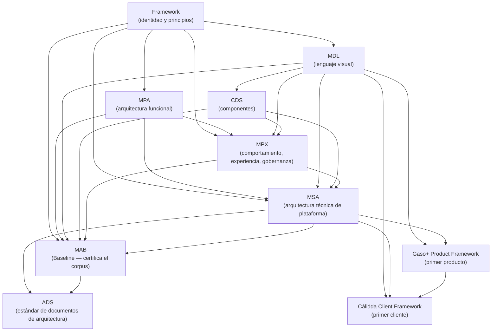

# Maiek AI — Documentation Index

**Estado: Approved**

| | |
|---|---|
| Documento | Documentation Index |
| Proyecto | Maiek AI |
| Versión | 1.0 |
| Estado | **Approved** |
| Fecha de creación | 2026-07-26 |
| Autor | Claude, a pedido de Jesús Millones |
| Fecha de aprobación | 2026-07-28 |
| Última actualización | 2026-07-28 (sección 7: alta de `MAIEK_AI_DATA_CURRENT_STATE_ASSESSMENT.md`, primer diagnóstico de estado actual de una arquitectura derivada) |

## Dependencias

Ninguna — este es el documento de más alto nivel, la puerta de entrada. No depende de otros
documentos de contenido, solo los cataloga.

## Consumido por

Cualquier persona nueva en el proyecto (humana o agente de IA) debería empezar acá antes de
abrir cualquier otro documento oficial.

## Baseline oficial del proyecto

`MAIEK_AI_ARCHITECTURE_BASELINE_V1.md` — Approved 2026-07-28 — certifica que el corpus completo
(Framework, MPA, MDL, CDS, MPX, MSA, este índice) es consistente y está **Ready for Technical
Expansion**, con riesgos y vacíos formalmente aceptados y con dueño futuro asignado. Marca el
cierre oficial de la fase de definición de Maiek AI y el inicio de la fase de construcción
técnica (Data → Backend → AI → API → Frontend → Security → DevOps → Operations Architecture).

---

## 1. Propósito del índice

Este documento centraliza la documentación oficial de Maiek AI y define el estado y la
relación entre cada documento — responde preguntas que ningún documento individual puede
responder por sí solo: **¿qué documentos existen?**, **¿en qué orden se leen?**, **¿cómo se
agrupan?**, **¿cómo se relacionan?**, y **¿bajo qué reglas se gobierna todo el conjunto?**

No repite el contenido de ningún documento — es un mapa, no un resumen. Si un dato acá
(versión, estado, dependencia) alguna vez no coincide con lo que dice el documento real, el
documento real tiene siempre la razón; este índice se actualiza para reflejarlo, nunca al
revés.

## 2. Convenciones

Cada documento registrado en la sección 6 (Estado actual) sigue esta ficha:

| Campo | Significado |
|---|---|
| **Nombre** | Nombre completo del documento. |
| **Código** | Abreviatura corta usada para referirse a él en conversación y en otros documentos (Framework, MPA, MDL, CDS, MPX, etc.). Los documentos que no tienen un acrónimo propio declarado en su título se listan con un nombre corto descriptivo, sin inventar una sigla. |
| **Dominio** | Categoría temática amplia — ver sección 5 (Agrupación por dominios). |
| **Owner** | Área responsable del contenido (Product, UX, Engineering, AI, Business) — distinto del Responsable de aprobación: el Owner es el área que mantiene el contenido al día; el Responsable (siguiente campo) es quien lo aprueba formalmente. |
| **Origen** | `Managed` (creado ya bajo este proceso de gobernanza — pasa o pasó por `In Review` antes de `Approved`) / `Legacy` (existía antes de que este proceso se formalizara). Es un atributo **independiente** del Estado — separa "en qué punto del ciclo de vida está" de "cómo llegó ahí". Ver la nota de gobernanza en la sección 3. |
| **Versión** | Número de versión formal (X.Y), si el documento sigue el proceso de control de versiones establecido a partir del MDL v1.1. Los documentos `Legacy` no tienen versión retroactiva inventada — ver sección 3. |
| **Estado** | Uno de los 6 estados del ciclo de vida documental — ver sección 3. Único ciclo de vida para todo documento, sin excepciones ni estados adicionales. |
| **Responsable** | Quién aprueba y es dueño final del contenido — Jesús Millones en todos los casos de este proyecto; Claude es autor material a su pedido. |
| **Fecha de aprobación** | Cuándo pasó a `Approved` mediante revisión formal (`In Review` → `Approved`). Solo aplica a documentos `Origen: Managed`. Para documentos `Legacy`, este campo es `N/A` — nunca pasaron por esa revisión, y no se les inventa una fecha retroactiva — ver el campo **Reconocido por gobernanza** en su lugar. |
| **Reconocido por gobernanza** | Solo para documentos `Origen: Legacy`: la fecha en que se decidió formalmente tratarlos como `Approved` dentro de este sistema de gobernanza, sin que eso implique que pasaron por `In Review`. Vacío para documentos `Managed` (usan Fecha de aprobación). |
| **Dependencias** | Qué documentos necesita leer/respetar antes de poder escribirse sin contradicciones. |
| **Consumido por** | Qué documentos lo usan como referencia — incluye documentos futuros del roadmap (sección 9) cuando ya se sabe que lo consumirán. |

## 3. Ciclo de vida documental

Seis estados posibles para cualquier documento oficial de Maiek AI, en el orden en que
normalmente se atraviesan:

| Estado | Significado |
|---|---|
| **Draft** | En construcción activa. El contenido puede cambiar sin previo aviso y no es referencia confiable todavía — nadie más debería tomar decisiones basándose en un Draft. |
| **In Review** | El autor considera el contenido completo; está en revisión del Owner/Responsable antes de aprobarse. Ya no debería cambiar de fondo sin que la revisión lo capture, pero todavía no es cita oficial. |
| **Approved** | Congelado como referencia oficial. Cualquier cambio de fondo requiere una nueva entrada en el control de versiones del documento — nunca edición silenciosa (regla ya vigente desde el MDL v1.1). |
| **Superseded** | Reemplazado por una versión más nueva del **mismo documento** (ej. una v1.0 queda Superseded cuando se aprueba v1.1). Se conserva por trazabilidad histórica; el índice siempre apunta a la versión Approved vigente, nunca a una Superseded. |
| **Deprecated** | El contenido ya no aplica — la decisión que documentaba cambió o se abandonó. Distinto de Superseded: acá no hay una versión nueva que lo reemplace directamente, simplemente dejó de ser válido. Se mantiene visible para que quede registro de que existió y por qué se dejó de usar. |
| **Archived** | Removido de la navegación activa — se conserva solo por auditoría o razones legales, ya no aparece listado como parte de la documentación vigente en la sección 6. |

**Nota sobre documentos anteriores a este ciclo de vida — no un séptimo estado, sino un
atributo separado:** `MAIEK_AI_FRAMEWORK.md`, `MAIEK_AI_PLATFORM_ARCHITECTURE.md`,
`GASOPLUS_PRODUCT_FRAMEWORK.md` y `CALIDDA_CLIENT_FRAMEWORK.md` existían antes de que este
proceso formal de gobernanza documental se definiera. El ciclo de vida se mantiene limitado a
los 6 estados de arriba, sin excepciones — para distinguir su historia sin inventar un estado
adicional, se usa el campo independiente **Origen** (ver sección 2): estos cuatro documentos son
`Origen: Legacy`. Se consideran **`Approved` por decisión de gobernanza** — no porque hayan
pasado por `In Review` como los documentos `Managed` — preservando su vigencia y contexto
histórico como base estable y activamente usada del proyecto. Para evitar que se interprete como
una aprobación histórica que nunca ocurrió, su **Fecha de aprobación** queda en `N/A` y, en su
lugar, la sección 7 registra por separado cuándo se **reconoció por gobernanza** su estado
`Approved`: 2026-07-26.

## 4. Orden recomendado de lectura

Para alguien nuevo en el proyecto, este es el orden que menos fricción genera — cada documento
se apoya en el anterior, nunca al revés:

1. **Framework** — identidad, filosofía y principios. El ADN del que todo lo demás se deriva.
2. **MPA** (Product Architecture) — cómo está organizado el producto por fuera (módulos
   funcionales) — no confundir con MSA (abajo), que es la arquitectura técnica.
3. **MDL** (Design Language) — cómo se ve y se siente visualmente.
4. **CDS** (Component Design System) — de qué piezas visuales concretas dispone el sistema.
5. **MPX** (Product Experience) — cómo se comporta y se vive el producto: interacción, protocolo
   de IA, decisión, voz, feedback, onboarding, notificaciones, y cómo se mide y gobierna esa
   experiencia con el tiempo.
6. **MSA** (System Architecture) — cómo está construida la plataforma técnicamente para soportar
   todo lo anterior: capas, componentes, Platform Engines, IA, datos, integraciones, seguridad,
   despliegue — documento padre de toda arquitectura técnica derivada. Reemplaza a la antigua
   Platform Architecture (hoy Superseded, ver sección 7).
7. **Gaso+ Product Framework** — la primera implementación real de todo lo anterior.
8. **Cálidda Client Framework** — el conocimiento de negocio del primer cliente, la capa más
   específica y menos reutilizable de todas.
9. **MAB** (Architecture Baseline v1) — certifica que los 8 anteriores son consistentes y da luz
   verde a construir las arquitecturas técnicas derivadas. Se lee al final, como cierre.

*(El **ADS**, Architecture Document Standard, no forma parte de este orden de lectura general —
se consulta puntualmente al empezar a construir cualquier arquitectura técnica derivada, ver
sección 5, dominio Documentación.)*

## 5. Agrupación por dominios

Vista complementaria al orden de lectura — agrupa por **de qué trata** el documento, no por en
qué orden conviene leerlo:

**Foundation** — identidad y principios de los que todo se deriva.
- Framework
- MAB (Architecture Baseline v1) — hito de gobernanza, no de contenido: certifica el resto.

**Engineering** — arquitectura técnica de la plataforma.
- MSA (System Architecture) — Platform Architecture queda Superseded, ver sección 7.

**Product** — cómo está organizado y cómo se comporta el producto.
- MPA (Product Architecture)
- MPX (Product Experience)

**Design** — lenguaje visual y componentes.
- MDL (Design Language)
- CDS (Component Design System)

**Business** — implementaciones concretas para un producto y un cliente reales.
- Gaso+ Product Framework
- Cálidda Client Framework

**Documentación** — gobierna cómo se produce y mantiene la documentación misma, no describe
identidad, producto, diseño ni arquitectura de la plataforma.
- ADS (Architecture Document Standard)

*(Nota: `MAIEK_AI_ARCHITECTURE_BASELINE_V1.md` es conceptualmente afín a este dominio nuevo —
certifica el corpus, no describe contenido — pero no se reubica retroactivamente desde
Foundation sin pedido explícito, mismo criterio que rige todo el resto de este índice.)*

Ningún documento pertenece a más de un dominio — si algún día uno parece necesitar dos, es
señal de que debería dividirse, no de que el dominio sea flexible.

## 6. Mapa documental

*(`MAIEK_AI_PLATFORM_ARCHITECTURE.md` queda fuera de este mapa activo — Superseded por MSA, ver
sección 7 para su registro histórico.)*

Línea sólida = "depende de" (flecha apunta del documento base hacia el que lo consume). Sin
ciclos — cada flecha va de lo más fundacional hacia lo más específico, nunca al revés.

## 7. Estado actual

| Nombre | Código | Dominio | Owner | Origen | Versión | Estado | Responsable | Fecha aprobación | Reconocido por gobernanza | Dependencias | Consumido por |
|---|---|---|---|---|---|---|---|---|---|---|---|
| `MAIEK_AI_FRAMEWORK.md` | Framework | Foundation | Business | Legacy | — | **Approved** | Jesús Millones | N/A (Legacy) | 2026-07-26 | Ninguna | Todos los demás |
| `MAIEK_AI_PLATFORM_ARCHITECTURE.md` | Platform Architecture | Engineering | Engineering | Legacy | — | **Superseded** (por MSA, 2026-07-28) | Jesús Millones | N/A (Legacy) | 2026-07-26 | Framework | Ninguno — reemplazado por MSA |
| `MAIEK_AI_SYSTEM_ARCHITECTURE.md` | MSA | Engineering | Engineering | Managed | 1.0 | **Approved** | Jesús Millones | 2026-07-28 | — | Framework, MPA, MDL, CDS, MPX, Platform Architecture (Superseded) | Frontend/Backend/AI/Data/API/Security/DevOps/Operations Architecture (futuros), QA Strategy (futuro) |
| `MAIEK_AI_PRODUCT_ARCHITECTURE.md` | MPA | Product | Product | Managed | 1.0 | **Approved** | Jesús Millones | 2026-07-26 | — | Framework, Platform Architecture | MPX, Gaso+ PF, MSA, *Frontend/Backend Architecture (futuro)* |
| `MAIEK_AI_DESIGN_SYSTEM.md` | MDL | Design | UX | Managed | 1.1 | **Approved** | Jesús Millones | 2026-07-26 | — | Framework, Platform Architecture | CDS, MPX, MSA, Gaso+ PF, Cálidda CF |
| `MAIEK_AI_COMPONENT_SYSTEM.md` | CDS | Design | UX | Managed | 1.0 | **Approved** | Jesús Millones | 2026-07-26 | — | MDL | MPX, MSA, *Frontend Architecture (futuro)* |
| `MAIEK_AI_PRODUCT_EXPERIENCE.md` | MPX | Product | UX | Managed | 1.0 (completo) | **Approved** — Partes I, II y III | Jesús Millones | 2026-07-28 | — | Framework, MDL, CDS, MPA | MSA, *Patrones de producto, Frontend/Backend Architecture (futuros)* |
| `GASOPLUS_PRODUCT_FRAMEWORK.md` | Gaso+ Product Framework | Business | Product | Legacy | — | **Approved** | Jesús Millones | N/A (Legacy) | 2026-07-26 | Framework, Platform Architecture, MDL | Cálidda CF |
| `CALIDDA_CLIENT_FRAMEWORK.md` | Cálidda Client Framework | Business | Business | Legacy | — | **Approved** | Jesús Millones | N/A (Legacy) | 2026-07-26 | Framework, Platform Architecture, MDL, Gaso+ PF | Ninguno (hoja del árbol documental) |
| `MAIEK_AI_ARCHITECTURE_BASELINE_V1.md` | MAB | Foundation | Business | Managed | 1.0 | **Approved** | Jesús Millones | 2026-07-28 | — | Framework, MPA, MDL, CDS, MPX, MSA, DOCUMENTATION_INDEX | 8 arquitecturas técnicas derivadas (futuras), QA/Testing Strategy (futuros) |
| `MAIEK_AI_ARCHITECTURE_DOCUMENT_STANDARD.md` | ADS | Documentación | Engineering | Managed | 1.0 | **Approved** | Jesús Millones | 2026-07-28 | — | MSA, DOCUMENTATION_INDEX, MAB | 8 arquitecturas técnicas derivadas (futuras) |
| `MAIEK_AI_DATA_CURRENT_STATE_ASSESSMENT.md` | CSA-Data | Engineering | Engineering | Managed | 1.0 | **Approved** | Jesús Millones | 2026-07-28 | — | MSA (Cap. 8, 12) | `MAIEK_AI_DATA_ARCHITECTURE.md` (futuro) |

## 8. Reglas de Gobernanza Documental

Reglas mínimas, aplicables a cualquier documento oficial nuevo o existente de Maiek AI:

1. **Todo documento nuevo debe registrarse primero en `DOCUMENTATION_INDEX.md`** — antes de
   escribir su contenido, o como parte del mismo cambio que lo crea. Un documento que no
   aparece acá no es oficial, sin importar cuán completo esté.
2. **Debe declarar sus dependencias** — de qué documentos se alimenta, en su propia sección
   `## Dependencias` y reflejado en la tabla de la sección 7 de este índice.
3. **Debe declarar quién lo consume** — qué documentos (existentes o previstos en el roadmap)
   lo usan como referencia, en su propia sección `## Consumido por` y en este índice.
4. **Debe pasar por `In Review` antes de `Approved`** — ningún documento salta directo de
   `Draft` a `Approved` sin que el Responsable lo revise explícitamente.
5. **Debe aprobarse antes del commit** — el commit que congela un documento como `Approved`
   ocurre después de la aprobación explícita, nunca antes ni como parte de "ya que estamos".
6. **Cuando corresponda, debe reflejar sus cambios en el CHANGELOG** — una vez ese documento
   exista (ver sección 9, Roadmap documental); hasta entonces, el control de versiones interno
   de cada documento cumple ese rol.

## 9. Roadmap documental

Documentos previstos, **no desarrollados todavía** — solo registrados como próximos pasos
posibles del sistema documental:

Los primeros 8 ítems son los documentos derivados formalmente anticipados en `MAIEK_AI_SYSTEM_ARCHITECTURE.md` (MSA) Capítulo 17 — cada uno hereda de capítulos específicos del MSA, no se desarrolla desde cero:

- **Frontend Architecture** — cómo se implementan MDL/CDS/MPX en código real (frameworks,
  estructura de carpetas, estado, tokens como variables). Hereda de MSA Cap. 4-5.
- **Backend Architecture** — cómo se implementa MPA en código real (servicios, capas, contratos
  entre módulos). Hereda de MSA Cap. 4-6, 10.
- **AI Architecture** — arquitectura técnica de los agentes de IA (Gabi, Copiloto) — distinto
  del MPX, que define comportamiento, no implementación. Hereda de MSA Cap. 6-7, 10.
- **Data Architecture** — modelo de datos multi-tenant, ya anticipado como visión en MSA. Hereda
  de MSA Cap. 8, 12.
- **API Architecture** — contratos de API entre módulos y con integraciones externas
  (Meta/WhatsApp, Anthropic, futuras: ERP, SAP, Power BI) — absorbe el alcance antes previsto
  para un "Integration Architecture" separado (decisión tomada en MSA Cap. 9/17). Hereda de MSA
  Cap. 9, 12.
- **Security Architecture** — modelo de amenazas, manejo de credenciales, auditoría, cifrado
  (ya hay decisiones reales tomadas en el código — ej. Fernet para canales WhatsApp — que este
  documento formalizaría). Hereda de MSA Cap. 11, 13.
- **DevOps Architecture** (antes "Deployment Architecture") — infraestructura de despliegue (hoy
  vive informalmente repartida entre este chat y la configuración de Railway). Hereda de MSA
  Cap. 14-15.
- **Operations Architecture** (nuevo, anticipado en MSA Cap. 17) — arquitectura de cómo se opera
  la plataforma en producción — distinto del Operations Runbook (abajo), que es procedimental,
  no arquitectónico. Hereda de MSA Cap. 15-16.

El resto sigue en el roadmap general, sin depender directamente del MSA salvo donde se indica:

- **QA Strategy** — enfoque de calidad y pruebas del proyecto — hereda directamente de MSA Cap.
  10 (Runtime Architecture): cada paso del flujo de una solicitud es un punto de prueba de
  extremo a extremo.
- **Testing Strategy** — estrategia concreta de testing (unitario, integración, end-to-end).
- **Operations Runbook** — procedimientos operativos (incidentes, rollback, monitoreo) — hijo de
  Operations Architecture (arriba), más operativo que arquitectónico.
- **ADR Index** — registro de Architecture Decision Records — decisiones técnicas puntuales
  futuras, con su razón, distinto de las decisiones fundacionales ya fijadas en MSA Cap. 12
  (Architectural Decisions), que no crece con cada decisión menor.
- **CHANGELOG** — historial de cambios de producto de cara afuera, distinto del control de
  versiones interno de cada documento. Una vez exista, la regla 6 de gobernanza (sección 8)
  empieza a aplicar en la práctica.

Ningún documento de esta lista se desarrolla hasta que se pida explícitamente — quedan acá
únicamente para que el roadmap documental sea visible desde ahora.
