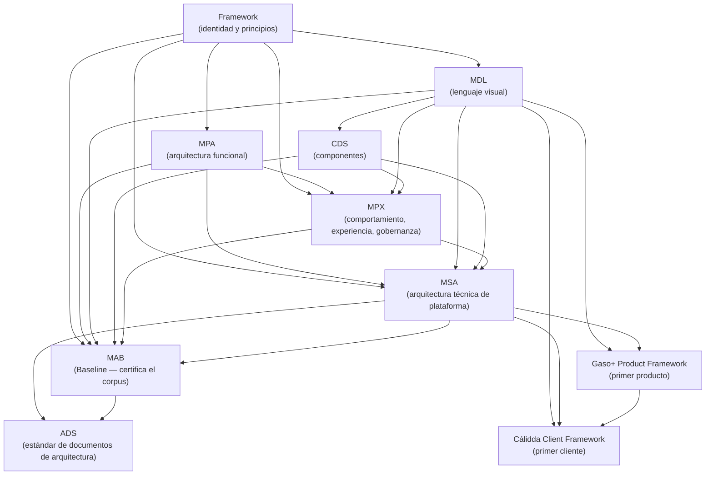

# Maiek AI — Documentation Index

**Estado: Approved**

| | |
|---|---|
| Documento | Documentation Index |
| Proyecto | Maiek AI |
| Versión | 1.0 |
| Estado | **Approved** |
| Fecha de creación | 2026-07-26 |
| Autor | Claude, a pedido de Jesús Millones |
| Fecha de aprobación | 2026-07-28 |
| Última actualización | 2026-10-12 (ADR-0005 — shell de sidebar de alto completo, Tira de acción en Inicio y Pulso de hoy por fases; enmiendas a Product Patterns y Component System; ver narrativa al final de esta sección y `MAIEK_AI_ADR_INDEX.md`) |

## Dependencias

Ninguna — este es el documento de más alto nivel, la puerta de entrada. No depende de otros
documentos de contenido, solo los cataloga.

## Consumido por

Cualquier persona nueva en el proyecto (humana o agente de IA) debería empezar acá antes de
abrir cualquier otro documento oficial.

## Baseline oficial del proyecto

`MAIEK_AI_ARCHITECTURE_BASELINE_V1.md` — Approved 2026-07-28 — certifica que el corpus completo
(Framework, MPA, MDL, CDS, MPX, MSA, este índice) es consistente y está **Ready for Technical
Expansion**, con riesgos y vacíos formalmente aceptados y con dueño futuro asignado. Marca el
cierre oficial de la fase de definición de Maiek AI y el inicio de la fase de construcción
técnica (Data → Backend → API → AI → Security → DevOps → Operations → Frontend Architecture).

## Fase de Implementación

Con la aprobación de `MAIEK_AI_FRONTEND_ARCHITECTURE.md` (2026-07-28) se cerró el corpus
arquitectónico principal — los 8 dominios técnicos derivados del MSA, cada uno con su Current
State Assessment y su arquitectura objetivo, quedan congelados como referencia oficial del
proyecto. `MAIEK_AI_IMPLEMENTATION_ROADMAP.md` — Approved 2026-07-28 — es el documento puente que
marca el inicio oficial de la Fase de Implementación: traduce las decisiones `Objetivo` del
corpus en un plan de ejecución priorizado (no es un documento de arquitectura), con Data
Architecture Fase 3 (`negocio_id`, Multi-Tenant) como el bloqueante transversal identificado en
los 8 CSAs.

**Fase 0 (Estabilización) — Cerrada el 2026-07-29.** 32 commits desplegados a producción y
verificados con tráfico real de WhatsApp (`IMPLEMENTATION_REVIEW_FASE_0.md`): sin desviaciones
respecto al corpus, deuda técnica identificada y con criterio de revisión.

**Fase 1 (Núcleo técnico — Backend/AI/API) — Cerrada oficialmente el 2026-07-30** (ver el cierre
completo al final de esta sección; el resto de este párrafo y los siguientes documentan cómo se
llegó ahí).
`MAIEK_AI_PHASE_1_EXECUTION_PLAN.md` v1.2 — Approved 2026-07-29 — traduce la Fase 1 del Roadmap en
un plan de ejecución (orden Backend (parcial) → AI → Backend (resto) → API, paralelización,
riesgos, criterios de aceptación), revisado por una auditoría independiente (Opus, como Principal
Architect/CTO externo) antes de aprobarse. Esa revisión detectó que `MAIEK_AI_DATA_ARCHITECTURE.md`
Fase 1 (baseline de migraciones con Alembic) no tenía ubicación explícita en el Roadmap pese a ser
prerrequisito declarado de la Fase 2 completa (`negocio_id`) — el Implementation Roadmap ya se actualizó para
incorporarla como pista transversal de su Fase 1, sin bloquear el inicio de Backend/AI/API.

**Data Architecture Fase 1 (baseline de Alembic) — Implementada.** Surgió como bloqueo real
durante la sub-etapa de AI (el marcador de "revisión prioritaria" del protocolo de confianza
necesitaba una columna nueva en `leads`, que `create_all()` no puede agregar a una tabla ya
existente en producción). AI se pausó explícitamente para resolver esta capacidad habilitadora
primero — commit `c04df62`, verificado localmente (equivalencia de esquema con `create_all()`,
escenario de producción simulado con `stamp`). El stamp manual contra producción se ejecutó el
2026-07-30 como parte del primer despliegue controlado — ver más abajo el hallazgo real que ese
paso reveló y su corrección.

**`MAIEK_AI_OPERATIONS_RUNBOOK.md` v1.0 — Approved.** Cierra el punto operativo del `stamp`
manual: documenta el procedimiento completo (cuándo, en qué entornos, qué verificar antes/después,
qué hacer si falla) como Escenario 1 del Operations Runbook — primer documento hijo de Operations
Architecture construido, adelantado desde la Fase 4 original del Roadmap por evidencia real, no
por planificación. `agent/migraciones.py` ahora también detecta el escenario en el arranque y
falla con un mensaje explícito remitiendo a este documento, en vez de un error genérico del motor
de base de datos — sin automatizar el `stamp` en sí, que sigue siendo una decisión administrativa
manual.

**Sub-etapa de AI (protocolo de confianza) — Implementada y Approved.** `agent/brain.py` implementa
las 5 responsabilidades del AI Orchestrator (AI Architecture Sec.1): protocolo de confianza con
salida estructurada forzada, delimitación estructural anti-prompt-injection, prompt caching activo,
y registro de cada inferencia como log estructurado — commits `93ba623`, `171a38f`. Activación
gradual detrás de `modo="pruebas"`; `modo="producción"` sigue sin cambios, verificado con llamadas
reales a la API de Anthropic (no solo mocks). Regla de negocio de escalamiento (Alta/Requiere
validación/Baja) definida y parametrizada vía `Configuracion`. `MAIEK_AI_CONVERSATIONAL_VALIDATION_PLAN.md`
v1.0 — Approved — cierra el punto pendiente antes de promover cualquier canal a producción: define
objetivos, casos representativos, criterios de calidad, métricas y criterios de promoción, citando
las métricas ya definidas en MPX Cap. 10 en vez de redefinirlas.

**Sub-etapa de Backend (tramo 2 — resto) — Implementada y Approved.** `requiere_rol` completado
(cero checks de rol inline en gates de endpoint), `ServicioCanales` (fachada sobre `campanas.py`) y
`ServicioConversacion` (fachada sobre mensajes/adjuntos/memoria conversacional, 28 call sites
migrados) — commits `d318a04`, `0e02ed1`, `9098c33`. Con esto quedan extraídos los 5 servicios de
dominio que Backend Architecture define. Validado con un flujo autenticado real de punta a punta
(login, asesor responde, mensaje persistido), no solo mocks.

**`IMPLEMENTATION_REVIEW_PRE_DEPLOYMENT_FASE_1.md` — gate de integración.** Antes de continuar con
la sub-etapa de API, verifica que Backend + AI + Data Architecture Fase 1 funcionan como conjunto
coherente: matriz de cumplimiento contra las 3 arquitecturas, mapa de dependencias actualizado,
riesgos reales pre-despliegue, prerrequisitos operativos exactos, y recomendación de desplegar el
núcleo técnico ya implementado antes de seguir sumando cambios sin verificar en producción real —
mismo criterio ya sostenido desde el cierre de Fase 0. 16 commits locales acumulados, 0 desplegados
al momento de este gate.

**Sub-etapa de API — Implementada y Approved.** `request_id` (middleware + correlación con logs),
modelo uniforme de errores (`{código, mensaje, detalle, request_id}`), e idempotencia general del
webhook (tabla `MensajeProcesado`, ya desbloqueada por Data Architecture Fase 1) — commit `b350ad1`.
Confirmado con el usuario antes de implementar que esta sub-etapa no requería refactorizaciones
estructurales sobre Backend ni AI (el contrato interno con AI ya es la interfaz de
`ServicioInteligencia`). Validado con envíos reales de webhook duplicados (idempotencia) y
correlación real de `request_id` entre logs y respuesta.

**`IMPLEMENTATION_REVIEW_FASE_1.md` — cierra la implementación de la Fase 1.** Backend + AI + Data
Architecture Fase 1 + API completos y validados localmente, 22 commits, 0 desplegados. **Code Freeze
activo** a partir de esta aprobación — solo correcciones de hallazgos de validación/despliegue hasta
completar el primer despliegue controlado y su validación en producción real.

**Entregables finales de versión — `RELEASE_NOTES_v0.2.0.md` y `DEPLOYMENT_CHECKLIST_v0.2.0.md`.**
Preparados bajo Code Freeze, sin código adicional: notas de versión (resumen ejecutivo,
funcionalidades, cambios internos, las 3 migraciones incluidas, riesgos y limitaciones conocidas,
próximos pasos de Fase 2) y el checklist operativo del primer despliegue controlado (backup,
migraciones, push, deploy, smoke tests, validación de logs/`request_id`/idempotencia/protocolo de
confianza/revisión prioritaria, criterios de éxito, y procedimiento de rollback).

**Primer despliegue controlado de v0.2.0 — Ejecutado el 2026-07-30.** Backup manual de producción
verificado (`pg_dump`, restaurabilidad confirmada con `pg_restore --list`), push a `deploy/main`
(`c808b8d`), deploy exitoso en Railway, arranque limpio, smoke tests y validación de logs/
`request_id` pasadas.

**Hallazgo real durante el despliegue — criticidad Alta, resuelto sin pérdida de datos.** El
procedimiento original (`alembic stamp head` directo) resultó incorrecto: `head` ya incluía dos
migraciones incrementales (`124cb805569e`, `925ec2d81736`) agregadas después del baseline, sin
aplicar todavía contra la base real. El `stamp` marcó la base como "al día" sin ejecutar ese DDL,
y el panel de leads quedó devolviendo `500` (`column leads.revision_prioritaria does not exist`)
desde el deploy (06:53 UTC) hasta la corrección (06:59 UTC) — unos 6 minutos, sin afectar el
webhook de WhatsApp. Corregido en el momento: `alembic stamp` al baseline real (`8bf43ecd3785`) +
`alembic upgrade head` (esta vez ejecutando el DDL real). Verificado con `psql` y con el panel
cargando con normalidad. `MAIEK_AI_OPERATIONS_RUNBOOK.md` (v1.1) y `DEPLOYMENT_CHECKLIST_v0.2.0.md`
se corrigieron el mismo día con la secuencia validada (verificar estado → stamp al baseline real →
`upgrade head` → verificar versión final) y una sección "Lecciones aprendidas del primer
despliegue" — commit `b1b6f4c`, pusheado a `deploy/main`. Validación de idempotencia y protocolo de
confianza quedan como monitoreo pasivo continuo (dependen de tráfico real de WhatsApp y de un canal
en `modo="pruebas"`, respectivamente) — no bloquean el cierre, según el propio criterio del
checklist.

**Fase 1 (Núcleo técnico) — Cerrada oficialmente el 2026-07-30.** Backend + AI + Data Architecture
Fase 1 + API implementados, desplegados a producción real, validados con el
`DEPLOYMENT_CHECKLIST_v0.2.0.md` completo, con el único hallazgo real del despliegue ya corregido y
documentado como aprendizaje operativo reutilizable. v0.2.0 queda como la nueva línea base del
proyecto. Code Freeze levantado — la Fase 2 (`MAIEK_AI_IMPLEMENTATION_ROADMAP.md`) puede empezar a
planificarse.

**Reorganización en tracks Product/Platform/SaaS — 2026-07-30.** El proyecto pasa de fases
secuenciales a tres tracks estratégicos permanentes con foco único (Product → Platform → SaaS,
re-priorizable por evidencia de uso real). Antes de crear documentación nueva, una auditoría
documental completa de Product/UX/Frontend/Design confirmó que la Jerarquía documental ya
declarada por `MAIEK_AI_PRODUCT_EXPERIENCE.md` (Framework → MPA → MDL → CDS → MPX →
Especificaciones derivadas) es consistente y no requiere un documento rector nuevo — la deuda real
identificada era de materialización (ningún patrón visual completo existía como referencia
oficial), no de arquitectura documental.

**`MAIEK_AI_PRODUCT_PATTERNS.md` v1.0 — Approved.** Primera especificación derivada de patrones
visuales completos del producto, cerrando exactamente la brecha de materialización identificada en
la auditoría — MDL y CDS ya definían lenguaje visual y componentes sueltos, pero ninguna pantalla
ensamblada existía como referencia canónica. Construido capítulo por capítulo, cada uno revisado y
ajustado por el usuario antes de continuar: Shell de Navegación, Bandeja de Conversaciones, Inicio,
Analítica, Copiloto IA, CRM/Pipeline, Catálogo/Campañas/Equipo, y un capítulo de cierre de
Principios Transversales de Producto (Plataforma primero, Capacidad vs. alcance, Acción antes que
observación, Human Decision Gate, Única fuente de verdad, La IA asiste-nunca reemplaza el criterio
humano). Auditoría de calidad y consistencia final sin observaciones de fondo.

**Product Patterns pasa a guiar la implementación real — nuevo flujo de trabajo.** Con la v1.0
aprobada, el Track Product deja de producir documentación por anticipación: cada funcionalidad
prioritaria se compara primero contra el código real y el corpus, se identifica el gap real, se
propone un plan técnico, se implementa y se valida — el corpus solo se actualiza si la
implementación lo justifica. Orden de prioridad acordado: Inicio (Cap. 3) → CRM/Pipeline (Cap. 6)
→ revisión del Shell residual → Copiloto IA (una vez validado el protocolo de confianza) →
Analítica y patrones administrativos.

**Sprint 1 — Patrón Inicio (Cap. 3) materializado — Implementado.** `panel_principal()` evoluciona
a orquestador del flujo de entrada: sin filtros explícitos en la URL aterriza en Inicio (Zona de
acción determinística, sin depender del Copiloto IA, + Zona de indicadores), único patrón para los
3 roles; con cualquier filtro explícito la Bandeja sigue funcionando exactamente igual. Construido
con namespace de tokens `--mdl-*` (migración incremental — el resto del panel no se toca). Validado
localmente con los 3 roles — commit `98098fc`.

**Sprint 2 — Sidebar + patrón CRM/Pipeline (Cap. 1 y 6) materializados — Implementado.** Decisión de
producto explícita: CRM/Pipeline es un destino de navegación propio ("gestionar mi cartera de
oportunidades"), no una evolución de la Bandeja ("qué hacer ahora"). Se construyó un Sidebar mínimo
(implementación incremental del Cap. 1 — Shell de Navegación, con los destinos de MPA §10 y sus
mismos permisos ya vigentes) que reemplaza los links sueltos que antes vivían en la Top Navigation
(el propio Cap. 1 señala eso como error común). Nuevo destino
`/dashboard/pipeline`: Data Grid con búsqueda/filtro/orden/paginación resueltos en el servidor y
persistidos en la URL, alcance por rol, reutilizando `detalle_lead` sin cambios como vista de
detalle. Sobre esa misma pantalla se completaron los dos comportamientos restantes del patrón:
Conversation Timeline (tabla `eventos_lead`, append-only, con payload estructurado además del texto
— pensada como fuente reutilizable por auditoría/analítica/Copiloto IA futuro, no solo una lista
para pantalla) y concurrencia optimista (`Lead.version`) en los 3 endpoints de escritura del lead —
un conflicto de edición no sobrescribe en silencio: muestra quién/cuándo/qué cambió (Human Decision
Gate) antes de dejar reintentar. Deuda técnica aceptada explícitamente: el reintento tras un
conflicto es manual (sin pre-cargar el intento previo) y el carrito de Cierre de venta se
reconstruye a mano si hay conflicto en ese formulario. Validado localmente en los 3 roles,
incluyendo un conflicto de edición simulado — commit `bd44489`.

**Sprint 3 — Primera implementación del Copiloto IA (Cap. 5) — Implementado.** Gap Analysis previo
confirmó que el Shell residual no bloquea el Copiloto, pero sí existe un prerrequisito real: las
capas de Sugerencias (`AI Suggestion Card`, `AI Confidence Indicator`) y Acciones dependen de
persistir `SugerenciaIA` (todavía diferido a Data Architecture Fase 2) y de una decisión de Security
Architecture sobre tool-calling (todavía no tomada) — ninguna de las dos se adelantó. Se construyó
en cambio un contenedor extensible (`_copiloto_ia()`, equivalente al `AI Action Panel` del CDS) con
las 3 zonas ya previstas en el código, activando únicamente la que no depende de nada de eso:
Resumen IA bajo demanda (`AI Summary`), independiente del protocolo de confianza de `brain.py`, sin
tools, sin persistencia propia. Estado de carga, indicador de "desactualizado" al llegar un mensaje
nuevo (reutiliza `window.__gasoWS`, el mismo mecanismo ya probado del chat en vivo), sin
autoexpansión. Validado localmente con conversaciones reales (calidad del resumen verificada a
simple vista) en los 3 roles — commit `c34a1a8`. **Validación pendiente, explícita:** el
comportamiento de "desactualizado" no se disparó con tráfico real de WhatsApp en esta sesión (solo
se verificó por equivalencia de código con el mecanismo ya probado del chat) — se valida junto con
la calidad de los resúmenes, alucinaciones y latencia en el próximo Sprint de Validación del
Copiloto, ejecutando `MAIEK_AI_CONVERSATIONAL_VALIDATION_PLAN.md` con tráfico real.

**Sprint de Validación del Copiloto — preparación (instrumentación + plan) completa, ejecución
pendiente.** Gap Analysis previo detectó que `MAIEK_AI_CONVERSATIONAL_VALIDATION_PLAN.md` v1.0 no
cubría el Copiloto/Resumen (fue escrito antes de que existiera) y que `generar_resumen_conversacion`
no tenía ninguna instrumentación — sin eso no había forma de medir latencia ni de auditar
retroactivamente qué se generó. Se agregó logging estructurado (`resumen_ia`, mismo criterio que
`inferencia_ia` del protocolo de confianza) — latencia, cantidad de mensajes de entrada, preview del
resultado, manejo explícito de historial vacío. El plan de validación evolucionó a **v1.1**,
incorporando una sección 6 dedicada al Copiloto con 5 criterios objetivos (fidelidad, cobertura,
claridad/utilidad, latencia, manejo de conversaciones vacías o con poco contexto) y sus propios
criterios de avance hacia Sugerencias/Indicador de confianza/Acciones IA — sigue siendo el único
plan de validación conversacional del producto, no se creó un documento aparte. Diferencia de riesgo
documentada explícitamente en la nueva sección: a diferencia del protocolo de confianza de Gabi (que
sí depende de un canal en `modo="pruebas"`), el Resumen IA es una herramienta interna sin bandera de
activación gradual — su prerrequisito operativo real es desplegar el Sprint 3 a producción, una
decisión y una acción separadas de esta preparación. Commit `c4347cd` (logging). El usuario confirmó
que ya existe un único canal real en `modo="pruebas"` (el que está en operación hoy) — ese es el
canal oficial de validación hasta que exista el número de producción de Gaso+ (`MAIEK_AI_CONVERSATIONAL_VALIDATION_PLAN.md`
v1.2). Con eso cerrado, el checklist Go/No-Go del Sprint de Validación queda con dos ítems abiertos:
aprobación explícita del plan de reversión propuesto, y la autorización de desplegar el Sprint 3 a
producción — ninguna de las dos ocurrida todavía. Se confirmó además que, en este repositorio, push
a la rama `deploy-main` (remoto `deploy`) dispara el deploy en Railway automáticamente — push y
deploy no son pasos separables acá, así que el código de esta preparación permanece sin pushear
hasta que ambas autorizaciones lleguen juntas.

**Sprints 1, 2, 3 y preparación del Sprint de Validación — cerrados (2026-07-30).** El usuario
aprobó el plan de reversión propuesto (oculta el botón de Resumen IA, o revierte el commit
`c34a1a8`, sin necesitar entorno de staging) y decidió, por criterio de producto — no técnico —
mantener el Copiloto IA fuera del canal real todavía: el push (= deploy, según el hallazgo de
arriba) queda reservado para el momento en que se autorice formalmente el inicio de la validación
con tráfico real. Todo el trabajo de estos 4 sprints permanece commiteado solo en la rama local
`deploy-main`, sin push. Se registró como **deuda de infraestructura** en
`MAIEK_AI_DEVOPS_ARCHITECTURE.md` (Control de versiones) el acoplamiento Push=Deploy, con evidencia
real — la mejora futura "Deployment Strategy" ya anticipada en la v1.0 del documento (2026-07-28)
ahora tiene un caso concreto que la justifica; el ambiente de staging que la resolvería sigue
`Objetivo`, no bloqueante para este Sprint. Queda pendiente únicamente la autorización del usuario
para iniciar la validación con tráfico real (push + deploy del Sprint 3, como una sola decisión).

**Proceso de trabajo institucionalizado — `MAIEK_AI_IMPLEMENTATION_ROADMAP.md` §2.1 (nueva,
2026-07-30).** Pedido explícito del usuario al cerrar los Sprints 1-3: que el ciclo Gap Analysis →
Diseño técnico → Revisión y aprobación → Implementación → Validación → Documentación → Commit →
Push y Deploy deje de depender de la memoria de una conversación puntual y quede definido por el
proyecto. Agregado como sección propia del Roadmap (documento puente entre arquitectura e
implementación, lugar natural para un proceso de ejecución) y referenciado desde `CLAUDE.md` —
auto-cargado en cada sesión — para que cualquier agente que trabaje en este repo lo siga sin
depender de haber leído esta conversación.

**ADR-0003 — Identidad de marca única de plataforma MAIEK (2026-09-12).** Retira la Decisión
local de `MAIEK_AI_FRONTEND_ARCHITECTURE.md` sobre identidad de marca resoluble por negocio —
la decisión de producto vigente, confirmada explícitamente por el usuario, establece que Maiek
AI mantiene una identidad de plataforma propia (nombre, colores, lenguaje visual, experiencia
UX), independiente de `negocio_id`: ningún tenant reemplaza el branding de Maiek, la plataforma
no es white-label. `MAIEK_AI_IMPLEMENTATION_ROADMAP.md` (Fase 3, secciones 4 y 8) se actualiza
en el mismo cambio, retirando ese ítem de su alcance. Lo que sigue siendo tenant-scoped, sin
cambio: nombre del negocio, Gabi/agente configurable, productos, campañas, canales, permisos.
Ver `MAIEK_AI_ADR_INDEX.md` y `adr/0003-identidad-marca-unica-plataforma.md` para el detalle
completo.

**ADR-0005 — Shell de sidebar de alto completo, Tira de acción en Inicio y Pulso de hoy (2026-10-12).**
Decisión del dueño (Origen: decisión del dueño; Estado: Aceptada). En escritorio y tablet (desde
`sm`, 768 px) la barra superior desaparece: marca, buscador, campana con contador, navegación y
tarjeta de cuenta pasan a un Sidebar de alto completo (colapsado a 64 px entre 768 y 1023,98 px);
«Ayuda» pasa al menú de cuenta; la barra superior permanece solo en móvil, ahora de 56 px. En Inicio,
una Tira de acción (4 celdas para Asesor, 5 para supervisión; filtros de «Mi cola», con verbo y
destino) reemplaza al cuadro «Indicadores» y a los chips de la cola. El Pulso de hoy (banda plegable
de supervisión) queda aceptado y se construye por fases (F3-F5) siempre después de la cola de acción.
Enmiendas con nueva fila de Control de versiones: `MAIEK_AI_PRODUCT_PATTERNS.md` (Cap. 1, Cap. 3 y
Cap. 9; versión 1.0, fila del 2026-10-12) y `MAIEK_AI_COMPONENT_SYSTEM.md` (v1.0.2: Sidebar, Top
Navigation, KPI Card). Sin cambios de estado ni de versión mayor en ningún documento catalogado. Ver
`MAIEK_AI_ADR_INDEX.md` y `adr/0005-shell-sidebar-alto-completo-y-tira-de-accion-en-inicio.md`.

---

## 1. Propósito del índice

Este documento centraliza la documentación oficial de Maiek AI y define el estado y la
relación entre cada documento — responde preguntas que ningún documento individual puede
responder por sí solo: **¿qué documentos existen?**, **¿en qué orden se leen?**, **¿cómo se
agrupan?**, **¿cómo se relacionan?**, y **¿bajo qué reglas se gobierna todo el conjunto?**

No repite el contenido de ningún documento — es un mapa, no un resumen. Si un dato acá
(versión, estado, dependencia) alguna vez no coincide con lo que dice el documento real, el
documento real tiene siempre la razón; este índice se actualiza para reflejarlo, nunca al
revés.

## 2. Convenciones

Cada documento registrado en la sección 6 (Estado actual) sigue esta ficha:

| Campo | Significado |
|---|---|
| **Nombre** | Nombre completo del documento. |
| **Código** | Abreviatura corta usada para referirse a él en conversación y en otros documentos (Framework, MPA, MDL, CDS, MPX, etc.). Los documentos que no tienen un acrónimo propio declarado en su título se listan con un nombre corto descriptivo, sin inventar una sigla. |
| **Dominio** | Categoría temática amplia — ver sección 5 (Agrupación por dominios). |
| **Owner** | Área responsable del contenido (Product, UX, Engineering, AI, Business) — distinto del Responsable de aprobación: el Owner es el área que mantiene el contenido al día; el Responsable (siguiente campo) es quien lo aprueba formalmente. |
| **Origen** | `Managed` (creado ya bajo este proceso de gobernanza — pasa o pasó por `In Review` antes de `Approved`) / `Legacy` (existía antes de que este proceso se formalizara). Es un atributo **independiente** del Estado — separa "en qué punto del ciclo de vida está" de "cómo llegó ahí". Ver la nota de gobernanza en la sección 3. |
| **Versión** | Número de versión formal (X.Y), si el documento sigue el proceso de control de versiones establecido a partir del MDL v1.1. Los documentos `Legacy` no tienen versión retroactiva inventada — ver sección 3. |
| **Estado** | Uno de los 6 estados del ciclo de vida documental — ver sección 3. Único ciclo de vida para todo documento, sin excepciones ni estados adicionales. |
| **Responsable** | Quién aprueba y es dueño final del contenido — Jesús Millones en todos los casos de este proyecto; Claude es autor material a su pedido. |
| **Fecha de aprobación** | Cuándo pasó a `Approved` mediante revisión formal (`In Review` → `Approved`). Solo aplica a documentos `Origen: Managed`. Para documentos `Legacy`, este campo es `N/A` — nunca pasaron por esa revisión, y no se les inventa una fecha retroactiva — ver el campo **Reconocido por gobernanza** en su lugar. |
| **Reconocido por gobernanza** | Solo para documentos `Origen: Legacy`: la fecha en que se decidió formalmente tratarlos como `Approved` dentro de este sistema de gobernanza, sin que eso implique que pasaron por `In Review`. Vacío para documentos `Managed` (usan Fecha de aprobación). |
| **Dependencias** | Qué documentos necesita leer/respetar antes de poder escribirse sin contradicciones. |
| **Consumido por** | Qué documentos lo usan como referencia — incluye documentos futuros del roadmap (sección 9) cuando ya se sabe que lo consumirán. |

## 3. Ciclo de vida documental

Seis estados posibles para cualquier documento oficial de Maiek AI, en el orden en que
normalmente se atraviesan:

| Estado | Significado |
|---|---|
| **Draft** | En construcción activa. El contenido puede cambiar sin previo aviso y no es referencia confiable todavía — nadie más debería tomar decisiones basándose en un Draft. |
| **In Review** | El autor considera el contenido completo; está en revisión del Owner/Responsable antes de aprobarse. Ya no debería cambiar de fondo sin que la revisión lo capture, pero todavía no es cita oficial. |
| **Approved** | Congelado como referencia oficial. Cualquier cambio de fondo requiere una nueva entrada en el control de versiones del documento — nunca edición silenciosa (regla ya vigente desde el MDL v1.1). |
| **Superseded** | Reemplazado por una versión más nueva del **mismo documento** (ej. una v1.0 queda Superseded cuando se aprueba v1.1). Se conserva por trazabilidad histórica; el índice siempre apunta a la versión Approved vigente, nunca a una Superseded. |
| **Deprecated** | El contenido ya no aplica — la decisión que documentaba cambió o se abandonó. Distinto de Superseded: acá no hay una versión nueva que lo reemplace directamente, simplemente dejó de ser válido. Se mantiene visible para que quede registro de que existió y por qué se dejó de usar. |
| **Archived** | Removido de la navegación activa — se conserva solo por auditoría o razones legales, ya no aparece listado como parte de la documentación vigente en la sección 6. |

**Nota sobre documentos anteriores a este ciclo de vida — no un séptimo estado, sino un
atributo separado:** `MAIEK_AI_FRAMEWORK.md`, `MAIEK_AI_PLATFORM_ARCHITECTURE.md`,
`GASOPLUS_PRODUCT_FRAMEWORK.md` y `CALIDDA_CLIENT_FRAMEWORK.md` existían antes de que este
proceso formal de gobernanza documental se definiera. El ciclo de vida se mantiene limitado a
los 6 estados de arriba, sin excepciones — para distinguir su historia sin inventar un estado
adicional, se usa el campo independiente **Origen** (ver sección 2): estos cuatro documentos son
`Origen: Legacy`. Se consideran **`Approved` por decisión de gobernanza** — no porque hayan
pasado por `In Review` como los documentos `Managed` — preservando su vigencia y contexto
histórico como base estable y activamente usada del proyecto. Para evitar que se interprete como
una aprobación histórica que nunca ocurrió, su **Fecha de aprobación** queda en `N/A` y, en su
lugar, la sección 7 registra por separado cuándo se **reconoció por gobernanza** su estado
`Approved`: 2026-07-26.

## 4. Orden recomendado de lectura

Para alguien nuevo en el proyecto, este es el orden que menos fricción genera — cada documento
se apoya en el anterior, nunca al revés:

1. **Framework** — identidad, filosofía y principios. El ADN del que todo lo demás se deriva.
2. **MPA** (Product Architecture) — cómo está organizado el producto por fuera (módulos
   funcionales) — no confundir con MSA (abajo), que es la arquitectura técnica.
3. **MDL** (Design Language) — cómo se ve y se siente visualmente.
4. **CDS** (Component Design System) — de qué piezas visuales concretas dispone el sistema.
5. **MPX** (Product Experience) — cómo se comporta y se vive el producto: interacción, protocolo
   de IA, decisión, voz, feedback, onboarding, notificaciones, y cómo se mide y gobierna esa
   experiencia con el tiempo.
6. **MSA** (System Architecture) — cómo está construida la plataforma técnicamente para soportar
   todo lo anterior: capas, componentes, Platform Engines, IA, datos, integraciones, seguridad,
   despliegue — documento padre de toda arquitectura técnica derivada. Reemplaza a la antigua
   Platform Architecture (hoy Superseded, ver sección 7).
7. **Gaso+ Product Framework** — la primera implementación real de todo lo anterior.
8. **Cálidda Client Framework** — el conocimiento de negocio del primer cliente, la capa más
   específica y menos reutilizable de todas.
9. **MAB** (Architecture Baseline v1) — certifica que los 8 anteriores son consistentes y da luz
   verde a construir las arquitecturas técnicas derivadas. Se lee al final, como cierre.

*(El **ADS**, Architecture Document Standard, no forma parte de este orden de lectura general —
se consulta puntualmente al empezar a construir cualquier arquitectura técnica derivada, ver
sección 5, dominio Documentación.)*

## 5. Agrupación por dominios

Vista complementaria al orden de lectura — agrupa por **de qué trata** el documento, no por en
qué orden conviene leerlo:

**Foundation** — identidad y principios de los que todo se deriva.
- Framework
- MAB (Architecture Baseline v1) — hito de gobernanza, no de contenido: certifica el resto.

**Engineering** — arquitectura técnica de la plataforma.
- MSA (System Architecture) — Platform Architecture queda Superseded, ver sección 7.

**Product** — cómo está organizado y cómo se comporta el producto.
- MPA (Product Architecture)
- MPX (Product Experience)

**Design** — lenguaje visual, componentes y patrones compuestos.
- MDL (Design Language)
- CDS (Component Design System)
- Product Patterns

**Business** — implementaciones concretas para un producto y un cliente reales.
- Gaso+ Product Framework
- Cálidda Client Framework

**Documentación** — gobierna cómo se produce y mantiene la documentación misma, no describe
identidad, producto, diseño ni arquitectura de la plataforma.
- ADS (Architecture Document Standard)

*(Nota: `MAIEK_AI_ARCHITECTURE_BASELINE_V1.md` es conceptualmente afín a este dominio nuevo —
certifica el corpus, no describe contenido — pero no se reubica retroactivamente desde
Foundation sin pedido explícito, mismo criterio que rige todo el resto de este índice.)*

Ningún documento pertenece a más de un dominio — si algún día uno parece necesitar dos, es
señal de que debería dividirse, no de que el dominio sea flexible.

## 6. Mapa documental

*(`MAIEK_AI_PLATFORM_ARCHITECTURE.md` queda fuera de este mapa activo — Superseded por MSA, ver
sección 7 para su registro histórico.)*

Línea sólida = "depende de" (flecha apunta del documento base hacia el que lo consume). Sin
ciclos — cada flecha va de lo más fundacional hacia lo más específico, nunca al revés.

## 7. Estado actual

| Nombre | Código | Dominio | Owner | Origen | Versión | Estado | Responsable | Fecha aprobación | Reconocido por gobernanza | Dependencias | Consumido por |
|---|---|---|---|---|---|---|---|---|---|---|---|
| `MAIEK_AI_FRAMEWORK.md` | Framework | Foundation | Business | Legacy | — | **Approved** | Jesús Millones | N/A (Legacy) | 2026-07-26 | Ninguna | Todos los demás |
| `MAIEK_AI_PLATFORM_ARCHITECTURE.md` | Platform Architecture | Engineering | Engineering | Legacy | — | **Superseded** (por MSA, 2026-07-28) | Jesús Millones | N/A (Legacy) | 2026-07-26 | Framework | Ninguno — reemplazado por MSA |
| `MAIEK_AI_SYSTEM_ARCHITECTURE.md` | MSA | Engineering | Engineering | Managed | 1.0 | **Approved** | Jesús Millones | 2026-07-28 | — | Framework, MPA, MDL, CDS, MPX, Platform Architecture (Superseded) | Frontend/Backend/AI/Data/API/Security/DevOps/Operations Architecture (futuros), QA Strategy (futuro) |
| `MAIEK_AI_PRODUCT_ARCHITECTURE.md` | MPA | Product | Product | Managed | 1.0 | **Approved** | Jesús Millones | 2026-07-26 | — | Framework, Platform Architecture | MPX, Gaso+ PF, MSA, *Frontend/Backend Architecture (futuro)* |
| `MAIEK_AI_DESIGN_SYSTEM.md` | MDL | Design | UX | Managed | 1.1 | **Approved** | Jesús Millones | 2026-07-26 | — | Framework, Platform Architecture | CDS, MPX, MSA, Gaso+ PF, Cálidda CF |
| `MAIEK_AI_COMPONENT_SYSTEM.md` | CDS | Design | UX | Managed | 1.0 | **Approved** | Jesús Millones | 2026-07-26 | — | MDL | MPX, MSA, *Frontend Architecture (futuro)* |
| `MAIEK_AI_PRODUCT_EXPERIENCE.md` | MPX | Product | UX | Managed | 1.0 (completo) | **Approved** — Partes I, II y III | Jesús Millones | 2026-07-28 | — | Framework, MDL, CDS, MPA | MSA, *Patrones de producto, Frontend/Backend Architecture (futuros)* |
| `GASOPLUS_PRODUCT_FRAMEWORK.md` | Gaso+ Product Framework | Business | Product | Legacy | — | **Approved** | Jesús Millones | N/A (Legacy) | 2026-07-26 | Framework, Platform Architecture, MDL | Cálidda CF |
| `CALIDDA_CLIENT_FRAMEWORK.md` | Cálidda Client Framework | Business | Business | Legacy | — | **Approved** | Jesús Millones | N/A (Legacy) | 2026-07-26 | Framework, Platform Architecture, MDL, Gaso+ PF | Ninguno (hoja del árbol documental) |
| `MAIEK_AI_ARCHITECTURE_BASELINE_V1.md` | MAB | Foundation | Business | Managed | 1.0 | **Approved** | Jesús Millones | 2026-07-28 | — | Framework, MPA, MDL, CDS, MPX, MSA, DOCUMENTATION_INDEX | 8 arquitecturas técnicas derivadas (futuras), QA/Testing Strategy (futuros) |
| `MAIEK_AI_ARCHITECTURE_DOCUMENT_STANDARD.md` | ADS | Documentación | Engineering | Managed | 1.3 | **Approved** | Jesús Millones | 2026-07-28 | — | MSA, DOCUMENTATION_INDEX, MAB | 8 arquitecturas técnicas derivadas (futuras) |
| `MAIEK_AI_DATA_CURRENT_STATE_ASSESSMENT.md` | CSA-Data | Engineering | Engineering | Managed | 1.0 | **Approved** | Jesús Millones | 2026-07-28 | — | MSA (Cap. 8, 12) | `MAIEK_AI_DATA_ARCHITECTURE.md` |
| `MAIEK_AI_DATA_ARCHITECTURE.md` | Data Architecture | Engineering | Engineering | Managed | 1.0 | **Approved** | Jesús Millones | 2026-07-28 | — | MSA (Cap. 8, 11, 12), CSA-Data, ADS, MPX (Cap. 8, 10), MPA | Backend/AI/API/Security/DevOps Architecture (futuros) |
| `MAIEK_AI_BACKEND_CURRENT_STATE_ASSESSMENT.md` | CSA-Backend | Engineering | Engineering | Managed | 1.0 | **Approved** | Jesús Millones | 2026-07-28 | — | MSA (Cap. 4-6, 9, 10, 12), Data Architecture, ADS | `MAIEK_AI_BACKEND_ARCHITECTURE.md` |
| `MAIEK_AI_BACKEND_ARCHITECTURE.md` | Backend Architecture | Engineering | Engineering | Managed | 1.0 | **Approved** | Jesús Millones | 2026-07-28 | — | MSA (Cap. 4-7, 9, 10, 12), Data Architecture, CSA-Backend, ADS, MPX (Cap. 1-3) | AI/API/Frontend/Security/DevOps Architecture (futuros) |
| `MAIEK_AI_API_CURRENT_STATE_ASSESSMENT.md` | CSA-API | Engineering | Engineering | Managed | 1.0 | **Approved** | Jesús Millones | 2026-07-28 | — | MSA (Cap. 9, 10, 12), Backend Architecture, ADS | `MAIEK_AI_API_ARCHITECTURE.md` |
| `MAIEK_AI_API_ARCHITECTURE.md` | API Architecture | Engineering | Engineering | Managed | 1.0 | **Approved** | Jesús Millones | 2026-07-28 | — | MSA (Cap. 6, 9, 10, 12), Backend Architecture, CSA-API, ADS | AI/Frontend/Security/DevOps Architecture (futuros) |
| `MAIEK_AI_AI_CURRENT_STATE_ASSESSMENT.md` | CSA-AI | Engineering | AI | Managed | 1.0 | **Approved** | Jesús Millones | 2026-07-28 | — | MSA (Cap. 6, 7, 11), Backend Architecture, API Architecture, Data Architecture, MPX (Cap. 2, 8), ADS | `MAIEK_AI_AI_ARCHITECTURE.md` |
| `MAIEK_AI_AI_ARCHITECTURE.md` | AI Architecture | Engineering | AI | Managed | 1.0 | **Approved** | Jesús Millones | 2026-07-28 | — | MSA (Cap. 6, 7, 11), Backend Architecture, API Architecture, Data Architecture, CSA-AI, MPX (Cap. 2, 3, 8, 10), ADS | Frontend/Security/DevOps/Operations Architecture (futuros) |
| `MAIEK_AI_SECURITY_CURRENT_STATE_ASSESSMENT.md` | CSA-Security | Engineering | Security | Managed | 1.0 | **Approved** | Jesús Millones | 2026-07-28 | — | MSA (Cap. 11, 13), Data Architecture, Backend Architecture, API Architecture, AI Architecture, ADS | `MAIEK_AI_SECURITY_ARCHITECTURE.md` |
| `MAIEK_AI_SECURITY_ARCHITECTURE.md` | Security Architecture | Engineering | Security | Managed | 1.0 | **Approved** | Jesús Millones | 2026-07-28 | — | MSA (Cap. 11, 13), Data Architecture, Backend Architecture, API Architecture, AI Architecture, CSA-Security, ADS | Frontend/DevOps/Operations Architecture (futuros) |
| `MAIEK_AI_DEVOPS_CURRENT_STATE_ASSESSMENT.md` | CSA-DevOps | Engineering | DevOps | Managed | 1.0 | **Approved** | Jesús Millones | 2026-07-28 | — | MSA (Cap. 14, 15), Data Architecture, Security Architecture, API Architecture, AI Architecture, ADS | `MAIEK_AI_DEVOPS_ARCHITECTURE.md` |
| `MAIEK_AI_DEVOPS_ARCHITECTURE.md` | DevOps Architecture | Engineering | DevOps | Managed | 1.0 | **Approved** | Jesús Millones | 2026-07-28 | — | MSA (Cap. 14, 15), Data Architecture, Security Architecture, API Architecture, AI Architecture, CSA-DevOps, ADS | Frontend/Operations Architecture (futuros) |
| `MAIEK_AI_OPERATIONS_CURRENT_STATE_ASSESSMENT.md` | CSA-Operations | Engineering | Operations | Managed | 1.0 | **Approved** | Jesús Millones | 2026-07-28 | — | MSA (Cap. 15, 16), DevOps Architecture, Security Architecture, Backend Architecture, AI Architecture, MPA, ADS | `MAIEK_AI_OPERATIONS_ARCHITECTURE.md` |
| `MAIEK_AI_OPERATIONS_ARCHITECTURE.md` | Operations Architecture | Engineering | Operations | Managed | 1.0 | **Approved** | Jesús Millones | 2026-07-28 | — | MSA (Cap. 15, 16), DevOps Architecture, Security Architecture, Backend Architecture, AI Architecture, CSA-Operations, ADS | Frontend Architecture (futuro), `MAIEK_AI_OPERATIONS_RUNBOOK.md` |
| `MAIEK_AI_FRONTEND_CURRENT_STATE_ASSESSMENT.md` | CSA-Frontend | Engineering | Frontend | Managed | 1.0 | **Approved** | Jesús Millones | 2026-07-28 | — | MSA (Cap. 4, 5), MDL, CDS, MPX, Security Architecture, AI Architecture, Operations Architecture, Data Architecture, ADS | `MAIEK_AI_FRONTEND_ARCHITECTURE.md` |
| `MAIEK_AI_FRONTEND_ARCHITECTURE.md` | Frontend Architecture | Engineering | Frontend | Managed | 1.0 | **Approved** | Jesús Millones | 2026-07-28 | — | MSA (Cap. 4, 5), MDL, CDS, MPX, Security Architecture, AI Architecture, Operations Architecture, Data Architecture, CSA-Frontend, ADS | Ninguno — cierra el corpus arquitectónico principal |
| `MAIEK_AI_IMPLEMENTATION_ROADMAP.md` | Implementation Roadmap | Foundation | Business | Managed | 1.0 | **Approved** | Jesús Millones | 2026-07-28 | — | Los 8 dominios técnicos (Data, Backend, API, AI, Security, DevOps, Operations, Frontend), MSA, ADS, DOCUMENTATION_INDEX | QA Strategy, Testing Strategy, `MAIEK_AI_OPERATIONS_RUNBOOK.md`, ADR Index, CHANGELOG (los otros 3, todavía futuros) |
| `MAIEK_AI_ADR_INDEX.md` | ADR Index | Documentación | Engineering | Managed | 1.0 | **Approved** | Jesús Millones | 2026-07-28 | — | Implementation Roadmap | Toda la Fase de Implementación |
| `MAIEK_AI_PHASE_1_EXECUTION_PLAN.md` | Phase 1 Execution Plan | Foundation | Business | Managed | 1.2 | **Approved** | Jesús Millones | 2026-07-29 | — | Implementation Roadmap, Backend/AI/API Architecture, Data Architecture | El trabajo real de implementación de la Fase 1 |
| `MAIEK_AI_OPERATIONS_RUNBOOK.md` | Operations Runbook | Engineering | Operations | Managed | 1.1 | **Approved** | Jesús Millones | 2026-07-29 | — | Operations Architecture, Data Architecture | Quien despliegue el proyecto |
| `MAIEK_AI_CONVERSATIONAL_VALIDATION_PLAN.md` | Conversational Validation Plan | Engineering | AI | Managed | 1.2 | **Approved** | Jesús Millones | 2026-07-30 (v1.2) | — | AI Architecture, MPX (Cap. 2, 3, 10), Phase 1 Execution Plan, Product Patterns (Cap. 5, desde v1.1) | Decisión de promover un canal de modo="pruebas" a modo="producción"; decisión de avanzar el Copiloto IA hacia Sugerencias/Indicador de confianza/Acciones (desde v1.1) |
| `MAIEK_AI_PRODUCT_PATTERNS.md` | Product Patterns | Design | UX | Managed | 1.0 | **Approved** | Jesús Millones | 2026-07-30 | — | Framework, MPA, MDL, CDS, MPX, Frontend Architecture | Próxima revisión de Frontend Architecture (primer patrón visual concreto del que partir); toda implementación futura del frontend |
| `MAIEK_AI_EXPERIENCE_FLOWS.md` | Experience Flows | Product | Product | Managed | 1.2 | **Draft** | Jesús Millones | N/A — artefacto funcional de Product Design, no pasa por el ciclo In Review/Approved de este índice | — | Product Patterns, MPA, UX Blueprint, Implementation Roadmap §2.2 | Todo recorrido de Product Design futuro que necesite citar EXP/UF/SCR ya existentes |
| `CHANGELOG.md` | Changelog | Documentación | Engineering | Managed | — (vive en actualización continua, sin número de versión propio) | **Approved** | Jesús Millones | 2026-07-30 | — | Implementation Roadmap, `RELEASE_NOTES_v0.2.0.md` | Cualquier persona que necesite saber qué cambió recientemente sin leer commits uno por uno |

## 8. Reglas de Gobernanza Documental

Reglas mínimas, aplicables a cualquier documento oficial nuevo o existente de Maiek AI:

1. **Todo documento nuevo debe registrarse primero en `DOCUMENTATION_INDEX.md`** — antes de
   escribir su contenido, o como parte del mismo cambio que lo crea. Un documento que no
   aparece acá no es oficial, sin importar cuán completo esté.
2. **Debe declarar sus dependencias** — de qué documentos se alimenta, en su propia sección
   `## Dependencias` y reflejado en la tabla de la sección 7 de este índice.
3. **Debe declarar quién lo consume** — qué documentos (existentes o previstos en el roadmap)
   lo usan como referencia, en su propia sección `## Consumido por` y en este índice.
4. **Debe pasar por `In Review` antes de `Approved`** — ningún documento salta directo de
   `Draft` a `Approved` sin que el Responsable lo revise explícitamente.
5. **Debe aprobarse antes del commit** — el commit que congela un documento como `Approved`
   ocurre después de la aprobación explícita, nunca antes ni como parte de "ya que estamos".
6. **Cuando corresponda, debe reflejar sus cambios en el CHANGELOG** — una vez ese documento
   exista (ver sección 9, Roadmap documental); hasta entonces, el control de versiones interno
   de cada documento cumple ese rol.

## 9. Roadmap documental

Documentos previstos, **no desarrollados todavía** — solo registrados como próximos pasos
posibles del sistema documental:

Los primeros 8 ítems son los documentos derivados formalmente anticipados en `MAIEK_AI_SYSTEM_ARCHITECTURE.md` (MSA) Capítulo 17 — cada uno hereda de capítulos específicos del MSA, no se desarrolla desde cero:

- **Frontend Architecture** — cómo se implementan MDL/CDS/MPX en código real (frameworks,
  estructura de carpetas, estado, tokens como variables). Hereda de MSA Cap. 4-5.
- **Backend Architecture** — cómo se implementa MPA en código real (servicios, capas, contratos
  entre módulos). Hereda de MSA Cap. 4-6, 10.
- **AI Architecture** — arquitectura técnica de los agentes de IA (Gabi, Copiloto) — distinto
  del MPX, que define comportamiento, no implementación. Hereda de MSA Cap. 6-7, 10.
- **Data Architecture** — modelo de datos multi-tenant, ya anticipado como visión en MSA. Hereda
  de MSA Cap. 8, 12.
- **API Architecture** — contratos de API entre módulos y con integraciones externas
  (Meta/WhatsApp, Anthropic, futuras: ERP, SAP, Power BI) — absorbe el alcance antes previsto
  para un "Integration Architecture" separado (decisión tomada en MSA Cap. 9/17). Hereda de MSA
  Cap. 9, 12.
- **Security Architecture** — modelo de amenazas, manejo de credenciales, auditoría, cifrado
  (ya hay decisiones reales tomadas en el código — ej. Fernet para canales WhatsApp — que este
  documento formalizaría). Hereda de MSA Cap. 11, 13.
- **DevOps Architecture** (antes "Deployment Architecture") — infraestructura de despliegue (hoy
  vive informalmente repartida entre este chat y la configuración de Railway). Hereda de MSA
  Cap. 14-15.
- **Operations Architecture** (nuevo, anticipado en MSA Cap. 17) — arquitectura de cómo se opera
  la plataforma en producción — distinto del Operations Runbook (abajo), que es procedimental,
  no arquitectónico. Hereda de MSA Cap. 15-16.

El resto sigue en el roadmap general, sin depender directamente del MSA salvo donde se indica:

- **QA Strategy** — enfoque de calidad y pruebas del proyecto — hereda directamente de MSA Cap.
  10 (Runtime Architecture): cada paso del flujo de una solicitud es un punto de prueba de
  extremo a extremo.
- **Testing Strategy** — estrategia concreta de testing (unitario, integración, end-to-end).
- **ADR Index** — registro de Architecture Decision Records — decisiones técnicas puntuales
  futuras, con su razón, distinto de las decisiones fundacionales ya fijadas en MSA Cap. 12
  (Architectural Decisions), que no crece con cada decisión menor.

Ningún documento de esta lista se desarrolla hasta que se pida explícitamente — quedan acá
únicamente para que el roadmap documental sea visible desde ahora.
