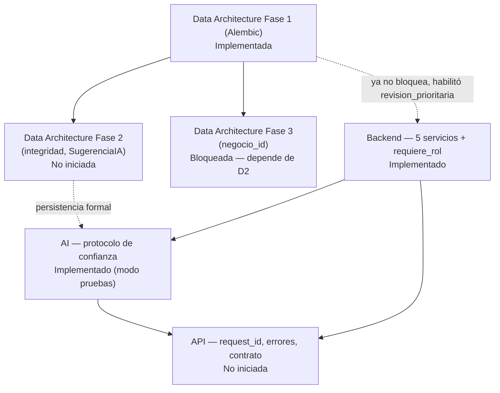

# Pre-Deployment Review — Fase 1 (Backend + AI + Data Architecture Fase 1)

**Fecha:** 2026-07-29
**Autor:** Claude, a pedido de Jesús Millones
**Naturaleza del documento:** Gate de integración — no es un documento de arquitectura ni un
Implementation Review por componente (esos ya se hicieron y fueron aprobados uno por uno). Este
documento verifica que el **conjunto** Backend + AI + Data Architecture Fase 1 funciona como un
sistema coherente, antes de continuar con la sub-etapa de API y antes del primer despliegue real
de la Fase 1.

---

## 1. Estado general de la Fase 1 hasta este momento

| Sub-etapa | Estado | Commits | Desplegado |
|---|---|---|---|
| Fase 0 (Estabilización) | Cerrada, verificada en producción | 32 commits (previos a esta Fase 1) | **Sí** — es lo que corre hoy en producción |
| Data Architecture Fase 1 (Alembic) | Completa | `c04df62`, `ff5adef` | No |
| Operations Runbook (Escenario 1) | Completo | `908d7d2` | No |
| Backend — tramo 1 (antes de AI) | Completo | `9029542`…`52cb13d` (6 commits) | No |
| AI — protocolo de confianza | Completo, validado con API real | `93ba623`, `171a38f` | No |
| Plan de Validación Conversacional | Completo (plan, no ejecución) | `154b4fa` | No |
| Backend — tramo 2 (resto) | Completo | `d318a04`, `0e02ed1`, `9098c33` | No |
| API (`request_id`, errores, contrato) | **No iniciada** | — | — |

**Hecho central de este gate:** hay **16 commits locales, 0 desplegados**. La rama `deploy-main`
está 16 commits adelante de `deploy/main` (producción real). Producción hoy corre exactamente lo
mismo que al cierre de Fase 0 — ningún cambio de Backend, AI o Data Architecture Fase 1 ha tocado
producción todavía. Esto es deliberado (criterio ya acordado: agrupar unidades funcionales
completas antes de desplegar), pero es la magnitud real que este gate evalúa.

## 2. Matriz de cumplimiento

Estado de cada Decisión local ya fijada en Backend/AI/Data Architecture — no se redefine ninguna,
solo se verifica su estado real en el código.

### Backend Architecture

| Decisión | Estado arquitectura | Estado real en código |
|---|---|---|
| Capas explícitas (Presentación/Aplicación/Dominio) | Objetivo | **Parcial** — Dominio (5 servicios) implementado; Presentación (routers delgados) y Aplicación (casos de uso) no existen todavía como capas separadas — `dashboard.py` sigue siendo el router monolítico |
| Extracción de `dashboard.py` por bounded context | Objetivo | **Parcial** — la lógica de Dominio salió de `dashboard.py`/`main.py` hacia los 5 servicios; `dashboard.py` en sí no se dividió en routers más chicos |
| Autorización centralizada (`requiere_rol`) | Objetivo | **Implementado** — cero checks de rol duplicados inline en gates de endpoint (verificado) |
| Cliente HTTP compartido + timeout explícito | Objetivo | **Implementado** — Meta/Resend comparten cliente; Anthropic ya tenía timeout explícito desde Fase 0 |
| Manejo de errores por capa (Infraestructura) | Objetivo | **Pendiente** — no se formalizó una separación explícita de manejo de errores por capa en esta sub-etapa |
| Protocolo de confianza de IA | Objetivo | **Implementado** — activo solo en `modo="pruebas"` |
| `BackgroundTasks` para tareas no críticas | Objetivo (transitorio) | **Pendiente** — no implementado |
| Retiro del branch roto de `twilio` | Objetivo | **Implementado** |
| Sincronización explícita con Data Architecture | Objetivo | **Implementado** — ningún cambio de esquema se hizo sin Alembic activo primero (la propia `revision_prioritaria` se diseñó esperando a que Data F1 existiera) |

### AI Architecture

| Decisión | Estado arquitectura | Estado real en código |
|---|---|---|
| Adoptar `{respuesta, confianza, razon}` | Objetivo | **Implementado**, validado con llamadas reales — activo solo en `modo="pruebas"` |
| Clasificar 6 fuentes de conocimiento | Objetivo | **No implementado como taxonomía explícita en código** — `_armar_bloques_contexto` sigue resolviendo las fuentes sin etiquetarlas por categoría; es una brecha real, no crítica para esta fase |
| Delimitación estructural (`<contexto_negocio>`/`<mensaje_cliente>`) | Objetivo | **Implementado**, activo solo en `modo="pruebas"` |
| Recuperación determinística sin tool-calling agéntico | Activa | Sin cambios — se mantiene |
| Prompt caching del contenido estático | Objetivo | **Implementado y confirmado** con métricas reales (`cache_read_input_tokens > 0`) |
| Registro de cada inferencia | Objetivo | **Implementado** — log estructurado; persistencia formal en `SugerenciaIA` sigue diferida (depende de Data Fase 2) |
| Parametrizar por `negocio_id` | Objetivo, depende de Data Fase 3 | **No aplica todavía** — Multi-Tenant no implementado, como corresponde |
| AI Orchestrator como componente explícito | Objetivo | **Implementado** — documentado en el módulo, responsabilidades distribuidas explícitamente, no como clase nueva |
| Explainability First | Objetivo | **Parcial** — verificable vía log estructurado hoy; verificación completa vía `SugerenciaIA` persistida sigue condicionada a Data Fase 1 y Fase 2 (Fase 1 ya está, Fase 2 no) |

### Data Architecture — Fase 1

| Decisión | Estado |
|---|---|
| Adoptar Alembic | **Implementado** |
| Generar migración baseline que replica el esquema actual | **Implementado**, verificado equivalente a `create_all()` |
| `create_all()` deja de usarse como mecanismo de cambio en producción | **Implementado** |

**Fases posteriores, correctamente no tocadas en esta sub-etapa:** Data Architecture Fase 2
(integridad, FKs, `SugerenciaIA`, `RegistroAuditoria`) y Fase 3 (`negocio_id`, Multi-Tenant) — ambas
dependen de que Fase 1 exista, que ya es el caso, pero ninguna se ejecutó todavía.

## 3. Mapa de dependencias actualizado

- **Data Fase 1 → Backend/AI**: ya no bloquea nada — es la razón por la que se ejecutó fuera de
  secuencia, y esa dependencia ya está resuelta.
- **Backend + AI → API**: API puede empezar — ambos tienen una forma estable que documentar en el
  contrato interno. "Forma estable" es una condición de diseño, no de haber corrido en producción
  real todavía (ver sección 4).
- **Data Fase 2 → AI (persistencia de `SugerenciaIA`)**: sigue bloqueado. El protocolo de confianza
  funciona sin esto (usa logs), pero la verificación completa de Explainability First no.
- **Data Fase 2 y Fase 1 → Data Fase 3 (`negocio_id`)**: sigue bloqueado, Fase 2 no ha empezado.

## 4. Riesgos reales antes del primer despliegue

1. **Crítico, ya conocido**: sin `alembic stamp head` contra la Postgres de producción, el próximo
   arranque falla (detección automática ya en su lugar, ver `MAIEK_AI_OPERATIONS_RUNBOOK.md`).
2. **Tamaño del conjunto sin desplegar**: 16 commits acumulados es más que cualquier lote anterior
   de este proyecto (Fase 0 fueron 32 commits, pero desplegados incrementalmente en el camino, no
   todos de una vez al final). Un problema real en producción sería más difícil de aislar a un
   commit específico cuanto más grande sea el lote que se despliega junto.
3. **Protocolo de confianza sin validar con tráfico real**: mitigado — solo se activa en
   `modo="pruebas"`, `modo="producción"` corre exactamente el código anterior. El riesgo real es
   distinto: nadie ha confirmado que ni siquiera el camino de `modo="producción"` (que sí cambió de
   forma indirecta — pasa ahora por 5 fachadas en vez de imports directos) se comporte igual con
   tráfico real, más allá de las pruebas automatizadas ya hechas.
4. **Gate de CI bloqueante**: Fase 0 dejó pendiente que actives "Require status checks to pass" en
   GitHub — no tengo forma de confirmar desde acá si ya lo hiciste. Si no, este despliegue no tiene
   ese control activo.
5. **Backup de Postgres**: el mecanismo existe desde Fase 0 (`scripts/backup_postgres.py`), pero no
   tengo visibilidad de si corrió recientemente antes de este despliegue puntual.
6. **`BackgroundTasks`/señal de error de `extraer_datos_lead`**: deuda conocida, no bloqueante, pero
   suma superficie de comportamiento no reforzado en el mismo despliegue.

## 5. Prerrequisitos operativos exactos para producción

1. **`alembic stamp head`** contra la `DATABASE_URL` real de Railway — una sola vez, antes del push
   (`MAIEK_AI_OPERATIONS_RUNBOOK.md`, Escenario 1, pasos 3-5 para verificar antes/después).
2. **Confirmar** que el branch protection con gate de CI bloqueante está activo en GitHub (pendiente
   desde Fase 0 — verificar, no asumir).
3. **Confirmar** un backup reciente de Postgres antes del push.
4. **Ninguna variable de entorno nueva** es necesaria — Alembic reutiliza `DATABASE_URL` ya
   existente; el cliente HTTP compartido y las fachadas de servicio no requieren configuración
   adicional. Confirmado revisando cada cambio.
5. Después del push: seguir el punto 7 del Runbook (logs limpios, health check, mensaje real de
   WhatsApp) antes de considerar el despliegue cerrado.

## 6. Recomendación técnica

**Desplegar el núcleo técnico (Backend + AI + Data Architecture Fase 1) ahora, antes de continuar
con API — no seguir acumulando sobre una base todavía no verificada en producción real.**

Razones:
- Es el mismo criterio que ya sostuvo la Fase 0: construir sobre una base validada con tráfico
  real, no solo con pruebas automatizadas locales, por más rigurosas que hayan sido.
- El riesgo real identificado en la sección 4 (punto 3) — que el camino de `modo="producción"`
  ahora pasa por 5 fachadas nuevas — es exactamente el tipo de cosa que las pruebas automatizadas
  locales no pueden descartar del todo por sí solas.
- 16 commits sin desplegar ya es un lote considerable; seguir sumando la sub-etapa de API encima
  antes de la primera verificación real aumentaría el riesgo sin necesidad — API no tiene ninguna
  dependencia que obligue a hacerlo antes del despliegue.
- El protocolo de confianza no se ve afectado por este orden: sigue en `modo="pruebas"` de todos
  modos, y su propio Plan de Validación Conversacional ya establece que no se promueve a producción
  hasta cumplir sus propios criterios, independientemente de cuándo se haga este despliegue.

Plan concreto sugerido: (1) confirmás los prerrequisitos de la sección 5, (2) hacés `alembic stamp
head`, (3) hago el push, (4) verificamos juntos el arranque y un mensaje real en producción (mismo
criterio de cierre que Fase 0), (5) recién ahí retomamos la sub-etapa de API.

---

*Fin del documento. Gate de integración — no requiere aprobación de arquitectura, requiere tu
decisión sobre cómo proceder con el despliegue.*
