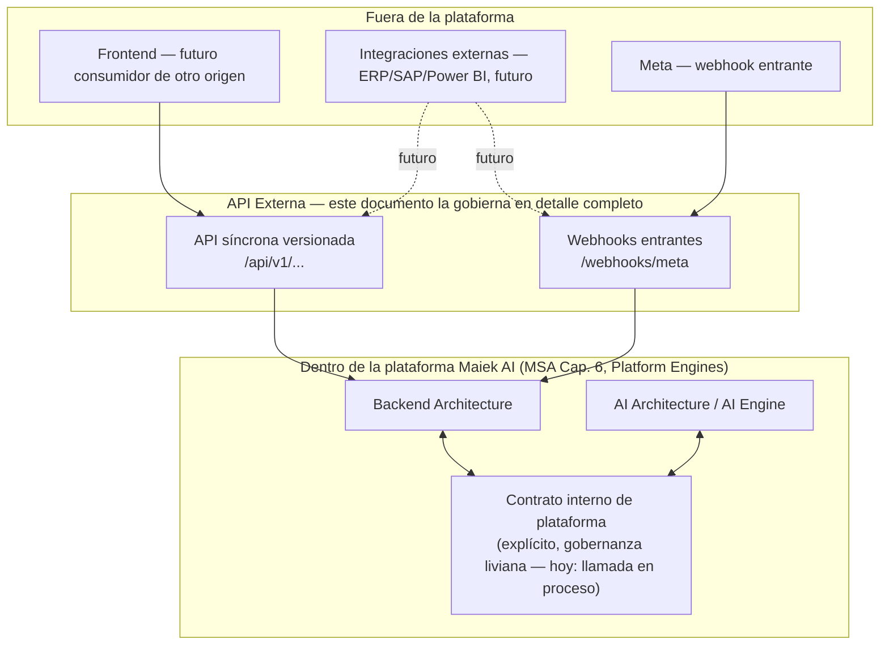

# Maiek AI — API Architecture

**Versión 1.0 · Estado: Approved**

| | |
|---|---|
| Documento | Maiek API Architecture |
| Proyecto | Maiek AI |
| Versión | 1.0 |
| Estado | **Approved** |
| Fecha de creación | 2026-07-28 |
| Autor | Claude, a pedido de Jesús Millones |
| Fecha de aprobación | 2026-07-28 |
| Última actualización | 2026-07-28 |

## Dependencias

- `MAIEK_AI_SYSTEM_ARCHITECTURE.md` (MSA) Capítulo 6 (Platform Engines — de donde se toma la distinción entre componentes *dentro* de la plataforma y consumidores *fuera* de ella), Capítulo 9 (Integraciones), Capítulo 10 (Runtime Architecture), Capítulo 12 (API First — ya fijada, este documento la implementa, no la redecide).
- `MAIEK_AI_BACKEND_ARCHITECTURE.md` — capas Presentación/Aplicación/Dominio y casos de uso ya definidos; este documento define **cómo se exponen** como contrato, nunca redefine su lógica (Regla de herencia arquitectónica, ADS Cap. 7).
- `MAIEK_AI_API_CURRENT_STATE_ASSESSMENT.md` (CSA-API) — clasificación de consumidores, Priorización P1-P3 y Architectural Readiness son el punto de partida de este documento.
- `MAIEK_AI_ARCHITECTURE_DOCUMENT_STANDARD.md` (ADS) v1.3.

## Consumido por

AI Architecture, Frontend Architecture, Security Architecture, DevOps Architecture (futuros) — todos consumen el contrato definido acá; ninguno redefine interfaces propias.

## Control de versiones

| Versión | Fecha | Autor | Descripción |
|---|---|---|---|
| 1.0 (borrador) | 2026-07-28 | Claude | Primera versión — contrato de API objetivo y plan de evolución desde el estado real diagnosticado en el CSA-API. Pendiente de revisión y aprobación. |
| 1.0 (Approved) | 2026-07-28 | Claude | Aprobado sin cambios de contenido tras revisión de las decisiones de frontera de confianza, idempotencia general y `request_id`/API Lifecycle. Tres recomendaciones de evolución futura quedaron registradas en memoria de proyecto, no incorporadas acá para no reabrir el documento: (1) `request_id` es explícitamente un identificador técnico de correlación, nunca un identificador de negocio o de usuario; (2) cuando Security Architecture defina autenticación de integraciones externas, evaluar API Keys con scopes en vez de acceso total; (3) incorporar a futuro una estrategia de Contract Testing que valide automáticamente que las versiones Stable no rompen el contrato publicado. Documento congelado como **Approved**. |

## Alcance y regla de no-duplicación

Define el contrato **externo** del sistema en detalle completo — versionado, convenciones de endpoint, modelo de errores, idempotencia, autenticación por frontera de confianza — sobre los casos de uso y servicios de dominio ya definidos en Backend Architecture, sin redefinirlos. Para el contrato **interno de plataforma** (entre Backend y otros Platform Engines como AI Architecture), este documento fija solo el principio de que existe y es explícito — el detalle exacto de esa interfaz interna es responsabilidad del documento que la implementa (ver sección 1). No define la lógica de negocio (Backend Architecture), no define el modelo de datos (Data Architecture), no define UI (Frontend Architecture), no define política de seguridad más allá de lo que este documento fija como contrato (Security Architecture profundiza).

---

## 1. API Architecture objetivo

**Distinción central de este documento: frontera de confianza, no solo tipo de consumidor.** No toda comunicación entre componentes es "una API externa" — algunos consumidores viven *dentro* de la plataforma Maiek AI (MSA Cap. 6, Platform Engines) y otros viven *fuera*. Tratar a un Platform Engine como AI Architecture con el mismo nivel de exposición, autenticación y gobernanza que una integración de terceros sería un error de modelado, no un detalle menor.

**Contrato interno de plataforma** — entre Backend y otros Platform Engines (AI Architecture, y a futuro Workflow Engine / Business Rules Engine si se separan como servicios propios, MSA Cap. 6). Hoy no es siquiera una llamada de red: el AI Engine vive en el mismo proceso que lo invoca (`ServicioInteligencia`, ya definido en Backend Architecture) — el "contrato interno" es, literalmente, la interfaz de función ya fijada ahí. Este documento no profundiza más en esa interfaz — decide únicamente el **principio**: nunca se trata a un Platform Engine como un consumidor externo.

**API Externa versionada** (`/api/v1/...` + webhooks) — la única superficie que este documento diseña y gobierna en detalle completo. Es el contrato para Frontend (si se separa de origen), integraciones de terceros, y el webhook entrante de Meta.

## 2. Architectural Constraints

Hechos del entorno que este contrato no puede elegir — instancias de restricciones ya fijadas en MSA Cap. 11 y operadas en Backend Architecture, más las propias de este dominio:

| Restricción | Naturaleza | Impacto en el diseño |
|---|---|---|
| Proceso único, no distribuido (MSA Cap. 11, instancia en Backend Architecture Cap. 2) | Infraestructura | El mecanismo de idempotencia (sección 3) debe apoyarse en la base de datos, no en memoria de proceso |
| Límite de llamadas de IA por mensaje, condicionado por costo (MSA Cap. 11, instancia en Backend Architecture Cap. 2) | Tecnológico / negocio | El contrato interno hacia AI Architecture no puede introducir una ronda adicional de llamadas a IA solo para satisfacer un formato de contrato |
| Formato de payload de webhook fijado por Meta (MSA Cap. 11) | Proveedor | El contrato de webhooks entrantes no puede exigirle a Meta un formato propio — la idempotencia se deriva de lo que Meta ya envía, nunca de un campo nuevo que Meta tendría que agregar |
| Sin ambiente de staging (MSA Cap. 11) | Infraestructura | Todo cambio de contrato debe poder desplegarse de forma aditiva y segura directo a producción |
| Documentación interactiva de FastAPI generada por defecto (hecho del framework, no elegido) | Tecnológico | Cualquier decisión de restringir `/docs` debe hacerse explícitamente (sección 3) — el comportamiento por defecto es exponerla |

## 3. Decisiones arquitectónicas

Formato ADS — prosa breve + tabla resumen.

**API First como contrato único de verdad, para la API externa.** Toda funcionalidad nueva expuesta hacia afuera de la plataforma pasa primero por `/api/v1/`; el panel (Frontend) consume esa misma API, nunca una ruta paralela. Implementa MSA Cap. 12 — no se redecide, se ejecuta.

**Frontera de confianza determina el mecanismo de autenticación — no el tipo de tráfico.** Frontend e integraciones externas consumen la API externa versionada, autenticados con sesión o API key respectivamente (abajo). **AI Architecture consume vía el contrato interno de plataforma, nunca vía `/api/v1/` con API key** — es un Platform Engine (MSA Cap. 6), no un tercero; tratarlo como consumidor externo violaría la distinción de la sección 1. Si AI Architecture se separa en su propio servicio deployable en el futuro, el mecanismo de confianza interno (red privada / secreto compartido de servicio) es una decisión de AI Architecture y DevOps Architecture cuando ese momento llegue (ver Brechas abiertas) — este documento solo fija que nunca será el mismo mecanismo que un consumidor externo.

**Versionado por path.** `/api/v1/...` explícito en la URL. Un cambio incompatible futuro crea `/api/v2/` en paralelo — `v1` nunca se modifica in-place mientras tenga consumidores activos (ver API Lifecycle, sección 4).

**Convenciones de endpoint.** Recursos como sustantivos en plural, el método HTTP expresa la acción (`GET /api/v1/leads/{id}`, `POST /api/v1/leads/{id}/mensajes`) — nunca un verbo en la URL, sin sufijos de formato tipo `.json`.

**Modelo uniforme de errores, con trazabilidad para observabilidad.** Toda respuesta de error de la API externa sigue una forma fija: `{codigo, mensaje, detalle, request_id}`. `codigo` es un string estable (ej. `LEAD_NO_ENCONTRADO`), no solo el status HTTP. `request_id` es un identificador único asignado a cada solicitud en el borde del contrato (o propagado si el consumidor ya trae uno vía header `X-Request-Id`), incluido también como header en **toda** respuesta — éxito o error — y propagado a través de los logs de esa solicitud. Es lo que permite a DevOps y Operations Architecture correlacionar un error reportado por un consumidor con lo que realmente pasó en el sistema, sin depender de que el consumidor describa el problema.

**Idempotencia como propiedad general del contrato — `mensaje_id` es una instancia, no una dependencia de Meta.** Regla general: toda solicitud con efectos secundarios (una escritura en la API síncrona, un webhook entrante) tiene un identificador único de idempotencia. Para la API síncrona externa, ese identificador es el header `Idempotency-Key` que el consumidor provee. Para un webhook entrante, ese identificador se **deriva** de un campo natural que el proveedor externo ya envía en su payload — Meta usa `mensaje_id` hoy, que es la instancia actual de la regla general, no un requisito especial escrito para Meta: cualquier integración de webhook futura (ERP, SAP) aplicaría la misma regla derivando su propio identificador natural, sin que este documento necesite cambiar una sola línea.

**Webhooks vs. APIs síncronas — familias separadas.** Un webhook entrante nunca se rediseña para parecerse a la API síncrona, y la API síncrona nunca se fuerza al formato de un webhook — cada una responde a las restricciones de su propio origen (sección 2).

**Compatibilidad hacia atrás.** Una vez Stable (sección 4), `/api/v1/` no cambia de forma incompatible. Un campo puede **agregarse** sin nueva versión; ningún campo se **remueve** ni cambia de tipo sin publicar `/api/v2/`. Mismo patrón expand-contract ya fijado en Data Architecture.

**Preparación Multi-Tenant sin romper consumidores existentes.** El contrato incorpora `negocio_id` cuando Data Architecture Fase 3 esté activa, resuelto desde la sesión o el token del consumidor — nunca como un segmento nuevo obligatorio en el path que invalide URLs ya integradas.

**Documentación restringida.** `/docs` y `/openapi.json` quedan detrás de autenticación hasta que exista una decisión explícita de Security Architecture de publicarlos.

### Resumen

| Decisión | Estado | Justificación | Criterio de revisión |
|---|---|---|---|
| API First para la API externa | Objetivo | MSA Cap. 12, ya fijada | No se revisa — se implementa |
| AI Architecture consume vía contrato interno, nunca API key externa | Objetivo | AI Architecture es Platform Engine (MSA Cap. 6), no un tercero | Se revisa solo si AI Architecture se separa en servicio propio — el mecanismo exacto lo define ese momento, no este documento |
| Versionado por path (`/api/v1/`) | Objetivo | Simplicidad y visibilidad para consumidores nuevos | Se revisa solo con evidencia real de que el versionado por header sería preferible |
| Modelo uniforme de errores con `request_id` | Objetivo | Errores dispersos sin trazabilidad hoy (CSA-API §4) | — |
| Idempotencia general (`Idempotency-Key` / clave derivada del payload) | Objetivo | P1 del CSA-API — riesgo activo hoy | — |
| Autenticación por API key para integraciones externas de servicio a servicio | Objetivo | Proporcional al número de consumidores externos actual (cero) | Se migra a OAuth2/mTLS solo con evidencia real de que la API key no alcanza |
| Compatibilidad hacia atrás (expand-contract) | Objetivo | Mismo patrón ya fijado en Data Architecture | — |
| `negocio_id` resuelto por sesión/token, nunca por path obligatorio | Objetivo | Evita romper consumidores ya integrados | — |
| `/docs` y `/openapi.json` restringidos | Objetivo | Expuestos sin restricción hoy (CSA-API §6) | Se revisa si Security Architecture decide explícitamente publicarlos |

## 4. API Lifecycle

Aplica a nivel de **versión completa** (`/api/v1/`, `/api/v2/`...) — no a endpoints individuales dentro de una versión ya Stable, que heredan su garantía de compatibilidad. Transición unidireccional, nunca se retrocede:

1. **Experimental** — versión en desarrollo activo, sin garantía de compatibilidad; puede cambiar o desaparecer sin previo aviso. Nunca es la única vía para una funcionalidad crítica de negocio — lo que un consumidor necesita para operar ya vive en la versión Stable vigente. Se marca explícitamente en la documentación y, si aplica, en el path.
2. **Stable** — la única con la garantía de compatibilidad hacia atrás fijada en la sección 3. Pasa de Experimental a Stable solo con evidencia real de al menos un consumidor validándola en un escenario real (Evidence over Opinion, MPX Cap. 11) — nunca por decreto sin uso real.
3. **Deprecated** — funciona exactamente igual que en Stable (ningún cambio de comportamiento), pero ya tiene fecha de retiro anunciada. Toda respuesta de una versión Deprecated incluye los headers HTTP estándar `Deprecation` y `Sunset`. Nunca se marca Deprecated una versión sin que ya exista una versión Stable de reemplazo.
4. **Retired** — ya no responde. Toda solicitud retorna un error fijo (`codigo: VERSION_RETIRADA`) indicando la versión mínima soportada — nunca un 404 genérico sin contexto.

El plazo mínimo de convivencia entre Deprecated y Retired es una decisión operativa, no arquitectónica — este documento fija el mecanismo (los estados, los headers, la garantía de comportamiento), el plazo exacto en días/meses queda como brecha explícita hacia Operations Architecture (sección 7).

## 5. Gap Analysis

| Tema | Estado actual | Objetivo | Impacto | Prioridad |
|---|---|---|---|---|
| Versionado | Inexistente | `/api/v1/` explícito, con ciclo de vida (sección 4) | Bloqueante para publicar cualquier contrato estable | P1 |
| Idempotencia | Inexistente | `Idempotency-Key` / clave derivada del payload en webhooks | Riesgo activo hoy (reintentos de Meta) | P1 |
| Modelo de errores | `HTTPException` disperso, sin estructura ni trazabilidad | `{codigo, mensaje, detalle, request_id}` | Consumidores no pueden manejar errores programáticamente; sin correlación con logs | P1 |
| Separación interna/externa de AI Architecture | No existe distinción — todo tráfico sería tratado igual | Contrato interno explícito, distinto del externo | Evita tratar un componente de plataforma como tercero | P1 |
| Documentación expuesta | `/docs` público sin restricción | Restringido a autenticación | Bajo riesgo hoy, sin decisión consciente | P2 |
| Contratos tipados (Pydantic) | Inexistentes | Modelos de entrada/salida en todo endpoint nuevo | Documentación real, validación automática | P2 |
| Autenticación externa de servicio a servicio | Inexistente | API key para integraciones de terceros | Bloqueante para integraciones externas reales | P2 |
| CORS | Inexistente | Configurado cuando exista un consumidor de otro origen | No bloqueante hoy | P3 |
| Multi-tenant en el contrato | Inexistente | `negocio_id` vía sesión/token | Depende de Data Architecture Fase 3 | P3 |

## 6. Roadmap de evolución

### Fase 1 — Fundación del contrato
**Depende de:** nada.
- Definir `/api/v1/` (estado Experimental inicial), el modelo uniforme de errores con `request_id`, y `Idempotency-Key`.
- Aplicar idempotencia al webhook de Meta usando `mensaje_id` como instancia de la regla general.
- Restringir `/docs` y `/openapi.json`.
- Formalizar el contrato interno de plataforma como interfaz explícita (aunque hoy sea solo una llamada en proceso).

### Fase 2 — Migración y consumidores externos
**Depende de:** Fase 1.
- Migrar los 4 endpoints JSON heredados a `/api/v1/` con modelos Pydantic.
- Promover `/api/v1/` de Experimental a Stable, con evidencia real de al menos un consumidor validándola.
- Introducir autenticación por API key para integraciones externas de servicio a servicio.

### Fase 3 — Multi-Tenant en el contrato
**Depende de:** Fase 1-2, y de que Data Architecture ejecute su Fase 3 en código (dependencia cruzada entre documentos).
- Incorporar `negocio_id` resuelto por sesión/token en cada endpoint de `/api/v1/`, sin romper ninguna URL ya integrada.

## 7. Brechas abiertas

Solo las que corresponden a otro documento derivado — no se resuelven acá:

- **Plazo exacto de convivencia Deprecated → Retired** — Operations Architecture.
- **Emisión, rotación y almacenamiento seguro de API keys** — Security Architecture.
- **Uso operativo real de `request_id`** (dashboards, alertas, correlación con logs de infraestructura) — DevOps Architecture / Operations Architecture; este documento solo garantiza que el campo existe en el contrato.
- **Rate limiting** — Security Architecture / DevOps Architecture, no decidido acá.
- **Mecanismo técnico exacto del contrato interno de plataforma** si AI Architecture se separa en un servicio propio — AI Architecture / DevOps Architecture; este documento solo fija el principio de que nunca es un consumidor externo.

## 8. Architecture Success Criteria

Condiciones verificables sobre el sistema real — no tareas, no roadmap:

- AI Architecture nunca se autentica con el mismo mecanismo que un consumidor externo — consume exclusivamente vía el contrato interno de plataforma.
- Todo endpoint de escritura de `/api/v1/` acepta y respeta un `Idempotency-Key`; el webhook de Meta no reprocesa un mensaje ya visto usando `mensaje_id`.
- La lógica general de idempotencia no contiene ninguna referencia hardcodeada a "Meta" — solo la integración específica del webhook la usa como su fuente del identificador.
- Todo error de la API externa responde con `{codigo, mensaje, detalle, request_id}`, y ese mismo `request_id` aparece en los logs del sistema para esa solicitud.
- Ninguna versión Stable cambia de forma incompatible sin abrir una versión nueva.
- Toda versión de la API declara su estado (Experimental/Stable/Deprecated/Retired) de forma verificable en su documentación y, cuando aplica, en sus headers de respuesta.
- El panel (Frontend) consume la misma API versionada que cualquier otro consumidor externo — no existe una ruta paralela de acceso directo a los servicios de dominio.
- `/docs` y `/openapi.json` no son accesibles sin autenticación.
- El contrato puede incorporar `negocio_id` sin romper ninguna URL ni consumidor ya integrado.

## 9. QA Arquitectónico

Checklist del ADS v1.3 aplicado:

1. ¿Declara Dependencias y Consumido por, citando capítulos exactos del MSA? — Sí (Cap. 6, 9, 10, 12).
2. ¿Ninguna sección redefine contenido ya cerrado en otros documentos? — Sí; API First se implementa, no se redecide; los casos de uso y servicios de dominio de Backend Architecture se citan, nunca se redefinen; AI Architecture se trata consistentemente con su rol de Platform Engine ya implícito en MSA Cap. 6, no como un consumidor nuevo inventado acá.
3. ¿Toda decisión propia sigue el formato Decisión/Estado/Justificación/Criterio de revisión? — Sí, sección 3.
4. ¿Toda brecha conocida está declarada con dueño? — Sí, sección 7, ninguna sin dueño.
5. ¿Toda referencia cruzada cita capítulo/sección exacta? — Sí.
6. ¿Actualiza el mapa y la tabla de `DOCUMENTATION_INDEX.md`? — Pendiente al commit.
7. ¿Nivel de detalle alto nivel, sin caer en implementación completa? — Sí.
8. ¿Una persona nueva, leyendo esto y el MSA, entendería el dominio sin preguntar? — Sí.
9. ¿Aporta conocimiento nuevo o duplica información existente? — Aporta: ninguna decisión de este documento existía antes en el corpus.
10. ¿Cada Architecture Success Criteria es verificable, no una tarea? — Sí, sección 8.
11. ¿Architectural Constraints contiene únicamente hechos del entorno, sin decisiones ni riesgos mezclados? — Sí, sección 2.

No se detectaron contradicciones con MSA, Backend Architecture, Data Architecture ni con el CSA-API.

---

*Fin del documento — Approved. Línea base del contrato de API de Maiek AI.*
