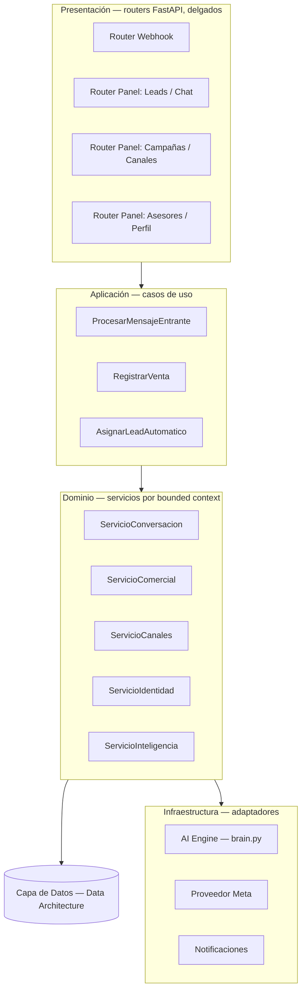

# Maiek AI — Backend Architecture

**Versión 1.0 · Estado: Approved**

| | |
|---|---|
| Documento | Maiek Backend Architecture |
| Proyecto | Maiek AI |
| Versión | 1.0 |
| Estado | **Approved** |
| Fecha de creación | 2026-07-28 |
| Autor | Claude, a pedido de Jesús Millones |
| Fecha de aprobación | 2026-07-28 |
| Última actualización | 2026-07-28 |

## Dependencias

- `MAIEK_AI_SYSTEM_ARCHITECTURE.md` (MSA) Capítulo 4-6 (Capas, Componentes, Platform Engines), Capítulo 7 (Arquitectura de IA), Capítulo 9 (Integraciones), Capítulo 10 (Runtime Architecture), Capítulo 12 (Architectural Decisions — API First, Event-Driven, Configuration over Code).
- `MAIEK_AI_DATA_ARCHITECTURE.md` — modelo de datos objetivo, bounded contexts, entidades de IA (`MemoriaPersistente`, `SugerenciaIA`) — este documento los consume, no los redefine (Regla de herencia arquitectónica, ADS Cap. 7).
- `MAIEK_AI_BACKEND_CURRENT_STATE_ASSESSMENT.md` (CSA-Backend) — diagnóstico real, Priorización P1-P3, Architectural Decision Impact y Strategic Recommendations son el punto de partida de este documento.
- `MAIEK_AI_ARCHITECTURE_DOCUMENT_STANDARD.md` (ADS) v1.3 — estructura, formato de decisiones, Architecture Success Criteria, Architectural Constraints, checklist de QA.
- `MAIEK_AI_PRODUCT_EXPERIENCE.md` (MPX) Capítulo 1 (Interaction Model), Capítulo 2 (Protocolo de interacción con IA), Capítulo 3 (Decision Experience) — condicionan el protocolo de confianza de IA de este documento.

## Consumido por

AI Architecture, API Architecture, Frontend Architecture, Security Architecture, DevOps Architecture (futuros) — heredan la separación de capas y los servicios de dominio definidos acá.

## Control de versiones

| Versión | Fecha | Autor | Descripción |
|---|---|---|---|
| 1.0 (borrador) | 2026-07-28 | Claude | Primera versión — arquitectura objetivo del backend y plan de evolución desde el estado real diagnosticado en el CSA-Backend. Pendiente de revisión y aprobación. |
| 1.0 (Approved) | 2026-07-28 | Claude | Revisión final: se agrega **Architectural Constraints** (sección 2, nueva sección permanente del ADS v1.3) con 5 restricciones reales del backend; se refuerza explícitamente el **límite de responsabilidad del protocolo de confianza de IA** — la confianza es emitida únicamente por el AI Engine, Backend la consume sin recalcularla ni reinterpretarla, con fail-safe a `Baja` si el modelo no la emite; se marca **`BackgroundTasks` explícitamente como mecanismo transitorio** de Event-Driven, no su estado final, con la migración a cola externa reservada a este mismo documento. Documento congelado como **Approved**. |
| 1.0 | 2026-09-12 | Claude | **Reconciliación — [ADR-0004](adr/0004-secuencia-data-fase2-vs-multitenant.md) (Aceptada) precisa §5, Fase 3, sobre la activación de escritura en `SugerenciaIA`/`MemoriaPersistente`.** El texto agrupaba esa activación a que "Data Architecture Fase 2" completa esté activa; se precisa que depende únicamente de que esas dos entidades existan, no del resto de Fase 2 (FKs legacy, `Numeric`, soft delete), sin dependencia técnica real entre ambos (evidencia en ADR-0004). No se modifica ninguna otra decisión de este documento — la escritura sigue diferida hoy, sin cambio de código. |

## Alcance y regla de no-duplicación

Define cómo se organiza el código del backend — capas, servicios, casos de uso, manejo de errores, autorización — para soportar lo ya definido en MPA (módulos), MPX (comportamiento) y Data Architecture (modelo de datos), sin redefinir ninguno de los tres. No define contratos HTTP (API Architecture), no define infraestructura de despliegue (DevOps Architecture), no define UI (Frontend Architecture). Implementa las decisiones ya fijadas en MSA Cap. 12 (API First, Event-Driven, Configuration over Code) — no las redecide.

---

## 1. Arquitectura objetivo

Cuatro capas, especializando directamente MSA Cap. 4 (la capa de Datos ya está definida en Data Architecture, este documento no la repite):

**Presentación** — routers FastAPI que solo parsean la petición, llaman a un caso de uso, y formatean la respuesta. Ninguna regla de negocio vive acá (Architecture Success Criteria, sección 5).

**Aplicación (casos de uso)** — orquestan una operación de negocio completa coordinando uno o más servicios de dominio: `ProcesarMensajeEntrante` (el flujo del webhook, hoy disperso en `main.py`), `RegistrarVenta`, `AsignarLeadAutomatico`, `ResponderComoAsesor`, `GestionarCanal`. Es la capa que hoy no existe explícitamente — la orquestación vive mezclada en `main.py` y `dashboard.py`.

**Dominio (servicios por bounded context)** — uno por bounded context ya identificado en Data Architecture, sin redefinirlos:
- **`ServicioConversacion`** — mensajes, adjuntos, memoria conversacional y persistente. Reemplaza la lógica de chat hoy dispersa entre `main.py` y `dashboard.py`.
- **`ServicioComercial`** — leads, líneas de venta, asignación. Formaliza `asignacion.py` y la lógica de venta hoy en `dashboard.py` (`registrar_venta`).
- **`ServicioCanales`** — canales de WhatsApp, campañas. Formaliza `campanas.py` y la gestión de canales de `dashboard.py`.
- **`ServicioIdentidad`** — usuarios, autenticación, autorización centralizada. Nuevo — hoy no existe como servicio, es lógica repetida inline.
- **`ServicioInteligencia`** — único punto desde el que el Dominio pide una respuesta o sugerencia al AI Engine; envuelve `brain.py` y escribe en `SugerenciaIA` (Data Architecture).

**Infraestructura** — adaptadores hacia el exterior: AI Engine (Anthropic), proveedor de WhatsApp (ya sigue el patrón correcto, MSA Cap. 9), notificaciones (Resend). Es donde vive el manejo de errores de red (sección 2, decisión 5).

## 2. Architectural Constraints

Hechos del entorno que ninguna implementación de esta arquitectura puede elegir ni resolver — se diseña alrededor de ellos, no se debate su existencia. Ninguno es un riesgo (no son probabilísticos) ni una decisión (no fueron elegidos entre alternativas) — ver ADS Cap. 14 para el criterio de separación.

| Restricción | Naturaleza | Impacto en el diseño |
|---|---|---|
| Proceso único, no distribuido — el backend corre como un solo proceso Python en Railway (instancia de MSA Cap. 11, infraestructura) | Infraestructura | `GestorConexiones` (WebSocket) y `BackgroundTasks` (sección 2, Decisiones) solo funcionan correctamente mientras exista una sola instancia — ninguna decisión de este documento asume múltiples réplicas corriendo en paralelo |
| Stack async obligatorio — FastAPI + SQLAlchemy async en todo el backend | Tecnológico | Cualquier librería nueva debe soportar `asyncio` nativamente o vía un adaptador explícito; una librería síncrona de terceros usada directo en una ruta async bloquea el event loop completo |
| Límite de llamadas a IA por mensaje, condicionado por costo — instancia backend-específica de la restricción ya fijada en MSA Cap. 11 | Tecnológico / negocio | El protocolo de confianza (sección 3) debe venir en la misma llamada que genera la respuesta — agregar una llamada adicional solo para obtener `confianza` no es aceptable sin evidencia de que el costo lo justifica |
| Formato de payload de webhook fijado por Meta, fuera de control del proyecto | Proveedor | El adaptador de Infraestructura (`ProveedorMeta`) se adapta al esquema de Meta; ninguna decisión de Presentación o Aplicación puede exigirle a Meta un formato propio |
| Sin ambiente de staging — instancia de la restricción ya fijada en MSA Cap. 11 | Infraestructura | El roadmap (sección 5) debe poder desplegarse de forma segura directo a producción, fase por fase, sin depender de un ambiente intermedio que hoy no existe |

## 3. Decisiones arquitectónicas

Formato ADS — prosa breve + tabla resumen.

**Capas explícitas.** Presentación → Aplicación → Dominio → Datos/Infraestructura, tal como se describe en la sección 1 — implementa MSA Cap. 4, no lo redecide.

**Extracción de `dashboard.py`.** Se divide en routers delgados (Presentación) + servicios de dominio (Dominio), uno por bounded context. La extracción se hace **por bounded context, no de una sola vez** — empezando por `ServicioComercial` (mayor concentración de reglas de negocio hoy, ej. `registrar_venta`).

**Autorización centralizada.** Una única dependencia de FastAPI, `requiere_rol(*roles)`, reemplaza los ~26 checks de rol duplicados inline identificados en el CSA-Backend. Vive en `ServicioIdentidad`.

**Cliente HTTP compartido con timeout explícito.** Un cliente `httpx.AsyncClient` reusado (no uno nuevo por llamada) con timeout configurado por defecto, para Meta y Resend. El cliente de Anthropic recibe `timeout=` explícito en su instanciación. Ninguna llamada externa queda sin límite de tiempo.

**Manejo de errores por capa.** Todo `try/except` de fallos de red vive en Infraestructura — ninguna excepción de transporte cruza sin capturar hasta el handler HTTP genérico. Cada adaptador traduce el fallo externo a un resultado explícito (éxito/fallo con motivo), nunca deja que la excepción se propague cruda.

**Protocolo de confianza de IA.** `ServicioInteligencia` exige que el AI Engine responda con salida **estructurada** (tool-calling forzado o JSON Schema), no texto libre: `{respuesta, confianza, razon}`. El campo `confianza` usa el vocabulario ya fijado en MPX Cap. 2 (Alta / Requiere validación / Baja). Esto reemplaza el disparador actual de handoff (conteo de fallas técnicas) por una señal real de incertidumbre del modelo — implementa MSA Cap. 7 y MPX Cap. 2, que hoy no tienen soporte técnico real (CSA-Backend, Desviaciones).

**Límite explícito de responsabilidad (Regla de herencia arquitectónica, ADS Cap. 7):** la confianza es **emitida exclusivamente por el AI Engine**, dentro de la misma llamada que produce la respuesta — nunca calculada, inferida ni ajustada en Backend. `ServicioInteligencia` y las capas superiores (Aplicación, Presentación) **consumen** el valor de `confianza` tal como llega para decidir qué regla de negocio ejecutar (mostrar la respuesta, pedir validación, o hacer handoff) — no lo recalculan con lógica propia, no lo reinterpretan con un umbral distinto al que ya definió MPX Cap. 2, y no lo sobreescriben bajo ninguna circunstancia. Si el AI Engine no puede emitir `confianza` en una respuesta dada, el caso se trata como `Baja` por defecto (fail-safe hacia el humano, nunca hacia una inferencia propia de Backend).

**Duplicación explícita a evitar:** un caso límite tentador sería que Backend "ayude" recalculando confianza con reglas propias cuando el valor del modelo "parece" incorrecto — esto violaría la Regla de herencia arquitectónica (MPX Cap. 2 es el documento propietario del protocolo de incertidumbre) y crearía dos fuentes de verdad para el mismo concepto, el mismo patrón de riesgo ya identificado entre CDS y MPX en la Architecture Baseline v1. Si el nivel de confianza emitido por el AI Engine resulta sistemáticamente mal calibrado, la corrección se hace en AI Architecture (ajustando el propio modelo/prompt), nunca con un parche de reinterpretación en Backend.

**Desacople de tareas no críticas — explícitamente transitorio.** `BackgroundTasks` de FastAPI para notificaciones, eventos WebSocket y escritura de `SugerenciaIA`/`RegistroAuditoria` — se ejecutan después de responder al webhook, no antes. **Esta es una implementación transitoria del patrón Event-Driven ya fijado en MSA Cap. 12 — no es su estado final.** `BackgroundTasks` comparte el mismo proceso y el mismo ciclo de vida de la petición HTTP que la generó: si el proceso se reinicia o cae antes de que la tarea termine, la tarea se pierde sin reintento — una cola externa real (fuera de proceso, persistente, con reintentos) no tiene esa limitación. Se adopta `BackgroundTasks` ahora porque es proporcional al volumen actual (Evidence over Opinion, MPX Cap. 11) y porque ya resuelve el problema concreto identificado en el CSA-Backend (el webhook no debe esperar a que salga un correo o se emita un evento WS) — pero el documento dueño de "cuándo migrar a una cola externa" sigue siendo este mismo, mediante una revisión futura con evidencia real de que `BackgroundTasks` ya no alcanza (ver Criterio de revisión, tabla resumen), no una decisión que DevOps Architecture pueda tomar por su cuenta ni que se asuma resuelta para siempre.

**Retiro del proveedor `twilio` roto.** Se elimina la referencia a `agent.providers.twilio` del factory hasta que exista una implementación real — un branch que apunta a un archivo inexistente no es una opción válida, es un bug latente.

**Sincronización con Data Architecture.** Backend Architecture no implementa el modelo de datos objetivo por su cuenta — consume cada fase de Data Architecture cuando esa fase se ejecute en código (ver Roadmap, sección 4).

### Resumen

| Decisión | Estado | Justificación | Criterio de revisión |
|---|---|---|---|
| Capas explícitas (Presentación/Aplicación/Dominio) | Objetivo | Implementa MSA Cap. 4; hoy no existen como capas reales | — |
| Extracción de `dashboard.py` por bounded context | Objetivo | Fat controller de 4601 líneas, bloqueante P1 del CSA-Backend | — |
| Autorización centralizada (`requiere_rol`) | Objetivo | 26 duplicaciones ya identificadas, alto riesgo de inconsistencia | — |
| Cliente HTTP compartido + timeout explícito | Objetivo | Riesgo de solicitudes colgadas, ya presente hoy | — |
| Manejo de errores por capa (Infraestructura) | Objetivo | Hoy las fallas de red se propagan sin control hasta el catch-all genérico | — |
| Protocolo de confianza de IA (salida estructurada, emitida solo por el AI Engine, Backend nunca la recalcula) | Objetivo | MSA Cap. 7 / MPX Cap. 2 sin soporte técnico real hoy | Se revisa si la salida estructurada degrada la calidad de la respuesta, medido con evidencia, no antes — nunca "corrigiendo" la confianza desde Backend |
| `BackgroundTasks` para tareas no críticas — **transitorio, no estado final** | Objetivo (transitorio) | Event-Driven ya decidido en MSA Cap. 12, procesamiento hoy 100% síncrono; proporcional al volumen actual | Se migra a cola externa (fuera de proceso, con reintentos) con evidencia real de que `BackgroundTasks` no alcanza — la migración la decide este documento, no DevOps Architecture por su cuenta |
| Retiro del branch roto de `twilio` | Objetivo | Falla de arranque real si se selecciona ese proveedor | — |
| Sincronización explícita con Data Architecture | Objetivo | Evita que Backend implemente el modelo de datos por su cuenta, duplicando la autoridad de Data Architecture | — |

## 4. Gap Analysis

| Tema | Estado actual | Objetivo | Impacto | Prioridad |
|---|---|---|---|---|
| Separación de capas | `dashboard.py` fat controller, sin capa de servicio | Presentación/Aplicación/Dominio explícitas | Bloqueante para API First y para escalar el equipo | P1 |
| Seguridad del webhook | Verificación de firma fail-open | Rechazo explícito si falta `app_secret` | Riesgo de seguridad activo hoy | P1 |
| Resiliencia de red | Sin timeout, sin `try/except` local | Cliente compartido con timeout, manejo por capa | Solicitudes colgadas, fallas propagadas sin control | P1 |
| Proveedor `twilio` | Branch roto (archivo inexistente) | Retirado del factory | Falla de arranque si se selecciona | P1 |
| Autorización | Duplicada ~26 veces | Dependencia centralizada `requiere_rol` | Alto riesgo de inconsistencia al crecer la superficie de rutas | P2 |
| Protocolo de confianza de IA | Inexistente — handoff por conteo de fallas técnicas | Salida estructurada con `confianza` explícita | MSA Cap. 7 / MPX Cap. 2 sin soporte técnico | P2 |
| Extracción de datos del lead | Fallo silencioso, sin señal hacia arriba | Resultado explícito de éxito/fallo | Datos de lead pueden quedar obsoletos sin que nadie lo note | P2 |
| Procesamiento del webhook | 100% síncrono, bloqueante | Tareas no críticas desacopladas vía `BackgroundTasks` | Event-Driven (MSA Cap. 12) pendiente de ejecución | P2 |
| Sincronización con Data Architecture | Sin FKs, sin Multi-Tenant, sin UUID en el código real | Backend consume cada fase cuando se ejecute | No bloqueante hoy, condiciona el roadmap | P2 |

## 5. Roadmap de evolución

Tres fases, dependencia estricta:

### Fase 1 — Fundación de capas y resiliencia básica
**Depende de:** nada — puede iniciar de inmediato.
- Extraer `ServicioComercial` de `dashboard.py` (mayor concentración de reglas de negocio hoy) como primer caso piloto del patrón de capas.
- Cliente HTTP compartido con timeout explícito para Meta/Resend/Anthropic.
- Corregir verificación de firma fail-open.
- Retirar el branch roto de `twilio`.
- Introducir `requiere_rol` y migrar las rutas administrativas más críticas (canales, asesores) primero.

### Fase 2 — Protocolo de IA y desacople
**Depende de:** Fase 1 (necesita `ServicioInteligencia` ya extraído como punto de integración limpio).
- Implementar salida estructurada de confianza en el AI Engine (`brain.py` → `ServicioInteligencia`).
- Reemplazar el disparador de handoff (conteo de fallas técnicas) por la señal de confianza real.
- Introducir `BackgroundTasks` para notificaciones, eventos WS y escritura futura de `SugerenciaIA`.
- Señal de error explícita cuando falla la extracción de datos del lead.
- Extraer `ServicioConversacion` y `ServicioCanales` restantes de `dashboard.py`.

### Fase 3 — Sincronización con Data Architecture
**Depende de:** Fase 1 y Fase 2, **y** de que Data Architecture ejecute sus propias fases en código (dependencia cruzada entre documentos, no solo interna a este roadmap).
- Cuando Data Architecture Fase 1 (Alembic) esté activa: ningún cambio de esquema propio de Backend se hace fuera de esa migración.
- Cuando `MemoriaPersistente` y `SugerenciaIA` existan (no necesariamente el resto de Data Architecture Fase 2 — [ADR-0004](adr/0004-secuencia-data-fase2-vs-multitenant.md), 2026-09-12, Aceptada, reconcilia que no hay dependencia técnica real con FKs legacy/`Numeric`/soft delete): `ServicioConversacion` e `ServicioInteligencia` empiezan a escribir en esas entidades.
- Cuando Data Architecture Fase 3 (Multi-Tenant) esté activa: `ServicioIdentidad` propaga `negocio_id` en la sesión, y todas las rutas del panel quedan scopeadas por tenant.

## 6. Architecture Success Criteria

Condiciones verificables sobre el sistema real — no tareas, no roadmap:

- Ningún router contiene reglas de negocio — toda regla vive en un servicio de dominio o un caso de uso.
- Toda lógica reutilizable reside en servicios de dominio o casos de uso, nunca duplicada entre rutas.
- Ninguna ruta accede directamente a la capa de datos — todo pasa por un servicio de dominio.
- Toda autorización pasa por `requiere_rol` — cero checks de rol duplicados inline en el código.
- Todas las llamadas externas (Meta, Resend, Anthropic) usan timeout explícito configurado.
- El webhook desacopla las tareas no críticas (notificaciones, eventos WS, analítica) de la respuesta HTTP inmediata.
- Toda recomendación o respuesta de la IA expone un nivel de confianza explícito y verificable en su salida estructurada, **emitido únicamente por el AI Engine** — ningún componente de Backend calcula, infiere o sobreescribe ese valor.
- El factory de proveedores no contiene ningún branch que referencie un módulo inexistente.
- Ninguna excepción de red no controlada llega al handler genérico del webhook sin haber pasado por manejo explícito en Infraestructura.
- El backend puede consumir `negocio_id`, Foreign Keys reales, y el esquema de soft delete de Data Architecture sin requerir un rediseño de capas — solo una actualización de los servicios de dominio ya existentes.
- El código y la documentación identifican `BackgroundTasks` explícitamente como mecanismo transitorio de Event-Driven — ninguna referencia lo presenta como la arquitectura final de desacople.

## 7. QA Arquitectónico

Checklist del ADS v1.3 aplicado:

1. ¿Declara Dependencias y Consumido por, citando capítulos exactos del MSA? — Sí (Cap. 4-7, 9, 10, 12).
2. ¿Ninguna sección redefine contenido ya cerrado en otros documentos? — Sí; Multi-Tenant, API First, Event-Driven se implementan, no se redecide; bounded contexts se heredan de Data Architecture sin redefinirlos; el protocolo de confianza se consume desde MPX Cap. 2, nunca se reinterpreta.
3. ¿Toda decisión propia sigue el formato Decisión/Estado/Justificación/Criterio de revisión? — Sí, sección 3.
4. ¿Toda brecha conocida está declarada con dueño? — No quedan brechas nuevas sin dueño; las brechas de Security/API/DevOps ya fueron declaradas en el CSA-Backend y no se repiten acá.
5. ¿Toda referencia cruzada cita capítulo/sección exacta? — Sí.
6. ¿Actualiza el mapa y la tabla de `DOCUMENTATION_INDEX.md`? — Pendiente al commit.
7. ¿Nivel de detalle alto nivel, sin caer en implementación completa? — Sí; servicios y casos de uso descritos por responsabilidad, no por firma de función.
8. ¿Una persona nueva, leyendo esto y el MSA, entendería el dominio sin preguntar? — Sí.
9. ¿Aporta conocimiento nuevo o duplica información existente? — Aporta: ninguna decisión de este documento existía antes en el corpus.
10. ¿Cada Architecture Success Criteria es verificable, no una tarea? — Sí, revisado uno por uno en la sección 6.
11. ¿Architectural Constraints contiene únicamente hechos del entorno, sin decisiones ni riesgos mezclados? — Sí, sección 2; cada fila fue verificada contra la tabla de distinción del ADS Cap. 14 (¿se eligió? no → constraint; sí → decisión).

No se detectaron contradicciones con MSA, MPX, MPA, Data Architecture ni con el CSA-Backend.

---

*Fin del documento — Approved. Línea base técnica del backend de Maiek AI.*
