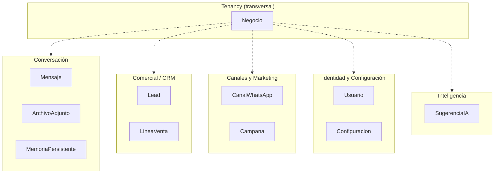
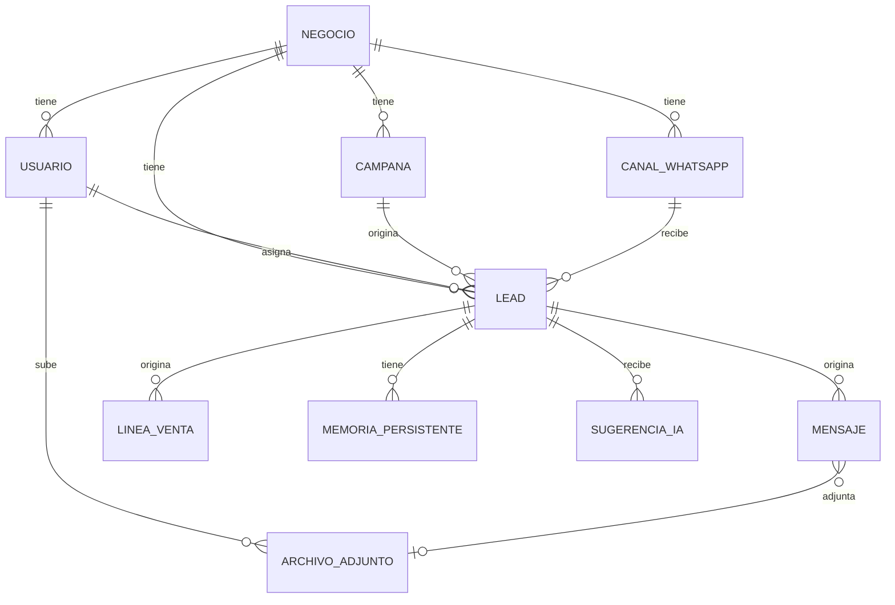

# Maiek AI — Data Architecture

**Versión 1.0 · Estado: Approved**

| | |
|---|---|
| Documento | Maiek Data Architecture |
| Proyecto | Maiek AI |
| Versión | 1.0 |
| Estado | **Approved** |
| Fecha de creación | 2026-07-28 |
| Autor | Claude, a pedido de Jesús Millones |
| Fecha de aprobación | 2026-07-28 |
| Última actualización | 2026-07-28 |

## Dependencias

- `MAIEK_AI_SYSTEM_ARCHITECTURE.md` (MSA) Capítulo 8 (Arquitectura de datos, alto nivel), Capítulo 11 (Architectural Constraints) y Capítulo 12 (Architectural Decisions — Multi-Tenant por fila, ya fijada, este documento la implementa, no la redecide).
- `MAIEK_AI_DATA_CURRENT_STATE_ASSESSMENT.md` (CSA-Data) — todo el diagnóstico, la matriz de Architectural Readiness y la tabla de priorización P1/P2/P3 son el punto de partida de este documento.
- `MAIEK_AI_ARCHITECTURE_DOCUMENT_STANDARD.md` (ADS) — estructura, formato de decisiones, checklist de QA.
- `MAIEK_AI_PRODUCT_EXPERIENCE.md` (MPX) Capítulo 8 (tres tipos de memoria) y Capítulo 10 (Experience Metrics) — condicionan las entidades de IA nuevas de este documento.
- `MAIEK_AI_PRODUCT_ARCHITECTURE.md` (MPA) — mapa de 9 módulos, usado como referencia para categorizar entidades, sin redefinir responsabilidades de módulo.

## Consumido por

Backend Architecture, AI Architecture, API Architecture, Security Architecture, DevOps Architecture (futuros) — todos heredan el modelo de datos objetivo y las decisiones de este documento.

## Control de versiones

| Versión | Fecha | Autor | Descripción |
|---|---|---|---|
| 1.0 (borrador) | 2026-07-28 | Claude | Primera versión — arquitectura objetivo del dominio de datos y plan de evolución desde el estado real diagnosticado en el CSA-Data. Pendiente de revisión y aprobación. |
| 1.0 (Approved) | 2026-07-28 | Claude | Revisión final de largo plazo: soft delete rediseñado (`eliminado_en`/`eliminado_por`, separado del estado de negocio `activo`, con capacidad de restauración auditable — Reversibilidad, MPX Cap. 1); estrategia de claves resuelta explícitamente a UUID como estándar para claves sustitutas nuevas, sin migrar retroactivamente las 5 PK autoincrement existentes; se agrega clasificación explícita de tipos de datos (Master Data/Transactional/Configuration/AI Knowledge/Audit) con implicancias para Security, DevOps y Operations; `RegistroAuditoria` declarado append-only, sin `UPDATE`/`DELETE`; se agrega sección de Data Ownership (propietario de escritura por categoría); se resuelve la ambigüedad `Configuracion` global vs. por Negocio (clave compuesta con cascada). Documento congelado como **Approved** — línea base técnica del dominio de datos. |
| 1.0 | 2026-09-12 | Claude | **Reconciliación — [ADR-0004](adr/0004-secuencia-data-fase2-vs-multitenant.md) precisa la dependencia de §6, Fase 3** ("Depende de: Fase 1 y Fase 2"). La implementación real de Multi-Tenant (`negocio_id`) avanzó sin esperar a que el resto de Fase 2 esté activo, por no existir dependencia técnica real entre `negocio_id` y `MemoriaPersistente`/`SugerenciaIA` (evidencia y análisis completos en ADR-0004). Esta Decisión (Multi-Tenant por fila, sección 4) no se modifica ni se redecide — se aclara únicamente que el resto pendiente de Fase 2 no bloquea el trabajo de Fase 3 ya en curso. El principio "Multi-Tenant by Design" (sección 2) permanece sin excepción: cuando `MemoriaPersistente`/`SugerenciaIA` se construyan, deberán nacer con `negocio_id` desde su creación. Data Architecture Fase 2 **no** se declara completa por este cambio — `MemoriaPersistente` y `SugerenciaIA` siguen sin implementar. Ninguna otra decisión de este documento se modifica. |

## Alcance y regla de no-duplicación

Este documento define el modelo de datos objetivo de Maiek AI y cómo se llega a él desde la implementación actual — no describe PostgreSQL ni SQLAlchemy como tecnologías genéricas, describe decisiones específicas para esta plataforma. No redefine qué hace el producto (MPA), cómo se comporta (MPX) ni la estrategia Multi-Tenant ya fijada en MSA Cap. 12 (la implementa). El contrato de API sobre estos datos es responsabilidad de API Architecture; la implementación de servicios es responsabilidad de Backend Architecture; este documento se detiene en el modelo y las decisiones, no en el código.

---

## 1. Executive Summary

El modelo de datos actual de Maiek AI sostiene correctamente el MVP de Gaso+, pero no está preparado para multi-tenant, tiene integridad referencial débil (sin `ForeignKey` reales) y no tiene mecanismo de migración formal — los tres bloqueos identificados como P1 en el CSA-Data. Esta arquitectura objetivo resuelve los tres, en ese orden de dependencia, junto con la corrección de deuda técnica puntual (precios como texto, soft-delete inconsistente) y la introducción de entidades de IA que hoy no existen pero que MPX ya requiere (memoria persistente, trazabilidad de sugerencias).

El documento no es una descripción ideal desconectada de la realidad — cada decisión está atada a un hallazgo real del CSA-Data, y el roadmap (sección 6) es la secuencia ejecutable, no una lista de deseos. El resultado esperado, al final de las 3 fases, es un modelo de datos con integridad referencial real, capaz de soportar más de un negocio (tenant), con migraciones versionadas y auditables — la base que Backend, AI y API Architecture necesitan para construirse sin heredar la deuda actual.

---

## 2. Principios de arquitectura de datos

Especializados para el dominio de datos — ninguno repite los principios de software del MSA Cap. 2 (Modular/Escalable/Reutilizable/Desacoplada/Extensible), cada uno tiene su propio criterio de verificación:

| Principio | Qué significa para el dato | Cómo se verifica |
|---|---|---|
| **Single Source of Truth** | Cada dato vive en una sola tabla/campo autoritativo — nada se persiste si puede derivarse. | Ningún campo nuevo se aprueba si su valor puede calcularse a partir de otro ya existente (ver `Lead.producto_vendido` legacy, CSA §13, como ejemplo de la violación que se corrige). |
| **Referential Integrity First** | Toda relación lógica identificada en el CSA-Data se convierte en `ForeignKey` real. | Ninguna tabla nueva referencia a otra con un campo `String` suelto — la ausencia de FK requiere justificación explícita documentada en este mismo documento, nunca silenciosa. |
| **Multi-Tenant by Design** | Todo modelo nuevo incluye `negocio_id` desde su creación, no como agregado posterior. | Ningún modelo se aprueba sin ese campo, salvo que sea explícitamente de configuración global de plataforma. |
| **Configuration over Code** | Valores enumerados de negocio (`paso_flujo`, `resultado`, `rol`) se gestionan con restricciones de base de datos o catálogos configurables, no solo con validación en Python. | Todo campo con un conjunto cerrado de valores lleva `CheckConstraint` o tabla de catálogo — nunca solo un comentario en el modelo. |
| **Auditability by Default** | Todo modelo nuevo lleva `creado`/`actualizado`; no es opcional. | Una tabla nueva sin ambos campos se rechaza en revisión, salvo justificación explícita (ej. tablas puramente de catálogo estático). |
| **Soft Delete Consistency** | Un único mecanismo genérico de borrado lógico (`eliminado_en`/`eliminado_por`), distinto del estado de negocio activo/inactivo — "borrado" y "pausado" no son el mismo concepto y nunca comparten campo. | Ninguna tabla nueva introduce un campo de borrado con nombre o semántica distinta a `eliminado_en`/`eliminado_por`; un campo `activo` en cualquier tabla siempre significa estado de negocio, nunca borrado. |
| **Backward Compatibility durante la migración** | Todo cambio de esquema se despliega sin romper el código en producción durante la transición. | Toda migración sigue el patrón expand-contract (agregar antes de usar, remover solo después de que nada lo use) — nunca un cambio destructivo en un solo paso. |

---

## 3. Arquitectura objetivo

### Clasificación de tipos de datos

Cinco categorías — no solo agrupan entidades, definen implicancias directas para Security, DevOps y Operations Architecture cuando se construyan:

| Categoría | Entidades | Sensibilidad (Security) | Volumen/Crecimiento (DevOps) | Criticidad de backup (Operations) |
|---|---|---|---|---|
| **Master Data** | `Negocio` *(nueva)*, `Usuario`, `CanalWhatsApp`, `Campana` | Alta — credenciales cifradas (`CanalWhatsApp`), credenciales de acceso (`Usuario`) | Bajo, crece lento | Crítico — su pérdida bloquea la operación completa |
| **Transactional** | `Lead`, `Mensaje`, `LineaVenta`, `ArchivoAdjunto` | Alta — datos personales de clientes reales | Alto, crece con cada interacción | Crítico — es el valor de negocio central |
| **Configuration** | `Configuracion` | Media — puede contener prompts/reglas internas sensibles | Muy bajo | Alto — su pérdida afecta comportamiento, no datos históricos |
| **AI Knowledge** | `MemoriaPersistente` *(nueva)*, `SugerenciaIA` *(nueva)* | Alta — memoria persistente equivale a datos personales inferidos | Medio-alto | Medio — parcialmente reconstruible desde interacciones futuras, con pérdida de contexto histórico |
| **Audit** | `RegistroAuditoria` *(nueva)* | Alta — es el registro de acciones sensibles en sí mismo | Alto, solo-append (nunca se actualiza ni se borra, ver sección 4) | Crítico, no negociable — es la evidencia de cumplimiento |

`Negocio` es la entidad fundacional de la que todas las demás (salvo `Configuracion` en su modo global, ver sección 4) dependen vía `negocio_id` — es la base física de Multi-Tenant by Design.

### Data Ownership

Qué componente (ya definido en MSA Cap. 5-6, no redefinido acá) es dueño de escribir cada categoría, y quién solo la consume:

| Categoría | Propietario (escribe) | Consumidores (solo lectura) |
|---|---|---|
| Master Data | Panel/Dashboard — administración humana | Todos los componentes, como referencia |
| Transactional | Webhook Handler + Servicio de Mensajería (mensajes entrantes/salientes); Panel (edición manual de Lead/LineaVenta por un asesor) | AI Engine, Servicio de Analítica |
| Configuration | Panel/Dashboard — administración humana | Todos los componentes |
| AI Knowledge | AI Engine, en exclusiva — ningún otro componente escribe memoria ni sugerencias directamente | Panel (mostrar al asesor), Servicio de Analítica (Experience Metrics) |
| Audit | Cualquier componente que ejecute una acción sensible escribe su propio evento — nunca "en nombre de" otro | Security/Operations Architecture (lectura exclusiva; nunca consumido por lógica de negocio en tiempo real) |

Un componente que necesita un dato del que no es propietario lo **consume**, nunca lo escribe directamente — si dos componentes necesitaran escribir la misma categoría, es señal de que la responsabilidad no está bien asignada, a resolver en Backend Architecture, no ignorarlo acá.

### Entidades nuevas — propósito conceptual (sin esquema completo, eso es Backend Architecture)

- **`Negocio`** — un tenant. Identificador, nombre, estado activo. Toda tabla de negocio referencia acá.
- **`MemoriaPersistente`** — hechos y preferencias declarados por un usuario que sobreviven entre sesiones y canales (MPX Cap. 8) — separada de `Mensaje` (memoria conversacional) precisamente para respetar el límite entre los tres tipos de memoria ya definido en MPX.
- **`SugerenciaIA`** — registro de cada sugerencia que el AI Engine (MSA Cap. 6-7) produjo: qué recomendó, nivel de confianza, si se aceptó o se ignoró. Es lo que hace medible la "tasa de aceptación de sugerencias" ya declarada como Experience Metric en MPX Cap. 10 — sin esta tabla, esa métrica no tiene de dónde salir.
- **`RegistroAuditoria`** — quién, cuándo, qué acción, sobre qué entidad — para las acciones ya clasificadas como irreversibles o sensibles en MPX Cap. 1 y exigidas por MSA Cap. 13.

### Bounded contexts

No se fuerzan bounded contexts donde el dominio todavía es simple — se identifican 4, alineados a módulos ya existentes del MPA, sin redefinir sus responsabilidades:

*(Auditoría, `RegistroAuditoria`, no aparece como contexto propio — es transversal, escrita desde cualquier contexto, nunca leída por ellos.)*

### Relaciones objetivo (con Foreign Key real)

---

## 4. Decisiones arquitectónicas

Formato ADS (Decisión / Estado / Justificación / Criterio de revisión) — prosa breve por decisión, tabla resumen al final.

**Estrategia Multi-Tenant.** Aislamiento a nivel de fila: nueva tabla `Negocio`, campo `negocio_id` (FK) en toda tabla de negocio. Implementa la decisión ya fijada en MSA Cap. 12 — no se redecide acá, se ejecuta.

**Foreign Keys.** Las 7 relaciones sueltas identificadas en el CSA-Data (§3) se convierten en `ForeignKey` real. Política de borrado por defecto: `RESTRICT` (no se permite borrar un padre con hijos activos) salvo dos excepciones documentadas: `Lead.campana_origen` usa `SET NULL` (una campaña vieja puede desaparecer sin invalidar el lead que originó), `LineaVenta→Lead` usa `CASCADE` (una línea de venta no tiene sentido sin su lead).

**Estrategia de claves.** Se estandariza **UUID** (preferentemente UUIDv7, ordenable por tiempo, para no perder localidad de índice frente a un UUID puramente aleatorio) como clave sustituta técnica — se resuelve así la ambigüedad "autoincrement o UUID" del borrador anterior. Aplica a las claves sustitutas nuevas de `Lead` y `Usuario` (hoy sin ninguna) y a las 4 entidades enteramente nuevas (`Negocio`, `MemoriaPersistente`, `SugerenciaIA`, `RegistroAuditoria`). Razón, pensando en largo plazo: un UUID no filtra volumen/crecimiento entre tenants a través de un ID secuencial expuesto en la futura API, y no requiere coordinación si `Mensaje` se particiona en el futuro (sección 4, Particionado). `telefono`/`username` se mantienen como columna única indexada, nunca como PK.

*No se migran retroactivamente* las 5 PK autoincrement ya existentes (`Mensaje`, `ArchivoAdjunto`, `LineaVenta`, `Campana`, `CanalWhatsApp`) — el costo de migrar un PK ya en producción, con FKs apuntándolo, no se justifica sin evidencia real de un problema (Evidence over Opinion, MPX Cap. 11). UUID es el estándar para toda clave sustituta *nueva* desde ahora, no una orden de reescribir lo ya construido.

**Auditoría.** Se mantiene la convención existente `creado`/`actualizado` (no se renombra por preferencia estética — Stable by Default) y se extiende a las 6 tablas que hoy no la tienen completa. Además, `RegistroAuditoria` cubre las acciones irreversibles/sensibles que un timestamp de fila no puede explicar por sí solo (quién, no solo cuándo).

**`RegistroAuditoria` es append-only.** Ninguna fila de `RegistroAuditoria` se actualiza ni se borra, nunca — ni siquiera con soft delete. Es la única tabla del esquema que **no** lleva `actualizado` (excepción explícita y justificada al principio Auditability by Default, sección 2: un registro de auditoría mutable deja de ser evidencia). La aplicación no debe tener permiso de `UPDATE`/`DELETE` sobre esta tabla a nivel de motor de base de datos — el mecanismo exacto de ese permiso (rol de BD separado, trigger de rechazo) es responsabilidad de implementación de Backend/DevOps Architecture; acá se fija la regla, no el mecanismo.

**Soft delete.** Dos conceptos distintos que el borrador anterior conflacionaba en un solo campo `activo` — se separan:
- **Estado de negocio** (`activo: Boolean, default True`) — un registro sigue siendo válido pero está pausado por decisión de negocio (ej. `CanalWhatsApp` desactivado temporalmente, `Campana` pausada). Se mantiene tal como existe hoy.
- **Eliminación lógica** (`eliminado_en: DateTime, nullable` + `eliminado_por: FK a Usuario, nullable`) — el registro fue borrado desde la perspectiva del usuario, pero se conserva para auditoría y **restauración** (mismo criterio de Reversibilidad y Modelo de deshacer ya definido en MPX Cap. 1 — un registro "eliminado" puede deshacerse mostrando quién y cuándo lo borró, no solo un booleano sin contexto). `eliminado_en IS NULL` = registro vigente.

Ambos campos pueden coexistir en una misma tabla sin conflicto — son preguntas distintas ("¿está pausado?" vs. "¿fue borrado?"). DELETE físico queda reservado solo para datos genuinamente efímeros o derivados sin identidad propia (`LineaVenta` mantiene su patrón de reemplazo total, documentado como excepción intencional, no como deuda).

**Configuración global vs. por Negocio.** `Configuracion` pasa a clave compuesta `(clave, negocio_id)`, con `negocio_id` nullable. `negocio_id = NULL` es el valor **global de plataforma** (default para todo tenant que no tenga override); `negocio_id = <id>` es un **override específico de ese negocio**. Resolución en cascada: se busca primero la fila del negocio, y si no existe, se cae al valor global — nunca al revés. Esta tabla es la excepción explícita a la estandarización de UUID (arriba): su clave natural compuesta *es* el patrón de acceso real (se consulta por `clave`+`negocio_id`, nunca por un id sintético), un UUID acá sería sobrecosto sin beneficio.

**Migraciones.** Se adopta Alembic. Toda migración sigue expand-contract (Backward Compatibility, principio 2). `Base.metadata.create_all` queda restringido a entornos de desarrollo/test — nunca la vía de cambio de esquema en producción una vez Alembic esté activo.

**Versionado del esquema.** Cada migración de Alembic queda numerada y versionada en el repo, con mensaje descriptivo — mismo criterio de trazabilidad que el Control de versiones de los documentos.

**Índices.** Política: todo campo usado en `WHERE`/`JOIN`/`ORDER BY` de una query real en producción lleva índice. Se extiende explícitamente a `negocio_id` en cada tabla multi-tenant — será el filtro más frecuente de todo el sistema una vez exista más de un negocio.

**Particionado futuro.** No se implementa ahora — **Objetivo**, no Activa. Candidata: particionar `Mensaje` por `negocio_id` o por rango de fecha si el volumen lo exige, decidido con evidencia real (Evidence over Opinion, MPX Cap. 11), no por anticipación.

**Políticas de retención.** Data Architecture prepara el mecanismo (campo de política de retención configurable por negocio, vía `Configuracion`), no la política legal exacta — eso es una brecha explícita hacia Security Architecture (sección 8).

**Precios como tipo numérico.** `Lead.precio_venta`, `LineaVenta.precio`, `Campana.precio_promocional` migran de `String` a `Numeric` con precisión fija — nunca `Float` para dinero.

### Resumen

| Decisión | Estado | Justificación | Criterio de revisión |
|---|---|---|---|
| Multi-Tenant por fila (`Negocio` + `negocio_id`) | Objetivo | Bloqueante P1 del CSA-Data; ya fijada como decisión de plataforma en MSA Cap. 12 | No se revisa — se implementa; solo el ritmo de rollout se ajusta con evidencia |
| Foreign Keys reales | Objetivo | Integridad referencial hoy ausente (CSA-Data §3) | Se revisa si una FK específica genera fricción operativa real medida, no antes |
| UUID como clave sustituta estándar (nuevas, no retroactivo) | Objetivo | Clave natural frágil ante cambio de teléfono/username; UUID no filtra volumen entre tenants ni requiere coordinación si se particiona | Se revisa solo con evidencia real de un problema de performance de índice, no antes |
| Auditoría completa + `RegistroAuditoria` append-only | Objetivo | Solo 2/8 tablas auditadas hoy; sin trazabilidad de acciones sensibles; un log de auditoría mutable no es evidencia | El carácter append-only no se revisa nunca — es la definición misma de la tabla |
| Soft delete: `eliminado_en`/`eliminado_por`, separado de `activo` (estado de negocio) | Objetivo | 3 patrones ad-hoc hoy (CSA-Data §7); "borrado" y "pausado" son conceptos distintos que un solo booleano confundía | — |
| Configuración global vs. por Negocio (clave compuesta, cascada) | Objetivo | Ambigüedad real detectada en revisión — sin esto, Multi-Tenant deja `Configuracion` sin resolver | — |
| Alembic (migraciones formales) | Objetivo | `create_all` no altera tablas existentes — riesgo de drift ya documentado | — |
| Índice en `negocio_id` | Objetivo | Será el filtro más común una vez exista multi-tenant | Se verifica con métricas reales de query una vez en producción |
| Particionado de `Mensaje` | Objetivo, diferido | Sin evidencia de volumen que lo justifique hoy | Se activa solo con evidencia real de degradación de performance |
| Precios como `Numeric` | Objetivo | Deuda técnica P1, riesgo de datos mal formados ya presente | — |

---

## 5. Gap Analysis

| Tema | Estado actual | Objetivo | Impacto | Prioridad |
|---|---|---|---|---|
| Multi-Tenant | Ausente — cero campos de tenant | `Negocio` + `negocio_id` en todo modelo de negocio | Bloqueante para SaaS multiempresa | P1 |
| Integridad referencial | Sin `ForeignKey` reales | FKs reales con política de borrado explícita | Riesgo de datos huérfanos, crece con el volumen | P1 |
| Migraciones de esquema | Sin Alembic, `create_all` únicamente | Alembic con expand-contract | Riesgo de drift; bloquea desplegar el resto de esta arquitectura con seguridad | P1 |
| Precios | `String` en 3 tablas | `Numeric` con precisión fija | Riesgo de datos mal formados, ya presente | P1 |
| Estrategia de claves | Clave natural como PK en `Lead`/`Usuario` | UUID como clave sustituta (nuevas, no retroactivo) + unique en la natural | Fragilidad ante cambio de teléfono/username | P2 |
| Soft delete | 3 patrones ad-hoc, "borrado" y "pausado" confundidos en un campo | `eliminado_en`/`eliminado_por` separado de `activo` (estado de negocio) | Inconsistencia operativa; sin capacidad real de restauración auditable | P2 |
| Auditoría | 2/8 tablas completas, sin log transversal | 8/8 + `RegistroAuditoria` append-only | Sin trazabilidad de acciones sensibles hoy | P2 |
| Entidades de IA | No existen | `MemoriaPersistente`, `SugerenciaIA` | Bloquea medir Experience Metrics de MPX Cap. 10 (aceptación de sugerencias) | P2 |
| `Configuracion` multi-tenant | Clave/valor sin negocio_id, sin resolver global vs. por tenant | Clave compuesta `(clave, negocio_id)` con cascada global→override | Ambigüedad real si se activa Multi-Tenant sin resolverlo antes | P2 |
| Índices en `negocio_id` | No aplica todavía | Índice en toda tabla multi-tenant | Performance, solo relevante tras Fase 3 | P3 |
| Particionado | No existe | Diferido, sin decisión activa | Ninguno hoy | P3 |

---

## 6. Roadmap de evolución

Tres fases, en orden de dependencia estricta — cada una depende de que la anterior esté completa, no son paralelas:

### Fase 1 — Fundación de evolución segura
**Depende de:** nada — es el punto de partida obligatorio.
- Adoptar Alembic; generar la migración inicial (baseline) que replica el esquema actual exactamente, sin ningún cambio de negocio todavía.
- A partir de acá, `create_all` deja de usarse como mecanismo de cambio en producción.

*Sin esta fase, ninguna de las siguientes puede desplegarse con seguridad — es la que habilita a todas las demás, no una mejora paralela.*

### Fase 2 — Integridad, corrección y entidades de IA
**Depende de:** Fase 1 (necesita Alembic para ejecutarse sin riesgo de drift).
- Limpiar filas huérfanas existentes (paso previo obligatorio antes de aplicar cualquier FK).
- Agregar `ForeignKey` reales con la política de borrado ya definida (sección 4).
- Migrar precios de `String` a `Numeric` (con limpieza/parsing de valores mal formados existentes).
- Introducir `eliminado_en`/`eliminado_por` donde se necesite borrado lógico, sin tocar el significado de los campos `activo` ya existentes (estado de negocio, no borrado).
- Completar auditoría (`creado`/`actualizado`) en las 6 tablas restantes.
- Crear `MemoriaPersistente`, `SugerenciaIA`, `RegistroAuditoria` (tablas nuevas, aditivas, sin riesgo sobre datos existentes) — `RegistroAuditoria` se despliega append-only desde el primer día, sin permiso de `UPDATE`/`DELETE` para la aplicación.

### Fase 3 — Multi-Tenant
**Depende de:** Fase 1 y Fase 2 (necesita integridad de datos ya resuelta y migraciones seguras antes de particionar por tenant).

*Nota de reconciliación ([ADR-0004](adr/0004-secuencia-data-fase2-vs-multitenant.md), 2026-09-12, Aceptada): esta dependencia con Fase 2 rige para que `MemoriaPersistente`/`SugerenciaIA` nazcan con `negocio_id` desde su creación (Multi-Tenant by Design, sección 2) — no bloquea el trabajo de esta Fase 3 ya en curso, que no tiene dependencia técnica real con esas dos entidades ni con el resto de Fase 2 (FKs legacy, `Numeric`, soft delete). Data Architecture Fase 2 permanece incompleta — `MemoriaPersistente` y `SugerenciaIA` siguen sin implementar.*
- Crear tabla `Negocio`.
- Agregar `negocio_id` a las 8 tablas existentes + las 3 nuevas de Fase 2.
- Migrar `Configuracion` a clave compuesta `(clave, negocio_id)` con resolución en cascada (global → override).
- Backfill: asignar todos los datos existentes al tenant "Gaso+" (único negocio real hoy).
- Agregar índice en `negocio_id` en cada tabla.

*Los ítems P3 del CSA-Data (pool de conexiones, centralizar reescritura de `DATABASE_URL`, nombres de booleanos) no forman parte de este roadmap — quedan como mejoras oportunistas a resolver durante Backend/DevOps Architecture, sin bloquear ninguna fase.*

---

## 7. Riesgos

1. **Datos huérfanos existentes al aplicar FKs** — puede haber filas que ya violan la integridad referencial implícita; requiere limpieza caso por caso antes de la Fase 2, no automatizable sin revisión.
2. **Precios mal formados en texto libre** (ej. "S/ 350", "350 soles") — el parsing a `Numeric` puede fallar silenciosamente si no se valida explícitamente antes de la migración.
3. **Backfill de `negocio_id` en `Mensaje`** — es la tabla de mayor volumen; el backfill debe probarse en un entorno equivalente antes de ejecutarse en producción para evitar downtime.
4. **Curva de aprendizaje de Alembic** — fricción operativa inicial en un equipo pequeño, mitigado por ser una herramienta estándar de la comunidad SQLAlchemy, no una construcción propia.
5. **Supuesto de tenant único en el backfill** — si existiera algún dato ya mezclado de más de un negocio (baja probabilidad hoy), el backfill simple "todo es Gaso+" sería incorrecto — debe verificarse explícitamente antes de ejecutar la Fase 3, no asumirse.

---

## 8. Brechas abiertas

Solo las que corresponden a otro documento derivado — no se resuelven acá:

- **Política legal de retención de datos** (plazo exacto, cumplimiento normativo) — Security Architecture. Ya señalada como riesgo aceptado en `MAIEK_AI_ARCHITECTURE_BASELINE_V1.md`.
- **Mecanismo de autenticación/sesión al panel** — Security Architecture. `Usuario.password_hash` ya existe; el flujo de sesión/token no es de este documento.
- **Configuración de pool de conexiones bajo carga real** — DevOps Architecture.
- **Contrato de API para exponer estas entidades** — API Architecture. Este documento define el modelo, no el contrato HTTP.
- **Particionado físico de `Mensaje`, si el volumen lo exige** — Backend/DevOps Architecture, con evidencia real, no antes.

---

## 9. QA Arquitectónico

Checklist del ADS (sección 11) aplicado:

1. ¿Declara Dependencias y Consumido por, citando capítulos exactos del MSA? — Sí (Cap. 8, 11, 12).
2. ¿Ninguna sección redefine contenido ya cerrado en otros documentos? — Sí; Multi-Tenant se implementa, no se redecide; memoria e IA citan MPX sin redefinirlo.
3. ¿Toda decisión propia sigue el formato Decisión/Estado/Justificación/Criterio de revisión? — Sí, sección 4.
4. ¿Toda brecha conocida está declarada con dueño? — Sí, sección 8, ninguna sin dueño.
5. ¿Toda referencia cruzada cita capítulo/sección exacta? — Sí.
6. ¿Actualiza el mapa y la tabla de `DOCUMENTATION_INDEX.md`? — Pendiente al commit.
7. ¿Nivel de detalle alto nivel, sin caer en implementación completa? — Sí; entidades nuevas descritas por propósito, no por esquema SQL completo.
8. ¿Una persona nueva, leyendo esto y el MSA, entendería el dominio sin preguntar? — Sí.
9. ¿Aporta conocimiento nuevo o duplica información existente? — Aporta: ninguna decisión de esta sección existía antes en ningún documento del corpus.

No se detectaron contradicciones con MSA, MPX, MPA ni con el CSA-Data.

---

*Fin del documento — Approved. Línea base técnica oficial del dominio de datos de Maiek AI.*
