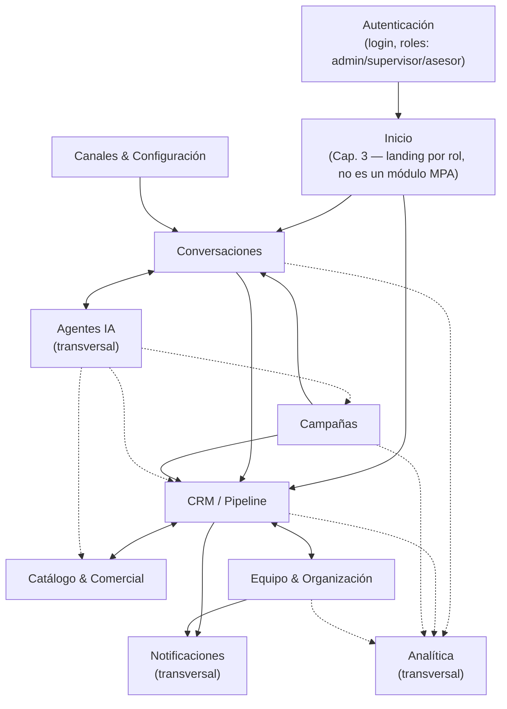

# Maiek AI — Auditoría Funcional (Master Product Map)

**Corte: 2026-07-31 · Naturaleza: Documento de auditoría histórica, no rector**

| | |
|---|---|
| Documento | Auditoría Funcional — Master Product Map |
| Proyecto | Maiek AI |
| Fecha de corte | 2026-07-31 |
| Autor | Claude, a pedido de Jesús Millones |
| Naturaleza | **Diagnóstico** (ver Entregable 3 — no es Rector, Especializado, Implementación funcional ni técnica) |
| Estado | Cierre de auditoría — no registrado en `DOCUMENTATION_INDEX.md` por decisión explícita del usuario |

## Naturaleza del documento — leer antes que el resto

Esta auditoría **describe el estado del producto en la fecha de corte** — no lo define ni lo gobierna.
No es un documento rector: no compite con `MAIEK_AI_PRODUCT_ARCHITECTURE.md` (MPA),
`MAIEK_AI_PRODUCT_EXPERIENCE.md` (MPX), `MAIEK_AI_PRODUCT_PATTERNS.md`, el resto del corpus técnico,
ni con `DOCUMENTATION_INDEX.md`. Ante cualquier conflicto aparente entre lo que dice esta auditoría y
lo que dice uno de esos documentos, **gana el documento del corpus** — esta auditoría es, en los
términos de su propio Entregable 3, un documento de rol **Diagnóstico**: constata, no decide.

No está registrada en `DOCUMENTATION_INDEX.md` — decisión explícita del usuario al cerrar esta fase,
consistente con el tratamiento ya dado a otros documentos históricos del proyecto (`RELEASE_NOTES_v0.2.0.md`,
los `IMPLEMENTATION_REVIEW_*.md`, `DEPLOYMENT_CHECKLIST_v0.2.0.md`).

**Propósito**: insumo principal para el diseño UX integral de Maiek AI, próxima fase del proyecto.
Construida en 5 entregables, cada uno revisado y aprobado explícitamente antes de avanzar al
siguiente, siguiendo el mismo ciclo institucionalizado en `MAIEK_AI_IMPLEMENTATION_ROADMAP.md` §2.1.

**Regla seguida en toda la auditoría**: no asumir funcionalidades no documentadas, no proponer
desarrollos nuevos, basarse únicamente en la documentación y el código existente, distinguir
siempre qué está definido, qué está implementado y qué todavía no existe.

---

## Entregable 1 — Inventario completo del corpus documental

42 documentos en la raíz del repositorio (excluyendo `README.md`, genérico de AgentKit) + 3 ADRs +
6 archivos de `knowledge/` (base de conocimiento de Gabi, fuera de alcance) + `graphify-out/GRAPH_REPORT.md`
(autogenerado, fuera de alcance).

### A. Fundacionales
| Documento | Ciclo de vida | Responsabilidad |
|---|---|---|
| `MAIEK_AI_FRAMEWORK.md` | Legacy | Gobernanza |
| `MAIEK_AI_ARCHITECTURE_BASELINE_V1.md` (MAB) | Activo | Gobernanza |

### B. Producto
| Documento | Ciclo de vida | Responsabilidad |
|---|---|---|
| `MAIEK_AI_PRODUCT_ARCHITECTURE.md` (MPA) | Activo | Producto |
| `MAIEK_AI_PRODUCT_EXPERIENCE.md` (MPX) | Activo | Producto |
| `MAIEK_AI_PRODUCT_PATTERNS.md` | Activo | Producto *(reclasificado desde UX — define comportamiento funcional, no solo experiencia visual)* |

### C. Diseño
| Documento | Ciclo de vida | Responsabilidad |
|---|---|---|
| `MAIEK_AI_DESIGN_SYSTEM.md` (MDL) | Activo | UX |
| `MAIEK_AI_COMPONENT_SYSTEM.md` (CDS) | Activo | UX |

### D. Arquitectura técnica
| Documento | Ciclo de vida | Responsabilidad |
|---|---|---|
| `MAIEK_AI_SYSTEM_ARCHITECTURE.md` (MSA) | Activo | Arquitectura |
| `MAIEK_AI_PLATFORM_ARCHITECTURE.md` | Superseded | Arquitectura |
| `MAIEK_AI_DATA_ARCHITECTURE.md` | Activo | Arquitectura |
| `MAIEK_AI_DATA_CURRENT_STATE_ASSESSMENT.md` (CSA) | Activo | Ingeniería |
| `MAIEK_AI_BACKEND_ARCHITECTURE.md` | Activo | Arquitectura |
| `MAIEK_AI_BACKEND_CURRENT_STATE_ASSESSMENT.md` (CSA) | Activo | Ingeniería |
| `MAIEK_AI_API_ARCHITECTURE.md` | Activo | Arquitectura |
| `MAIEK_AI_API_CURRENT_STATE_ASSESSMENT.md` (CSA) | Activo | Ingeniería |
| `MAIEK_AI_AI_ARCHITECTURE.md` | Activo | IA |
| `MAIEK_AI_AI_CURRENT_STATE_ASSESSMENT.md` (CSA) | Activo | IA |
| `MAIEK_AI_SECURITY_ARCHITECTURE.md` | Activo | Arquitectura |
| `MAIEK_AI_SECURITY_CURRENT_STATE_ASSESSMENT.md` (CSA) | Activo | Ingeniería |
| `MAIEK_AI_DEVOPS_ARCHITECTURE.md` | Activo | DevOps |
| `MAIEK_AI_DEVOPS_CURRENT_STATE_ASSESSMENT.md` (CSA) | Activo | DevOps |
| `MAIEK_AI_OPERATIONS_ARCHITECTURE.md` | Activo | Operaciones |
| `MAIEK_AI_OPERATIONS_CURRENT_STATE_ASSESSMENT.md` (CSA) | Activo | Operaciones |
| `MAIEK_AI_FRONTEND_ARCHITECTURE.md` | Activo | Arquitectura |
| `MAIEK_AI_FRONTEND_CURRENT_STATE_ASSESSMENT.md` (CSA) | Activo | Ingeniería |

### E. Puente arquitectura → implementación
| Documento | Ciclo de vida | Responsabilidad |
|---|---|---|
| `MAIEK_AI_IMPLEMENTATION_ROADMAP.md` | Activo | Ingeniería |
| `MAIEK_AI_ADR_INDEX.md` | Activo | Ingeniería |
| `MAIEK_AI_PHASE_1_EXECUTION_PLAN.md` | Activo | Ingeniería |
| `MAIEK_AI_OPERATIONS_RUNBOOK.md` | Operativo | Operaciones |
| `MAIEK_AI_CONVERSATIONAL_VALIDATION_PLAN.md` | Operativo | IA |

### F. Negocio
| Documento | Ciclo de vida | Responsabilidad |
|---|---|---|
| `GASOPLUS_PRODUCT_FRAMEWORK.md` | Legacy | Negocio |
| `CALIDDA_CLIENT_FRAMEWORK.md` | Legacy | Negocio |

### G. Gobernanza
| Documento | Ciclo de vida | Responsabilidad |
|---|---|---|
| `MAIEK_AI_ARCHITECTURE_DOCUMENT_STANDARD.md` (ADS) | Activo | Gobernanza |
| `DOCUMENTATION_INDEX.md` | Activo | Gobernanza |

### H. Seguimiento de cambios
| Documento | Ciclo de vida | Responsabilidad |
|---|---|---|
| `CHANGELOG.md` | Activo | Gobernanza |

### I. ADRs
| Documento | Ciclo de vida | Responsabilidad |
|---|---|---|
| `adr/0000-template.md` | Activo | Gobernanza |
| `adr/0001-backup-postgres-pg-dump-s3.md` | Histórico | DevOps |
| `adr/0002-independencia-proveedor-backups.md` | Histórico | DevOps |

### J. No registrados en `DOCUMENTATION_INDEX.md` (hallazgo — tratado en Entregable 4)
| Documento | Ciclo de vida | Responsabilidad |
|---|---|---|
| `RELEASE_NOTES_v0.2.0.md` | Histórico | Producto |
| `DEPLOYMENT_CHECKLIST_v0.2.0.md` | Operativo | Operaciones |
| `IMPLEMENTATION_REVIEW_FASE_0.md` | Histórico | Ingeniería |
| `IMPLEMENTATION_REVIEW_FASE_1.md` | Histórico | Ingeniería |
| `IMPLEMENTATION_REVIEW_PRE_DEPLOYMENT_FASE_1.md` | Histórico | Ingeniería |
| `MAIEK_AI_PHASE_2_STRATEGIC_PLAN.md` | Draft (abandonado) | Producto |

**Caso especial — `CLAUDE.md`**: Activo, Gobernanza — no es del corpus de producto/arquitectura, pero
gobierna el proceso de trabajo desde el cierre de los Sprints 1-3 (referencia a `MAIEK_AI_IMPLEMENTATION_ROADMAP.md` §2.1).

---

## Entregable 2 — Mapa Funcional del Producto

Los 9 módulos son los definidos en MPA §2 — verificado contra el documento real, no asumido.
**"Inicio" no es uno de los 9 módulos** (es un ítem de navegación §10 y un patrón de Product Patterns
Cap. 3, distinto de la lista de módulos funcionales).

### Recorrido completo (autenticación → operación)

*(Base: diagrama conceptual de MPA §16, con Autenticación e Inicio agregados al inicio del recorrido.)*

### Vista ejecutiva por dominio

| Dominio | Madurez funcional predominante | Despliegue predominante | Resumen |
|---|---|---|---|
| **Producto** (Conversaciones, CRM/Pipeline, Campañas, Catálogo) | Mixto — núcleo en 5, patrón dedicado más reciente (Cap. 6) en 3 | Mixto | El core funcional opera hace semanas; el patrón de UI dedicado más nuevo está construido, sin desplegar. |
| **IA / Copiloto** | Mixto — Gabi en 5, protocolo de confianza (mecanismo 4 / calidad conversacional 3), Resumen en 3, resto en 0-2 | Mixto | La brecha más grande entre lo documentado y lo operativo — motivo directo del Sprint de Validación. |
| **UX / Sistema de diseño** | 2 (Documentado) en la mayor parte del panel; 3 puntual donde ya se aplicó `--mdl-*` | Los puntos ya alineados están en local | MDL/CDS completos desde julio; el panel real recién empezó a migrar, pantalla por pantalla. |
| **Plataforma / Arquitectura técnica** | Arquitectura base consolidada (decisiones `Activa` implementadas); evolución de plataforma en curso (SaaS multiempresa, Deployment Strategy, entre otras `Objetivo`) | Producción (base) / N/A (iniciativas `Objetivo`) | Base sólida y validada; no "terminada" — sigue evolucionando por decisiones ya identificadas y no ejecutadas. |
| **Configuración** (Canales, Equipo) | 5 en lo operativo diario; 2 en alta de usuarios | Producción (con esa excepción puntual) | Funciona a diario; un hueco puntual ya documentado. |
| **Operaciones** (Notificaciones, Analítica, Runbook) | 5 | Producción | Estable, sin cambios recientes. |
| **SaaS / Multi-tenant** | 1 (Conceptual) | No existe código | `negocio_id` sigue siendo visión — hallazgo transversal repetido en los 8 CSA. |
| **Gobernanza documental** | 5 | — (no aplica a documentación) | Corpus consistente; 6 documentos sin registrar (Entregable 1/4). |

### Los 9 módulos — madurez funcional y despliegue como dimensiones independientes

| Módulo | Madurez funcional | Estado de despliegue |
|---|---|---|
| **Conversaciones** | 5 — Operativo | Producción |
| **Agentes IA** | Mixto — ver desglose | Mixto — ver desglose |
| **CRM / Pipeline** | Mixto — ver desglose | Mixto — ver desglose |
| **Campañas** | 5 — Operativo (alineación con Cap. 7.B no verificada) | Producción |
| **Catálogo & Comercial** | Mixto — ver desglose | Mixto — ver desglose |
| **Equipo & Organización** | Mixto — ver desglose | Mixto — ver desglose |
| **Analítica** | 5 — Operativo (alineación con Cap. 4 no verificada) | Producción |
| **Canales & Configuración** | 5 — Operativo | Producción |
| **Notificaciones** | 5 (en producto) / 1 (correo/push) | Producción / N/A |

#### Desglose — Agentes IA
| Capacidad | Madurez funcional | Despliegue |
|---|---|---|
| Respuesta automática (Gabi) | 5 — Operativo | Producción |
| Protocolo de confianza — mecanismo técnico | 4 — Validado (llamadas reales a la API, Fase 1) | Producción (activo solo en `modo="pruebas"`) |
| Protocolo de confianza — calidad conversacional/calibración | 3 — Implementado | Producción (validación formal pendiente) |
| Resumen de conversación (Copiloto) | 3 — Implementado | Local, no desplegado |
| Scoring de lead / Recomendación / Cotización asistida | 0 — No existe | N/A |
| Sugerencias IA / Indicador de confianza / Acciones IA | 2 — Documentado | N/A |

#### Desglose — CRM / Pipeline
| Capacidad | Madurez funcional | Despliegue |
|---|---|---|
| Núcleo (Lead, resultado, asignación, venta) sin patrón dedicado | 5 — Operativo | Producción |
| Patrón completo Cap. 6 (Data Grid, Timeline, conflicto de edición) | 3 — Implementado | Local, no desplegado |

#### Desglose — Catálogo & Comercial
| Capacidad | Madurez funcional | Despliegue |
|---|---|---|
| Citar catálogo/precio, cierre de venta con financiamiento | 5 — Operativo | Producción |
| Gestión de catálogo vía panel | 3 — Implementado (limitado, disco efímero) | Producción |

#### Desglose — Equipo & Organización
| Capacidad | Madurez funcional | Despliegue |
|---|---|---|
| Disponibilidad, asignación, balance de carga | 5 — Operativo | Producción |
| Alta de usuarios | 2 — Documentado/codificado, no utilizable | N/A (sin UI expuesta) |

### Fuera de los 9 módulos, pero real en el recorrido
| Elemento | Madurez funcional | Despliegue |
|---|---|---|
| Autenticación | 5 — Operativo | Producción |
| Inicio (Cap. 3) | 3 — Implementado | Local, no desplegado |

---

## Entregable 3 — Matriz Documento → Funcionalidad

### Leyenda de roles (resuelve contradicciones futuras directamente desde esta matriz)

| Rol | Código | Significado | Precedencia |
|---|---|---|---|
| Rector / Canónico | **R** | Define QUÉ es la funcionalidad — fuente de verdad del alcance | 1 — máxima autoridad |
| Especializado | **E** | Especializa CÓMO se ve/comporta, sin contradecir al Rector | 2 |
| Implementación funcional | **IF** | Patrón/pantalla concreto ya ensamblado, o instancia real de negocio | 3 |
| Implementación técnica | **IT** | Cómo se construye por dentro | 4 |
| Diagnóstico | **D** | Constata el estado real — no define ni decide | 5 |
| Operativo | **O** | Procedimiento de uso/validación/despliegue — transversal, no compite por precedencia | — |

**Regla de resolución**: ante contradicción, gana el de menor número de precedencia (R > E > IF > IT > D).

### Matriz

| Funcionalidad | MPA | MDL/CDS | MPX | Product Patterns | Arquitectura técnica | CSA | Otro | Rol (en orden de columnas) |
|---|---|---|---|---|---|---|---|---|
| **Conversaciones** | §2-3 | Chat, Message Bubble, Conversation Timeline, Typing Indicator, Attachment | Interaction Model, feedback en tiempo real | Cap. 2 | Backend Architecture, Data Architecture | CSA-Backend, CSA-Data | — | R · E · E · IF · IT · D |
| **Agentes IA** | §2-3, §7 | AI Suggestion Card, AI Summary, AI Confidence Indicator, AI Action Panel, AI Insight, AI Recommendation | Cap. 2, Cap. 3 | Cap. 5 | AI Architecture | CSA-AI | Conversational Validation Plan | R · E · E · IF · IT · D · O |
| **CRM / Pipeline** | §2-3 | Tabla/Data Grid, Card, Badge, Modal, Conversation Timeline | Cap. 9 | Cap. 6 | Data Architecture, Backend Architecture | CSA-Data, CSA-Backend | — | R · E · E · IF · IT · D |
| **Campañas** | §2-3 | Parcial | — | Cap. 7.B | Parcial | — | Gaso+ Product Framework | R · (E parcial) · IF · (IT parcial) · IF |
| **Catálogo & Comercial** | §2-3 | Parcial | — | Cap. 7.A | Parcial | — | Cálidda Client Framework | R · (E parcial) · IF · (IT parcial) · IF |
| **Equipo & Organización** | §2-3 | Parcial | — | Cap. 7.C | Backend Architecture, Security Architecture | CSA-Backend, CSA-Security | — | R · (E parcial) · IF · IT · D |
| **Analítica** | §2-3 | KPI Card, Statistic Card | Cap. 10 | Cap. 4 | Parcial | — | — | R · E · E · IF · (IT parcial) |
| **Canales & Configuración** | §2-3 | Parcial | — | **— (sin IF)** | API Architecture, Security Architecture | CSA-API, CSA-Security | — | R · (E parcial) · IT · D |
| **Notificaciones** | §2-3 | Toast, Alert, Badge | Cap. 6 | **— (sin IF)** | Parcial | — | — | R · E · E · (IT parcial) |
| **Autenticación** | §8 (no como módulo) | Parcial | — | **— (sin IF)** | Security Architecture | CSA-Security | — | (R débil) · (E parcial) · IT · D |
| **Inicio** | §10 (no como módulo) | — | — | Cap. 3 | — | — | — | (R débil) · IF |

**Documentos transversales, fuera de la matriz a propósito** (no corresponden a una fila puntual): MSA
(padre de toda la columna "Arquitectura técnica"), DevOps/Operations Architecture + sus CSA (gobiernan
cómo se opera/despliega, no una funcionalidad de producto), Implementation Roadmap/ADR Index/Phase 1
Execution Plan (gobiernan el proceso), Framework/MAB/ADS (fundacionales/gobernanza).

**Hallazgo visible en la columna de Rol**: Canales & Configuración, Notificaciones y Autenticación son
los únicos casos donde la cadena de autoridad salta de Rector directo a Implementación técnica, sin
pasar por Especializado ni por Implementación funcional (Product Patterns) — sin nada a nivel de
diseño/patrón del que un futuro diseño UX pueda partir.

---

## Entregable 4 — Duplicados, inconsistencias y vacíos (análisis, no solo inventario)

**No se encontraron duplicados reales** — ningún documento redefine algo que otro ya define con
autoridad, en 42 documentos revisados.

### Deuda estratégica (decisiones sobre hacia dónde va la plataforma)

| Tema | Por qué es estratégico | Decisión pendiente |
|---|---|---|
| **`negocio_id` / Multi-Tenant** | Repetido en los 8 CSA; condiciona si Maiek AI sostiene un segundo negocio real o sigue single-tenant | ¿Cuándo retoma prioridad el track Plataforma? |
| **Madurez de Agentes IA como diferenciador central** | El "Comprende" de *Conecta → Comprende → Cierra* (MPA §1) depende de que el Copiloto pase de resumir a sugerir/actuar | ¿Cuánta autonomía de IA queremos, y cuándo invertimos en sus 2 prerrequisitos técnicos? |

### Deuda de producto (completitud funcional/UX de lo ya decidido)

| Tema | Impacto |
|---|---|
| Canales & Configuración, Notificaciones y Autenticación sin patrón en Product Patterns | Bloquea diseñar UX integral de esas 3 pantallas — insumo directo para la próxima fase |
| Product Patterns Cap. 4 y 7.A/B/C sin verificar contra código | Aprobados, nunca confirmados con Gap Analysis |
| Gestión de catálogo vía panel (limitada, disco efímero) | Ya registrado; requiere migrar catálogo a Postgres |
| Alta de usuarios sin UI expuesta | Función ya existe en código, falta el punto de entrada |
| `MAIEK_AI_PHASE_2_STRATEGIC_PLAN.md` sin marcar `Deprecated` | Único riesgo real de contradicción silenciosa en todo el corpus |

### Deuda técnica (mecanismos de infraestructura/arquitectura)

| Tema | Impacto |
|---|---|
| Push = Deploy acoplado, sin ambiente de staging | Cada despliegue de IA nueva es un evento de todo-o-nada en producción real |
| Persistencia de decisiones de IA (`SugerenciaIA`) | Prerrequisito de la deuda estratégica "Agentes IA" |
| Decisión de Security sobre tool-calling | El otro prerrequisito de la misma deuda estratégica |

*(Copiloto capas 2-3, catálogo/usuarios, multiempresa formal, Marketplace: consecuencia natural del
roadmap ya secuenciado explícitamente en el corpus — sin acción inmediata requerida más allá de lo ya
en marcha.)*

### Fortalezas consolidadas (maduras — no replantear salvo evidencia nueva)

**Producto, operativo en producción real**: Conversaciones (Bandeja, chat en vivo, adjuntos), Gabi
(respuesta automática), CRM/Pipeline (núcleo), Campañas, Catálogo & Comercial (citar/cerrar venta),
Equipo & Organización (disponibilidad/asignación/carga), Analítica, Canales & Configuración,
Notificaciones, Autenticación.

**Corpus documental fundacional**: Framework, MPA, MDL, CDS, MPX, MSA + los 8 pares CSA/Architecture,
ADS, MAB — consistentes entre sí, sin una sola contradicción encontrada en 42 documentos.

**Patrones confirmados contra código real** (no solo aprobados en papel): Product Patterns Cap. 1
(parcial/Shell), 2, 3, 5, 6 — validados en los Sprints 1-3.

**El propio proceso de trabajo**: ciclo Gap Analysis → Diseño → Revisión → Implementación →
Validación → Documentación → Commit → Push/Deploy, institucionalizado en
`MAIEK_AI_IMPLEMENTATION_ROADMAP.md` §2.1, probado en 3 sprints reales sin desvíos.

---

## Entregable 5 — Roadmap Ejecutivo basado en impacto

Sin cronología ni versiones — organizado por impacto, usando exclusivamente la evidencia de los
Entregables 1-4.

### 1. ¿Qué debemos hacer ahora?

- **Ejecutar el Sprint de Validación del Copiloto IA con tráfico real.** Checklist Go/No-Go casi
  completo — la única evidencia que falta para decidir con datos, no con opinión, la deuda
  estratégica "Agentes IA".
- **Cerrar la inconsistencia de gobernanza** de `MAIEK_AI_PHASE_2_STRATEGIC_PLAN.md` (marcar
  `Deprecated`) y **registrar los 5 documentos históricos/operativos restantes**. Bajo esfuerzo,
  cierra el único riesgo real de contradicción silenciosa encontrado.

### 2. ¿Qué puede esperar?

- Gestión de catálogo vía panel (migración a Postgres) — funciona hoy con limitación conocida.
- Alta de usuarios vía UI — alternativa operativa existe mientras tanto.
- Verificar Product Patterns Cap. 4 y 7.A/B/C contra código — importante para el diseño UX, nada
  depende de esto hoy.

### 3. ¿Qué no debemos tocar todavía?

- **Sugerencias IA / Indicador de confianza / Acciones IA** — bloqueado detrás de 2 decisiones no
  tomadas + el resultado del Sprint de Validación.
- **`negocio_id`/Multi-Tenant** — condicionado por el propio MPA a que aparezca un segundo negocio real.
- **Separación Push/Deploy (staging)** — deuda reconocida, decisión explícita ya tomada de no
  resolverla todavía.
- **Shell residual** — ya despriorizado; confirmado en esta auditoría que no bloquea nada más.
- **Las Fortalezas consolidadas** — no por prematuro, sino porque ya están cerradas por evidencia;
  reabrirlas sin evidencia nueva sería retroceder.

### 4. ¿Qué iniciativas desbloquean más valor?

1. **Persistencia de decisiones de IA (`SugerenciaIA`)** — desbloquea Sugerencias IA, Indicador de
   confianza, parte de Analítica/Operaciones, y es prerrequisito parcial de Acciones IA. El de mayor
   apalancamiento de todo el corpus.
2. **El Sprint de Validación del Copiloto en sí** — desbloquea la decisión informada sobre toda la
   evolución futura de Agentes IA.
3. **`negocio_id`/Multi-Tenant** — desbloquea de una sola vez la posibilidad completa de SaaS
   multiempresa.

### 5. ¿Qué iniciativas representan la evolución estratégica de Maiek AI?

- **Copiloto IA completo** — materialización real del "Comprende" en *Conecta → Comprende → Cierra*.
- **Multiempresa/SaaS real** — el paso de "producto para Gaso+" a "plataforma Maiek AI".
- **Diseño UX integral** — cerrar las 3 pantallas sin patrón y extender `--mdl-*` a todo el panel.
- **Separación Push/Deploy con staging** — la maduración operativa que sostiene poder construir las
  tres anteriores sin arriesgar producción en cada paso.

---

*Fin de la Auditoría Funcional. Cierre: 2026-07-31. Próximo paso declarado por el usuario: diseño UX
integral de Maiek AI, usando este documento como insumo principal — no como fuente de verdad del
producto, ese rol sigue siendo de MPA, MPX, Product Patterns y el resto del corpus.*
