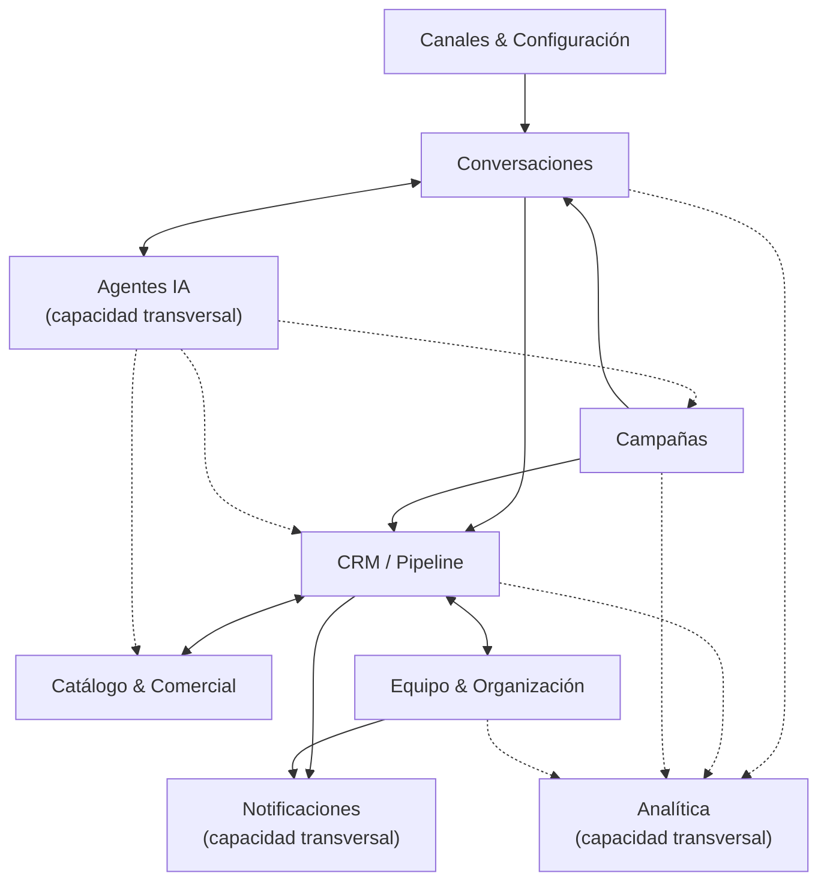

# Maiek AI — Product Architecture (MPA)

**Versión 1.0 · Estado: Approved — Referencia oficial**

| | |
|---|---|
| Documento | Maiek Product Architecture (MPA) |
| Proyecto | Maiek AI |
| Versión | 1.0 |
| Estado | **Approved** |
| Fecha de creación | 2026-07-26 |
| Autor | Claude, a pedido de Jesús Millones |
| Última actualización | 2026-08-08 (sección 4 y 12 — relación Campañas → Agentes IA, ver Control de versiones) |

## Dependencias

- `MAIEK_AI_FRAMEWORK.md` — identidad, filosofía y principios de la empresa.
- `MAIEK_AI_PLATFORM_ARCHITECTURE.md` — arquitectura técnica (capas, multi-tenant, API first);
  el MPA traduce esas capas a módulos funcionales, sin redefinirlas.

## Consumido por

- `GASOPLUS_PRODUCT_FRAMEWORK.md` — Gaso+ es la instanciación concreta de los módulos que este
  documento define.
- *Frontend Architecture* y *Backend Architecture* (futuros, todavía no construidos) —
  tomarán el mapa de módulos y sus relaciones como punto de partida técnico.
- Cualquier producto futuro sobre Maiek AI Platform (Retail+, Health+, etc.) — reutiliza esta
  misma arquitectura funcional, ver sección 13 (Escalabilidad futura).

> **No confundir los dos documentos de arquitectura, a propósito de lo parecido de sus
> nombres:** `MAIEK_AI_PLATFORM_ARCHITECTURE.md` responde *"cómo está construida la
> plataforma por dentro"* (capas técnicas: Core Platform, Business Services, AI Services,
> Communication Services, Analytics). Este documento (MPA) responde *"cómo está organizado
> Maiek AI como producto"* — módulos funcionales, qué hace cada uno, cómo se relacionan, qué
> ve cada rol. No describe código, base de datos ni infraestructura — eso vive en el otro
> documento.
>
> **Alcance:** arquitectura funcional de Maiek AI como plataforma (la marca matriz, no
> únicamente Gaso+). No diseña pantallas, no escribe código, no define componentes visuales
> (eso es el CDS) y no modifica ni el MDL ni el CDS. Gaso+ aparece a lo largo del documento
> como la instanciación real y concreta de estos módulos — es el único producto donde este
> mapa ya existe en código, aunque parcialmente.

## Control de versiones

| Versión | Fecha | Autor | Descripción |
|---|---|---|---|
| 1.0 | 2026-07-26 | Claude | Primera versión — visión, mapa de 9 módulos funcionales, responsabilidades, relaciones, flujo de información, capacidades (incluida IA exclusiva), roles y permisos de alto nivel, navegación principal, arquitectura funcional, dependencias, escalabilidad futura, reglas para nuevos módulos, roadmap y diagrama conceptual. Congelado como referencia oficial. |
| 1.0 | 2026-08-08 | Claude | **Nueva relación (sección 4 y 12): Campañas → Agentes IA.** El contexto de una campaña puede aportar información al contexto conversacional que los Agentes IA usan para responder — capacidad disponible y configurable, sujeta a las reglas de negocio aplicables, nunca una obligación universal. Formaliza una decisión de producto tomada durante el Gap Analysis del recorrido #5 de Product Design (Campaña → Lead atribuido → Pipeline), que identificó esta relación ya implementada en código (`agent/brain.py`, `agent/campanas.py`) sin respaldo canónico previo en ningún documento del corpus. No define reglas detalladas de cuándo o cómo se usa ese contexto — eso queda para Product Patterns, MPX y AI Architecture cuando corresponda. |

Cualquier módulo nuevo o cambio de fondo en las relaciones descritas acá suma una fila nueva a
esta tabla — mismo criterio de gobierno que el MDL y el CDS.

---

## 1. Visión general del producto

Maiek AI no es un CRM con una IA agregada — es una plataforma de **inteligencia
conversacional**: cada módulo existe para sostener una sola idea central, ya declarada en el
MDL: *Conecta → Comprende → Cierra*. Conecta canales y personas en un solo lugar, comprende
cada conversación con IA aplicada de forma transversal (no como un módulo aparte), y cierra
convirtiendo esas conversaciones en resultados de negocio medibles.

La unidad de trabajo de todo el producto es la **conversación**, no el registro de base de
datos. Un lead, una venta, una cita, una cotización — todo nace y se actualiza a partir de una
conversación real con un cliente. Esa es la diferencia funcional central frente a un CRM
tradicional, donde la conversación es un anexo del registro y no al revés.

## 2. Mapa completo de módulos

| # | Módulo | En una frase |
|---|---|---|
| 1 | **Conversaciones** | La bandeja omnicanal — donde vive cada conversación con un cliente. |
| 2 | **Agentes IA** | La inteligencia que interpreta, responde, resume y recomienda — transversal a todo lo demás. |
| 3 | **CRM / Pipeline** | El ciclo de vida del lead — de conversación a resultado de negocio. |
| 4 | **Campañas** | Cómo entran leads nuevos al sistema desde fuera. |
| 5 | **Catálogo & Comercial** | Qué se vende, a qué precio, con qué condiciones. |
| 6 | **Equipo & Organización** | Quién atiende, con qué rol, con qué carga. |
| 7 | **Analítica** | Qué tan bien está funcionando todo lo anterior. |
| 8 | **Canales & Configuración** | Cómo se conecta el negocio con el mundo exterior (WhatsApp y futuros canales). |
| 9 | **Notificaciones** | Cómo se entera cada persona de lo que necesita saber, sin tener que ir a buscarlo. |

## 3. Responsabilidad de cada módulo

**Conversaciones.** Recibe, almacena y presenta cada mensaje entrante y saliente,
independientemente del canal de origen. Responsable de la bandeja, el historial completo, los
adjuntos y el estado de lectura/entrega. No decide qué responder — solo sostiene el espacio
donde la conversación ocurre.

**Agentes IA.** Interpreta intención, genera respuestas (Gabi, cara al cliente), resume
conversaciones largas, califica leads (scoring), recomienda la siguiente mejor acción y asiste
al equipo interno (Copiloto). No es un módulo que el usuario "visita" — es una capacidad que
otros módulos consumen (ver Capítulo de Arquitectura funcional).

**CRM / Pipeline.** Dueño del concepto de "lead" y su ciclo de vida completo: creación,
estado, asignación, resultado. Traduce conversaciones en oportunidades de negocio rastreables
y en el embudo que Analítica después mide.

**Campañas.** Responsable de la adquisición — de dónde vienen los leads nuevos (anuncios,
mensajería masiva, formularios) y de mantener la atribución de origen visible en todo el
ciclo de vida posterior del lead.

**Catálogo & Comercial.** Fuente única de verdad de qué se vende, a qué precio y bajo qué
condiciones de financiamiento — todo lo que un asesor o Gabi necesitan citar con exactitud
durante una conversación.

**Equipo & Organización.** Dueño de usuarios, roles, disponibilidad y reglas de asignación —
responde "quién puede ver esto" y "a quién le toca este lead" para todos los demás módulos.

**Analítica.** Consume eventos de todos los demás módulos y los traduce en métricas,
tendencias y reportes — nunca genera datos propios, siempre reinterpreta los de otros.

**Canales & Configuración.** Responsable de la conexión técnica-funcional con cada canal
externo (hoy WhatsApp Business, mañana potencialmente otros) y de la configuración general del
negocio (horarios, datos de la empresa, credenciales) que el resto del producto necesita para
operar.

**Notificaciones.** Capacidad transversal que decide qué, a quién y cuándo avisar — dentro del
producto hoy, y potencialmente por otros medios (correo, push) en el futuro.

## 4. Relaciones entre módulos

- **Canales & Configuración → Conversaciones**: todo mensaje entra primero por un canal
  configurado antes de convertirse en una conversación gestionable.
- **Conversaciones ↔ Agentes IA**: relación bidireccional constante — cada mensaje nuevo pasa
  por la IA (interpretación) y cada respuesta de la IA vuelve a Conversaciones (entrega).
- **Conversaciones → CRM / Pipeline**: una conversación con intención de negocio real se
  convierte (o actualiza) un lead.
- **Campañas → CRM / Pipeline**: los leads originados en una campaña llegan con su atribución
  ya adjunta.
- **Campañas → Agentes IA**: el contexto de una campaña puede aportar información al contexto
  conversacional que los Agentes IA usan para responder — una **capacidad disponible y
  configurable**, sujeta a las reglas de negocio aplicables, nunca una obligación universal de
  que la IA deba usarla o mencionarla en cada conversación.
- **CRM / Pipeline ↔ Catálogo & Comercial**: el pipeline consulta el catálogo para cotizar; una
  venta cerrada en el pipeline actualiza qué se vendió realmente.
- **CRM / Pipeline ↔ Equipo & Organización**: el pipeline pregunta "quién está disponible" para
  asignar; el módulo de equipo expone la carga actual de cada persona.
- **Todos los módulos → Analítica**: relación de una sola vía — Analítica observa, nunca
  escribe de vuelta en los módulos de origen.
- **CRM / Pipeline y Equipo & Organización → Notificaciones**: cualquier evento que requiere
  la atención de una persona (nueva asignación, mensaje sin responder) dispara una
  notificación.
- **Agentes IA → todos los módulos anteriores**: relación transversal, no jerárquica — la IA
  no es un módulo más en la cadena, es una capacidad que Conversaciones, CRM, Campañas,
  Catálogo y Analítica consultan según la necesiten (ver sección 11).

## 5. Flujo principal de información

El recorrido completo de una conversación real, de punta a punta:

1. Un cliente escribe por WhatsApp → **Canales & Configuración** valida y enruta el mensaje al
   canal correcto (si hay más de un número de negocio).
2. **Conversaciones** registra el mensaje, lo asocia a una conversación existente o crea una
   nueva.
3. **Agentes IA** interpreta el mensaje: si es una consulta que Gabi puede resolver sola,
   genera y envía la respuesta directamente a través de Conversaciones. Si detecta intención de
   compra real, prepara la derivación.
4. **CRM / Pipeline** crea o actualiza el lead correspondiente, reflejando el estado real de la
   conversación (explorando, comparando, evaluando financiamiento, derivado a un asesor).
5. Si el lead viene de una campaña activa, **Campañas** ya dejó la atribución de origen
   adjunta desde el paso 2.
6. Si la conversación involucra un producto o precio, **Catálogo & Comercial** es consultado
   (por Gabi o por el asesor) para responder con exactitud.
7. Al derivarse a un humano, **Equipo & Organización** determina quién lo atiende según
   disponibilidad y carga actual.
8. **Notificaciones** avisa al asesor asignado que tiene una conversación nueva esperando.
9. Cada uno de estos eventos (mensaje, cambio de estado, asignación, venta) queda disponible
   para **Analítica**, que los agrega en el embudo y las métricas de equipo sin intervenir en
   el flujo en sí.

## 6. Capacidades de cada módulo

| Módulo | Capacidades principales |
|---|---|
| Conversaciones | Bandeja unificada, historial completo, adjuntos (imagen/documento/audio), indicadores en tiempo real (escribiendo, entregado). |
| Agentes IA | Respuesta automática (Gabi), resumen de conversación, scoring de lead, recomendación de siguiente acción, copiloto interno, generación asistida de cotizaciones. |
| CRM / Pipeline | Estados de conversación configurables, asignación manual y automática, historial de resultado, filtros y búsqueda. |
| Campañas | Detección de origen (anuncios, mensajería masiva), atribución persistente, activación/desactivación de campañas. |
| Catálogo & Comercial | Gestión de productos y precios, envío de fichas/catálogo dentro de la conversación, cálculo de financiamiento. |
| Equipo & Organización | Alta de usuarios, roles, disponibilidad en tiempo real, balance de carga entre asesores. |
| Analítica | Embudo de conversión, métricas por asesor/canal/campaña, tendencias en el tiempo. |
| Canales & Configuración | Conexión de canales, credenciales, horario de atención, datos generales del negocio. |
| Notificaciones | Alertas en producto por evento relevante, badges de conteo, notificaciones de escritorio. |

## 7. Capacidades exclusivas de la IA

Distinción explícita entre lo que la IA hace porque **nadie más puede hacerlo a esa escala o
velocidad**, y lo que la IA solo **asiste** sin reemplazar el criterio humano (principio ya
establecido en `MAIEK_AI_FRAMEWORK.md`: "la IA asiste al usuario, nunca reemplaza su
criterio"):

**Exclusivas de la IA** (ningún humano las hace igual de bien a la misma escala):
- Responder en el instante en que llega un mensaje, fuera de horario de atención humana.
- Leer y resumir una conversación de cientos de mensajes en segundos.
- Calificar (score) cada lead activo del sistema de forma simultánea y consistente, sin fatiga
  ni sesgo de "el último cliente que atendí".
- Detectar patrones a través de todo el portafolio de conversaciones a la vez (ej. "cinco
  clientes preguntaron por el mismo producto esta semana") — invisible para cualquier persona
  mirando una conversación a la vez.

**Asistidas por IA, decisión humana final:**
- Negociación de precio o condiciones especiales — la IA puede sugerir, nunca cierra sola una
  excepción comercial.
- Relación de largo plazo con un cliente de alto valor — la IA puede recordar contexto, la
  persona construye la confianza.
- Cualquier acción marcada como irreversible en el CDS (ver Confirm Dialog) — la IA nunca
  ejecuta esas sin una persona confirmando.

## 8. Roles del sistema

| Rol | Alcance |
|---|---|
| **Administrador** | Visión y configuración completas de la organización — todos los módulos, sin restricción. |
| **Supervisor** | Visión completa de equipo y resultados (CRM, Analítica, Equipo), sin acceso a configuración de negocio ni facturación. |
| **Vendedor / Asesor** | Visión acotada a sus propias conversaciones y leads asignados — sin acceso a Analítica agregada, Campañas ni Configuración. |

Gaso+ ya implementa una versión concreta de estos tres roles (`admin`, `supervisor`,
`asesor`) — este documento generaliza el modelo para cualquier producto futuro sobre Maiek AI
Platform, no introduce roles nuevos que Gaso+ no tenga hoy.

## 9. Permisos de alto nivel

| Módulo | Administrador | Supervisor | Vendedor/Asesor |
|---|---|---|---|
| Conversaciones | Todas | Todas del equipo | Solo las propias |
| Agentes IA (copiloto) | Sí | Sí | Sí, sobre sus conversaciones |
| CRM / Pipeline | Lectura y escritura total | Lectura y escritura total | Solo sus leads |
| Campañas | Crear, editar, desactivar | Solo lectura | Sin acceso |
| Catálogo & Comercial | Crear, editar | Solo lectura | Solo lectura, para citar en conversación |
| Equipo & Organización | Alta, edición, permisos | Solo lectura de carga/disponibilidad | Solo su propia disponibilidad |
| Analítica | Completa | Completa | Sin acceso (o acotada a sus propios números, según producto) |
| Canales & Configuración | Completo | Sin acceso | Sin acceso |
| Notificaciones | Todas las del sistema | Las de su equipo | Solo las propias |

Esta tabla es de **alto nivel** — el detalle de permisos (RBAC técnico) vive en la
implementación de cada producto, no en este documento.

## 10. Navegación principal

Estructura de navegación de primer nivel, independiente de cómo se vea (eso es el CDS —
Sidebar, Top Navigation):

1. **Inicio** — resumen ejecutivo o bandeja operativa, según el rol (ver el trabajo ya
   iniciado sobre landing diferenciado por rol para Gaso+).
2. **Conversaciones** — la bandeja, siempre accesible, para todos los roles.
3. **CRM / Pipeline** — vista de leads, solo para roles con visión más allá de sus propias
   conversaciones.
4. **Campañas** — solo Administrador (y lectura para Supervisor).
5. **Catálogo** — accesible a todos en modo lectura, edición solo Administrador.
6. **Equipo** — gestión de asesores, Administrador y Supervisor.
7. **Analítica** — Administrador y Supervisor.
8. **Configuración** — solo Administrador.

Esta jerarquía ya está reflejada, con otros nombres, en la navegación actual de Gaso+
(Métricas, Gestionar asesores, Campañas, Catálogos, Canales de WhatsApp) — el MPA la formaliza
como estándar de producto, no la reemplaza.

## 11. Arquitectura funcional

El producto se organiza en tres capas funcionales, no jerárquicas sino de **naturaleza**
distinta:

- **Capa de flujo** (Conversaciones → CRM/Pipeline): el camino lineal por el que avanza una
  conversación hasta convertirse en resultado de negocio. Es la columna vertebral operativa.
- **Capa de soporte al flujo** (Campañas, Catálogo & Comercial, Equipo & Organización): módulos
  que el flujo principal consulta o recibe, pero que tienen su propio ciclo de gestión
  independiente (una campaña se crea y se pausa sin que eso dependa de una conversación en
  curso).
- **Capas transversales** (Agentes IA, Analítica, Notificaciones): no ocupan un lugar fijo en
  la secuencia — se conectan a cualquier módulo de las otras dos capas según se necesite. Esta
  es la traducción funcional directa del principio ya establecido en
  `MAIEK_AI_PLATFORM_ARCHITECTURE.md`: *"la IA nunca es un módulo aislado, es una capacidad
  transversal de toda la plataforma"* — acá se extiende el mismo criterio a Analítica y
  Notificaciones.

Canales & Configuración no encaja en ninguna de las tres — es la capa de **entrada/base**,
la condición previa para que cualquiera de las otras funcione (sin un canal conectado, no hay
conversación que fluya).

## 12. Dependencias entre módulos

| Módulo | Depende de | Es consumido por |
|---|---|---|
| Conversaciones | Canales & Configuración | CRM/Pipeline, Agentes IA, Analítica |
| Agentes IA | Conversaciones (para tener contexto), Campañas (contexto de atribución, cuando esté habilitado) | Conversaciones, CRM/Pipeline, Catálogo, Analítica |
| CRM / Pipeline | Conversaciones, Equipo & Organización | Analítica, Notificaciones |
| Campañas | Canales & Configuración | CRM/Pipeline, Agentes IA (cuando esté habilitado), Analítica |
| Catálogo & Comercial | — (módulo independiente) | Conversaciones (vía IA o asesor), CRM/Pipeline |
| Equipo & Organización | — (módulo independiente) | CRM/Pipeline, Notificaciones, Analítica |
| Analítica | Todos los demás (solo lectura) | — (es un consumidor final) |
| Canales & Configuración | — (módulo base) | Conversaciones, Campañas |
| Notificaciones | CRM/Pipeline, Equipo & Organización | — (es un consumidor final) |

Ningún módulo de soporte (Campañas, Catálogo, Equipo) depende de otro módulo de soporte — están
deliberadamente desacoplados entre sí, consistente con el principio "Desacoplada" de
`MAIEK_AI_PLATFORM_ARCHITECTURE.md`.

## 13. Escalabilidad futura

El mapa de 9 módulos está diseñado para sostenerse igual más allá de Gaso+ — Retail+, Health+
o cualquier producto futuro sobre Maiek AI Platform reutiliza exactamente esta misma
estructura, cambiando solo el contenido de **Catálogo & Comercial** (otro tipo de producto o
servicio) y el detalle fino de **CRM / Pipeline** (otros estados de ciclo de vida según la
industria) — los siete módulos restantes son, por diseño, agnósticos de industria.

**Multiempresa (nota de estado):** el modelo multiempresa ya documentado como visión en
`MAIEK_AI_PLATFORM_ARCHITECTURE.md` afecta transversalmente a **Equipo & Organización**
(usuarios pertenecen a una empresa) y a **Canales & Configuración** (cada empresa conecta sus
propios canales) — sigue siendo visión, no construido en el código actual de Gaso+ (ver
[[project_entidad_negocio_pendiente]] en el histórico del proyecto). Este documento no
cambia ese estado.

## 14. Reglas para incorporar nuevos módulos

Antes de agregar un módulo nuevo al mapa (no una función dentro de uno existente — un módulo
completo nuevo):

1. Debe resolver una responsabilidad que ningún módulo existente ya cubre — si "casi" encaja
   en uno existente, se extiende ese módulo en vez de crear uno nuevo (mismo criterio de
   "Reutilización primero" del documento de arquitectura técnica).
2. Debe tener sentido para más de un producto futuro sobre Maiek AI Platform, no solo para
   Gaso+ — si es exclusivo de un cliente o producto, es una capacidad de Nivel 2 o 3 (ver
   `MAIEK_AI_PLATFORM_ARCHITECTURE.md`), no un módulo de plataforma.
3. Se debe poder ubicar en una de las tres capas funcionales (flujo, soporte al flujo,
   transversal) — si no encaja claramente en ninguna, la propuesta necesita revisarse antes de
   aprobarse.
4. Sus relaciones de dependencia deben documentarse en la tabla de la sección 12 antes de
   construirse — ningún módulo se agrega "y ya se verá cómo se conecta con el resto".
5. Todo módulo nuevo se suma a este documento por control de versiones (ver tabla al inicio),
   nunca como una nota aparte fuera de esta arquitectura oficial.

## 15. Roadmap de evolución

Fases funcionales — versión de producto del roadmap técnico ya existente en
`MAIEK_AI_PLATFORM_ARCHITECTURE.md`:

1. **Consolidar el flujo principal** — Conversaciones + CRM/Pipeline funcionando de punta a
   punta para un solo cliente (Gaso+/Cálidda), como ya es el caso hoy.
2. **Madurar Agentes IA** — de Gabi (respuesta automática) al Copiloto interno completo
   (resumen, scoring, recomendación) especificado ya en el CDS, categoría IA.
3. **Formalizar Equipo & Organización multiempresa** — cuando aparezca un segundo negocio real
   (ver sección 13), no antes.
4. **Expandir Canales** — más allá de WhatsApp, según demanda real de clientes, nunca de forma
   especulativa.
5. **Marketplace de módulos y SDK para terceros** — visión de largo plazo, ya anotada en
   `MAIEK_AI_PLATFORM_ARCHITECTURE.md`, sin cambios en este documento.

## Diagrama conceptual

Línea sólida = flujo de datos directo. Línea punteada = capacidad transversal consumida bajo
demanda (Agentes IA y Analítica no "reciben" de los otros módulos en el sentido operativo,
los observan o son consultados por ellos).
