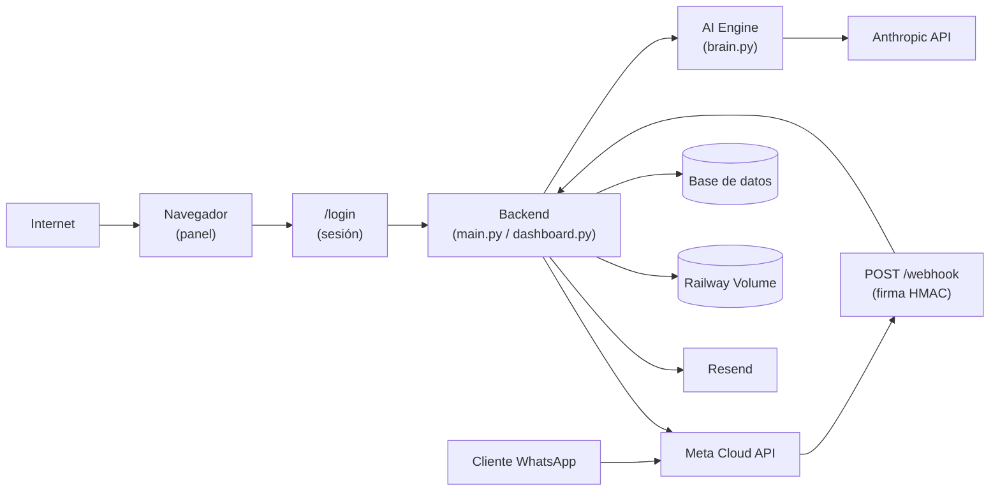

# Maiek AI — Current State Assessment: Security Architecture

**Versión 1.0 · Estado: Approved**

| | |
|---|---|
| Documento | Current State Assessment – Security Architecture |
| Proyecto | Maiek AI |
| Versión | 1.0 |
| Estado | **Approved** |
| Fecha de creación | 2026-07-28 |
| Autor | Claude, a pedido de Jesús Millones |
| Fecha de aprobación | 2026-07-28 |
| Última actualización | 2026-07-28 |

## Dependencias

- `MAIEK_AI_SYSTEM_ARCHITECTURE.md` (MSA) Capítulo 11 (Architectural Constraints), Capítulo 13 (Seguridad — alto nivel).
- `MAIEK_AI_DATA_ARCHITECTURE.md` — `RegistroAuditoria` (append-only, target no implementado), `negocio_id` (Multi-Tenant, target Fase 3), soft delete — este CSA verifica cuánto de eso existe hoy en el código real.
- `MAIEK_AI_BACKEND_ARCHITECTURE.md` — `ServicioInteligencia`, capas y servicios de dominio — contexto de dónde vive la lógica que este CSA audita.
- `MAIEK_AI_API_ARCHITECTURE.md` — brechas ya derivadas explícitamente hacia Security Architecture: emisión/rotación de API keys, rate limiting, restricción de `/docs` y `/openapi.json`.
- `MAIEK_AI_AI_ARCHITECTURE.md` — brechas ya derivadas explícitamente hacia Security Architecture: emisión/rotación de credenciales del proveedor de IA, rate limiting sobre la llamada de IA, cualquier exposición futura de herramientas al modelo.
- `MAIEK_AI_ARCHITECTURE_DOCUMENT_STANDARD.md` (ADS) v1.3.

## Consumido por

`MAIEK_AI_SECURITY_ARCHITECTURE.md` (Security Architecture, todavía no construida).

## Control de versiones

| Versión | Fecha | Autor | Descripción |
|---|---|---|---|
| 1.0 (borrador) | 2026-07-28 | Claude | Primera versión — auditoría objetiva del estado real de seguridad (`agent/main.py`, `agent/dashboard.py`, `agent/memory.py`, `agent/providers/meta.py`, `.env.example`, `requirements.txt`), sobre las 10 dimensiones pedidas por el usuario. Sin propuestas de solución. Pendiente de revisión y aprobación. |
| 1.0 | 2026-07-28 | Claude | Aprobado. Se incorporaron 2 elementos antes de la aprobación: **Threat Landscape** (clasificación de actores frente a los que el sistema debe defenderse hoy) y **Trust Boundaries** (mapa de fronteras de confianza, con diagrama Mermaid y tabla de mecanismo por frontera), ambos como secciones de encuadre previas a las 10 dimensiones. El usuario registró 2 observaciones menores para futuras versiones, sin incorporar ahora: (a) separar conceptualmente protección de PII y políticas de retención en Security Architecture, ya que responden a objetivos distintos; (b) mantener la evaluación de PII de este CSA en términos descriptivos (estado actual) y reservar la decisión de cifrado de campo para Security Architecture, no para este documento. |

## Alcance

Auditoría objetiva del estado real de seguridad del sistema — identidad, secretos, APIs/webhooks, AI Engine, datos, Multi-Tenant, auditoría y dependencias externas — con evidencia de código citada por archivo y línea. No repite el análisis ya hecho en los CSA de Data, Backend, API y AI: los cita como contexto ya establecido (protocolo de confianza pendiente, `negocio_id`/`RegistroAuditoria` no implementados, prompt injection sin mitigación) en vez de re-derivarlos.

---

## Threat Landscape

Clasificación de los actores frente a los que el sistema debe defenderse hoy, según las superficies reales confirmadas en este CSA — no es un modelo de amenazas completo (sin matriz STRIDE ni probabilidad/impacto por actor), solo identifica quién está en juego en el estado actual, como punto de partida para Security Architecture:

| Actor | Superficie de contacto hoy | Evidencia en este CSA |
|---|---|---|
| Usuario externo no autenticado (Internet) | `/login` (sin límite de intentos), `/webhook` (si la firma falla o está mal configurada) | Secciones 1, 3 |
| Cliente real vía WhatsApp | Su mensaje de texto llega al AI Engine y se persiste en `Mensaje`/`Lead` como contenido no confiable | Secciones 4, 5 |
| Usuario autenticado de rol limitado (asesor) | Rutas del panel, con acceso restringido por `_verificar_acceso_lead` | Sección 1 |
| Usuario autenticado de rol elevado (admin/supervisor) | Todas las rutas administrativas — sin registro de auditoría de sus acciones | Secciones 1, 7 |
| Integraciones/proveedores externos de confianza (Meta, Anthropic, Railway, Resend, CDN de Bootstrap) | Reciben o entregan datos sin verificación más allá de TLS o una firma puntual | Secciones 3, 4, 8 |
| Insider con acceso a la plataforma de despliegue (Railway) o a variables de entorno | Acceso directo a la base de datos y a todas las credenciales, incluida `CANAL_ENCRYPTION_KEY` | Sección 2 |
| Error operativo no malicioso | Mala configuración (canal sin `app_secret` → fail-open), pérdida de una clave de cifrado, secreto filtrado por accidente | Secciones 2, 3 |

## Trust Boundaries

Mapa de dónde cambia el nivel de confianza en el sistema actual, para que Security Architecture parta de un punto en común y no tenga que deducirlo de nuevo:

| Frontera | Mecanismo que la protege hoy | Verificado en este CSA |
|---|---|---|
| Internet → Meta | Fuera del alcance de este sistema — responsabilidad de Meta | N/A |
| Meta → Webhook | Firma HMAC-SHA256 (`X-Hub-Signature-256`) | Sí, con fail-open si ningún canal tiene `app_secret` (sección 3) |
| Webhook → Backend | Ninguno adicional — la firma verifica el transporte, no el contenido; el mensaje del cliente sigue siendo no confiable | Sección 4 |
| Backend → AI Engine | Ninguna separación estructural del contexto de confianza vs. el mensaje del cliente | Sección 4 (diagnosticado en detalle en el CSA-AI, citado acá) |
| Backend → Base de datos | ORM (SQLAlchemy) parametriza consultas; sin sanitización adicional de campos de texto libre | Sección 5 |
| Navegador → `/login` | Cookie de sesión firmada (`itsdangerous`) + verificación con bcrypt | Sección 1 |
| `/login` → Backend (dashboard) | `Depends(_usuario_actual)` en casi toda ruta autenticada | Sección 1 |
| Backend → Anthropic (saliente) | TLS estándar de la librería `anthropic`; sin verificación adicional del contenido en tránsito | Sección 8 |
| Backend → Meta (saliente — envío de mensajes/media) | Token de acceso cifrado en reposo (Fernet); TLS en tránsito | Sección 2 |
| Backend → Railway Volume (archivos) | Control de acceso de la ruta que sirve el archivo; sin cifrado del archivo en sí | Sección 5 |
| Backend → Resend (saliente, opcional) | TLS estándar; API key en variable de entorno | Sección 2 |

---

## 1. Identidad, autenticación y autorización

El panel interno (`/dashboard`) usa sesión basada en cookie firmada (Starlette `SessionMiddleware`, firmada con `itsdangerous`) — `agent/main.py:79-84`. `SESSION_SECRET_KEY` es obligatoria en producción (`agent/main.py:49-53`, falla duro con `RuntimeError` si falta) y solo tiene un valor por defecto inseguro en desarrollo (`agent/main.py:54`).

El modelo `Usuario` (`agent/memory.py:276-287`) tiene `username` (PK), `password_hash` (bcrypt), `rol` (`admin`/`supervisor`/`asesor`), `nivel` y `disponible`. El login (`agent/dashboard.py:1667-1676`) valida con `bcrypt.checkpw` — sin límite de intentos fallidos ni bloqueo temporal tras varios intentos (no hay rate limiting en ningún punto del proyecto, ver sección 3).

La autorización sigue un patrón consistente: casi toda ruta del panel exige `Depends(_usuario_actual)` (`agent/dashboard.py:250-257`), que redirige al login si no hay sesión válida. El acceso a un lead específico se restringe por rol vía `_verificar_acceso_lead` (`agent/dashboard.py:260-265`) — un asesor solo ve sus propios leads asignados; `admin`/`supervisor` tienen "visión total" (`ROLES_CON_VISION_TOTAL`, `agent/dashboard.py:142`). El WebSocket del panel replica la misma verificación de sesión (`agent/dashboard.py:276-285`).

`crear_usuario()` existe (`agent/memory.py:817-831`) pero **no se invoca desde ninguna ruta del panel** — el único camino real para dar de alta un usuario es un script de migración que inserta filas directamente en la base de datos (`scripts/migrar_usuarios_a_railway.py:57-60`), fuera del flujo de la aplicación (coincide con la memoria de proyecto ya registrada: "crear usuario en panel" pendiente).

La recuperación de contraseña es un flujo de aviso humano ("le avisamos a un administrador"), no un reseteo automático por email/token (`agent/dashboard.py:1620-1664`). No hay MFA/2FA en ningún punto. No hay expiración de sesión explícita (`max_age` no configurado) — la sesión dura lo que dure la cookie por defecto de Starlette.

## 2. Gestión de secretos y credenciales

La mayoría de las credenciales del proyecto (`ANTHROPIC_API_KEY`, `DATABASE_URL`, `SESSION_SECRET_KEY`, `RESEND_API_KEY`, credenciales de Twilio) viven **solo en variables de entorno** de la plataforma de despliegue (Railway) — nunca en la base de datos, patrón explícitamente documentado en el propio código (`agent/memory.py:26-30`, `.env.example:82-83`).

La única excepción deliberada son las credenciales de canal de WhatsApp (`access_token`, `app_secret`, `page_access_token`), que sí se persisten en la base de datos porque se administran desde el panel — se cifran con Fernet (`agent/memory.py:12`, `21-52`) usando una clave separada, `CANAL_ENCRYPTION_KEY`, que a su vez vive solo en variable de entorno. Si esa clave falta, la aplicación falla duro al primer uso (`agent/memory.py:34-38`) — no hay fallback inseguro silencioso.

No existe rotación prevista para ninguna clave o credencial — ni `CANAL_ENCRYPTION_KEY`, ni `SESSION_SECRET_KEY`, ni las credenciales de Meta/Anthropic/Resend. Cambiar `CANAL_ENCRYPTION_KEY` vuelve ilegibles los canales ya guardados, sin ningún mecanismo de re-cifrado (advertido explícitamente en `.env.example:49-50`).

En la UI, los tokens se enmascaran al mostrarse (`_enmascarar_token`, `agent/dashboard.py:4312-4319`), pero el formulario de creación/edición de un canal envía el valor en texto plano en el cuerpo del POST (`agent/dashboard.py:4436-4467`, `4482-4499`) — protegido solo por TLS y por la sesión autenticada, sin cifrado adicional en tránsito. No hay gestor de secretos dedicado (Vault, AWS Secrets Manager, etc.); todo vive en variables de entorno de Railway o cifrado con una única clave simétrica sin versión.

## 3. Seguridad de APIs y Webhooks

El webhook de WhatsApp verifica la firma HMAC-SHA256 de Meta (`X-Hub-Signature-256`) con comparación *timing-safe* (`hmac.compare_digest`) — `agent/providers/meta.py:39-61`, implementación técnicamente correcta. **Pero si ningún canal activo tiene `app_secret` configurado, la verificación se salta por completo y la función retorna `True`** (`meta.py:47-52`) — un fail-open explícito, con solo un `logger.warning`, no un error duro que bloquee el arranque. La verificación GET (`hub.verify_token`) usa comparación de string simple, no *timing-safe* (`meta.py:69`) — de menor criticidad al no ser un secreto de firma.

El handler del webhook (`agent/main.py:117-120`) rechaza con 403 si la firma falla, y re-lanza `HTTPException` sin envolverla en un 500 genérico (`agent/main.py:291-292`) — el resto de errores caen a un 500 genérico (`main.py:294-296`).

**No hay rate limiting en ningún endpoint** — ni en el webhook ni en el panel — confirmado ausente en todo el repositorio (sin `slowapi` ni mecanismo equivalente). No hay protección contra replay de webhooks más allá de la firma del contenido (sin verificación de timestamp o nonce). No hay `CORSMiddleware` configurado en ningún punto. No hay token CSRF en ningún formulario del panel — mitigado parcialmente por el atributo `SameSite` por defecto de Starlette (`lax`), pero sin declaración explícita ni verificación adicional.

La API externa versionada (`/api/v1/...`, ya decidida en API Architecture) **no existe todavía en código** — es diseño objetivo, no estado actual. Por tanto hoy no hay API keys, scopes ni rate limiting que auditar en esa capa porque la superficie en sí no existe aún.

## 4. Seguridad del AI Engine

Se cita, sin re-derivar, lo ya establecido en el CSA-AI y en AI Architecture: el riesgo de prompt injection no tiene mitigación estructural hoy (contexto de confianza y mensaje del cliente se concatenan como texto plano en el turno `user`); la delimitación estructural ya es una Decisión Objetivo en AI Architecture, pero no está implementada en código todavía. La ausencia de tool-calling real (patrón RAG-lite, ya caracterizado en AI Architecture) significa que hoy no existe superficie de "exposición de herramientas" al modelo — no es una mitigación diseñada, es una consecuencia de la arquitectura cognitiva actual.

`ANTHROPIC_API_KEY` vive solo en variable de entorno (sección 2), sin rotación ni scopes — es una clave con acceso total a la cuenta de Anthropic del proyecto, no acotada por función.

El aislamiento de contexto entre negocios no aplica hoy porque no existe `negocio_id` (sección 6) — el prompt y la base de conocimiento son únicos y compartidos; no hay riesgo de fuga cross-tenant simplemente porque no hay multi-tenencia todavía, pero tampoco hay ningún mecanismo preparado para cuando la haya (brecha ya identificada en AI Architecture, no se re-analiza acá).

## 5. Protección de datos y privacidad

Los datos de un lead (`telefono`, `nombre`, `interes` — `agent/memory.py:122-199`) y el contenido completo de cada mensaje (`Mensaje.content`, `agent/memory.py:79-98`, incluye lo que un cliente comparta en texto libre, potencialmente un DNI mencionado conversacionalmente) se almacenan **sin ninguna encriptación a nivel de campo**. El único dato cifrado en toda la base de datos son las credenciales de `CanalWhatsApp` (sección 2) — no los datos de clientes.

No hay mecanismo de anonimización o pseudonimización, ni política de retención o purga — los datos de leads y mensajes persisten indefinidamente, sin TTL ni proceso de borrado. No hay clasificación de datos sensibles dentro de `Mensaje`: un DNI mencionado en un mensaje vive en la misma tabla, sin distinción, que cualquier otro texto conversacional.

Los archivos adjuntos (proformas, catálogos) se guardan en disco local o en un Volume de Railway (`agent/dashboard.py:3322-3329`) sin cifrado a nivel de archivo — protegidos solo por el control de acceso de la ruta que los sirve.

## 6. Multi-Tenant y aislamiento entre negocios

`negocio_id` no existe en ningún lugar del código ejecutable (confirmado por búsqueda exhaustiva en `agent/`) — es puramente un target de Data Architecture Fase 3, no implementado. El único límite de "instalación" hoy es `CanalWhatsApp` (un número de WhatsApp), pero `Usuario`, `Lead`, `Mensaje` y `Campana` no tienen ninguna columna de tenant: son tablas compartidas globalmente. Un usuario con rol de "visión total" ve todos los leads de todos los canales sin ningún límite por negocio.

Esto es coherente con ser hoy un solo negocio (Cálidda/Gaso+) — pero significa que la arquitectura actual no tiene ningún punto de partición del que Security Architecture pudiera partir si Multi-Tenant se activara. Estado ya reconocido en Data Architecture y AI Architecture; se cita, no se re-decide.

## 7. Auditoría y trazabilidad

`RegistroAuditoria` no existe en código (confirmado) — es un target ya definido en Data Architecture. La única excepción real de trazabilidad de autor encontrada en todo el esquema es `ArchivoAdjunto.subido_por` (`agent/memory.py`, modelo `ArchivoAdjunto`) — quién subió un archivo sí queda registrado; ninguna otra acción administrativa (crear un canal, cambiar un prompt, cambiar el rol de un usuario, asignar un asesor) deja un rastro de quién la realizó, más allá de lo que el propio dato modificado refleje.

No hay logging estructurado de eventos de seguridad (intentos de login fallidos, cambios de credenciales de canal, cambios de rol) — solo logs de aplicación genéricos (`logger.info`/`warning`/`error`), sin catalogación de eventos de seguridad ni persistencia más allá de los logs del proceso. La trazabilidad de inferencias de IA (qué vio el modelo, qué decidió) — ya identificada como ausente en el CSA-AI y como Decisión Objetivo en AI Architecture (`SugerenciaIA`) — se cita, no se re-analiza acá.

## 8. Dependencias externas y cadena de confianza

Terceros con acceso directo a datos u operación del sistema: **Anthropic** (recibe el contenido de cada conversación más el contexto de negocio en cada inferencia), **Meta** (mensajes entrantes/salientes vía WhatsApp Cloud API), **Railway** (hosting, base de datos, variables de entorno), **Resend** (notificaciones por correo, opcional).

`requirements.txt` no fija límites superiores de versión en ningún paquete (todo declarado como `>=`, sin techo) — cualquier actualización de una dependencia puede entrar sin control explícito de compatibilidad o seguridad; no se encontró lockfile pineado ni configuración de Dependabot/Renovate en el repositorio. No hay SBOM ni proceso de escaneo de vulnerabilidades (`pip-audit`, `safety`, `Snyk` u otro) configurado.

El panel carga Bootstrap (CSS/JS) e iconos desde un CDN externo (`cdn.jsdelivr.net`, `agent/dashboard.py:308-309`) **sin atributo `integrity`/`crossorigin`** (Subresource Integrity) — si el CDN fuera comprometido, el panel cargaría ese contenido sin ninguna verificación de integridad.

## 9. Riesgos actuales priorizados

Riesgos identificados por severidad cualitativa (probabilidad × impacto, sin proponer remediación — eso vive en Priorización de remediación, al cierre):

| Severidad | Riesgo |
|---|---|
| **Alta** | Fuerza bruta sin límite contra `/login` — sin lockout ni rate limiting |
| **Alta** | Fail-open de verificación de firma del webhook si ningún canal tiene `app_secret` configurado |
| **Alta** | Ausencia total de rate limiting (webhook y panel) — expone a abuso/DoS de bajo esfuerzo |
| **Media** | Sin token CSRF explícito en formularios de estado (mitigado parcialmente por `SameSite=Lax` por defecto) |
| **Media** | PII de leads/mensajes sin cifrado a nivel de campo ni política de retención |
| **Media** | Sin rotación de ninguna credencial o clave del proyecto |
| **Media** | CDN externo sin Subresource Integrity |
| **Baja** | Alta de usuarios solo vía script directo a la base de datos, sin flujo de alta formal en el panel |
| **Baja hoy / bloqueante futuro** | Sin `negocio_id`, no existe ningún aislamiento técnico para cuando exista Multi-Tenant |

## 10. Preparación para la arquitectura objetivo

| Brecha ya declarada | Origen | Estado real hoy |
|---|---|---|
| Emisión/rotación de API keys | API Architecture §7 | No aplica todavía — la API externa versionada no existe en código |
| Rate limiting (API y AI) | API Architecture §7, AI Architecture | Ausente en todo el sistema, no solo en esas dos superficies |
| Restricción de `/docs` y `/openapi.json` | API Architecture §7 | No aplica todavía — no hay API externa expuesta |
| Emisión/rotación de credenciales del proveedor de IA | AI Architecture | `ANTHROPIC_API_KEY` sin rotación ni scopes, en variable de entorno |
| Exposición futura de herramientas al AI Engine | AI Architecture | No aplica hoy — no hay tool-calling real |
| `RegistroAuditoria` como mecanismo de persistencia de eventos de seguridad | Data Architecture | No implementado — Security Architecture deberá especificar qué eventos alimentarlo |
| Modelo de amenazas, manejo de credenciales, auditoría, cifrado | MSA Cap. 11, 13 | Parcialmente resuelto de forma ad-hoc (Fernet, bcrypt) sin un modelo de amenazas formal que lo respalde |

---

## Fortalezas

- Verificación de firma de webhook con HMAC-SHA256 y comparación *timing-safe* — implementación técnicamente correcta cuando está configurada.
- Contraseñas de usuario con bcrypt (nunca texto plano ni hash débil).
- Cifrado deliberado y bien documentado de las credenciales de canal (Fernet) — con fail-hard explícito si falta la clave, no un fallback inseguro.
- Separación consistente entre credenciales que viven solo en variables de entorno (la mayoría) y las que se persisten cifradas (canales) — decisión de diseño clara, no accidental.
- Patrón de autorización consistente en el panel (`Depends(_usuario_actual)` en casi toda ruta) — no hay rutas "olvidadas" sin protección.
- `HTTPException` del webhook se re-lanza sin envolverse en un 500 genérico — el código de error real (403 por firma inválida) llega intacto.

## Decisiones heredadas del MVP (razonables para la etapa, a reevaluar)

- Sin rate limiting ni MFA — proporcional a un solo negocio con un equipo comercial pequeño y bajo volumen.
- Recuperación de contraseña vía aviso humano en vez de flujo automático — simple y suficiente al tamaño actual del equipo.
- Toda credencial en variables de entorno salvo canales — evita construir un gestor de secretos dedicado antes de necesitarlo.
- Sin `negocio_id` ni aislamiento multi-tenant — coherente con operar un solo negocio real hoy.

## Deuda técnica (sin justificación de etapa)

- **Fail-open de la verificación de firma del webhook** — un canal mal configurado (sin `app_secret`) desactiva silenciosamente la protección central contra webhooks falsificados, sin bloquear el arranque ni alertar más allá de un log.
- **Ausencia total de rate limiting** — no es una decisión de simplicidad, es una omisión de robustez frente a abuso, independiente del tamaño del proyecto.
- **`crear_usuario()` sin ruta de acceso en el panel** — la única vía real (script directo a la base de datos) no pasa de forma consistente por el mismo camino que el resto del alta de usuarios.
- **CDN sin Subresource Integrity** — el costo de agregar `integrity`/`crossorigin` es mínimo y no depende de la etapa del proyecto.
- **Sin rotación de ninguna credencial** — omisión de higiene de seguridad, no una decisión consciente de simplicidad.

## Desviaciones respecto al MSA y documentos derivados ya Approved

- **MSA Cap. 11/13, Data Architecture (`RegistroAuditoria`), API/AI Architecture (brechas ya declaradas hacia Security)** — no son desviaciones, son **sincronización pendiente**: todas son arquitectura objetivo de otros documentos, todavía no implementada, mismo criterio ya aplicado en los CSA anteriores.
- No se identificó ninguna decisión de seguridad ya tomada en un documento Approved que el código actual contradiga activamente — el estado actual es, en su mayoría, ausencia de mecanismos todavía no exigidos formalmente por ningún documento superior, no una violación de una decisión ya tomada.

## Riesgos detectados

(Ver tabla completa en la sección 9 del cuerpo — se resume acá el criterio de agrupación: 3 riesgos de severidad Alta, todos relacionados con ausencia de controles de abuso/fuerza bruta; 4 de severidad Media, relacionados con protección de datos y cadena de suministro; 2 de severidad Baja o condicionales al crecimiento del proyecto.)

## Architectural Readiness

| Dimensión | Madurez actual | Nota |
|---|---|---|
| Autenticación | **Sólida** | bcrypt + sesión firmada, sin MFA ni límite de intentos |
| Autorización | **Sólida** | Patrón consistente por rol, sin excepciones encontradas |
| Gestión de secretos | **Parcial** | Separación correcta env vars vs. cifrado en BD, sin rotación |
| Seguridad de webhook | **Parcial** | Verificación técnicamente correcta, con fail-open real en mala configuración |
| Rate limiting / abuso | **Ausente** | No existe en ningún punto del sistema |
| Seguridad del AI Engine | **Débil** | Ya diagnosticado en CSA-AI; sin mitigación estructural de prompt injection |
| Protección de datos | **Débil** | PII sin cifrado de campo, sin política de retención |
| Multi-Tenant / aislamiento | **Ausente (por diseño actual)** | Sin `negocio_id`, sin partición técnica |
| Auditoría | **Ausente** | Sin `RegistroAuditoria`, sin logging estructurado de eventos de seguridad |
| Cadena de dependencias externas | **Débil** | Sin límites de versión, sin escaneo de vulnerabilidades, sin SRI en CDN |

**Conclusión de preparación:**

- **MVP (uso actual, un solo negocio):** **Listo, con riesgos aceptados implícitamente.** El sistema opera hoy sin incidentes conocidos, pero varios de los riesgos de severidad Alta (fuerza bruta, fail-open de webhook, ausencia de rate limiting) no son hipotéticos — son condiciones ya presentes en producción, simplemente no explotadas todavía.
- **Crecimiento (más volumen, mismo negocio):** **No listo.** La ausencia de rate limiting y de auditoría se vuelve crítica antes que cualquier otra brecha — un solo endpoint sin protección de abuso es suficiente para un incidente real a mayor volumen.
- **SaaS multiempresa:** **No listo.** No existe ningún mecanismo de aislamiento entre negocios — todo el modelo de autorización actual (por rol, no por tenant) tendría que extenderse, y hoy no hay ningún punto de partición técnico del que partir.

## Priorización de remediación

| Prioridad | Ítem | Por qué |
|---|---|---|
| **P1** | Rate limiting en `/login` y `/webhook`, como mínimo | Mitiga directamente los 3 riesgos de severidad Alta identificados |
| **P1** | Eliminar el fail-open de verificación de firma del webhook (fallar duro, no silenciarlo con un warning) | Es la protección central contra webhooks falsificados |
| **P2** | Token CSRF explícito en formularios de estado del panel | Cierra la dependencia implícita en el comportamiento por defecto de `SameSite` |
| **P2** | Política de retención/purga y evaluación de cifrado de campo para PII de leads/mensajes | Cierra la brecha de protección de datos más señalada del CSA |
| **P2** | Ruta formal de alta de usuarios en el panel | Cierra la brecha ya registrada en memoria del proyecto |
| **P3** | Subresource Integrity en el CDN de Bootstrap/iconos | Bajo costo, bajo riesgo actual, pero sin justificación de etapa para omitirlo |
| **P3** | Rotación de credenciales (Fernet, sesión, proveedores externos) | Sin evidencia hoy de que la ausencia de rotación haya sido explotada |
| **P3** | Escaneo de vulnerabilidades / SBOM de dependencias | Proporcional a cuando el proyecto tenga más superficie expuesta |

## Architectural Decision Impact

| Hallazgo | Arquitecturas afectadas | Por qué |
|---|---|---|
| Ausencia total de rate limiting | Security, API, AI, DevOps | Ya era una brecha declarada en API y AI Architecture; DevOps Architecture es quien lo implementaría operacionalmente |
| Fail-open del webhook | Security, Backend | Backend Architecture ya documentó el patrón "fail-open" del webhook a nivel de procesamiento de mensajes; este CSA identifica un segundo fail-open, a nivel de verificación de firma |
| PII sin cifrado de campo ni retención | Security, Data | Data Architecture define el modelo; Security Architecture debe decidir qué campos ameritan protección adicional |
| Sin `RegistroAuditoria` implementado | Security, Data, DevOps/Operations | Security Architecture debe especificar qué eventos lo alimentan; Data Architecture ya definió su forma |
| Sin aislamiento técnico para Multi-Tenant | Security, Data, AI | Bloqueante compartido — ya señalado en Data y AI Architecture, confirmado acá desde la óptica de seguridad |

## Strategic Recommendations

1. **El rate limiting es la decisión de mayor apalancamiento de este documento** — es la única brecha que aparece simultáneamente en los riesgos de severidad Alta, en las brechas ya declaradas por API y AI Architecture, y en la conclusión de "no listo para Crecimiento".
2. **El fail-open del webhook merece una decisión explícita de postura** (fallar duro vs. degradar) — hoy la ausencia de `app_secret` en un canal desactiva una protección central sin que nadie lo note salvo revisando logs.
3. **La protección de datos (PII) y la auditoría pueden diseñarse juntas** — ambas requieren decidir qué información se considera sensible, y esa clasificación es la base tanto de qué cifrar como de qué registrar en `RegistroAuditoria`.
4. **El aislamiento Multi-Tenant no es urgente hoy, pero cuanto más tarde se diseñe, más código habrá que tocar retroactivamente** — vale la pena que Security Architecture al menos deje declarado el principio (aunque la implementación dependa de Data Architecture Fase 3), igual que ya se hizo en AI Architecture.
5. **La cadena de confianza de terceros (Anthropic, Meta, Railway, Resend, CDN) no tiene hoy ningún documento que la haga explícita** — Security Architecture es el lugar natural para declarar qué se confía y por qué, no solo para AI Architecture.

---

*Fin del documento. Approved el 2026-07-28. Siguiente paso: construir `MAIEK_AI_SECURITY_ARCHITECTURE.md` (arquitectura objetivo) como evolución explícita desde este estado real, siguiendo el ADS, el MSA, y las brechas ya declaradas por Data, Backend, API y AI Architecture.*
