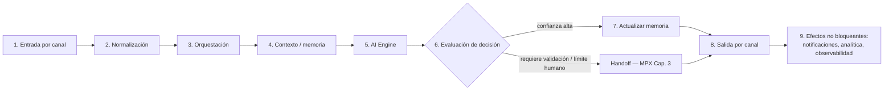

# Maiek AI — System Architecture (MSA)

**Versión 1.0 · Estado: Approved**

| | |
|---|---|
| Documento | Maiek System Architecture (MSA) |
| Proyecto | Maiek AI |
| Versión | 1.0 |
| Estado | **Approved** |
| Fecha de creación | 2026-07-28 |
| Autor | Claude, a pedido de Jesús Millones |
| Fecha de aprobación | 2026-07-28 |
| Última actualización | 2026-07-28 |

## Dependencias

- `MAIEK_AI_FRAMEWORK.md` — identidad, misión, principios de negocio y modelo de producto (Maiek AI → Platform → Intelligence → Productos → Clientes), del que este documento deriva su propósito técnico.
- `MAIEK_AI_PRODUCT_ARCHITECTURE.md` (MPA) — módulos funcionales, capacidades exclusivas de IA, roles y permisos de alto nivel — este documento define cómo se construyen técnicamente, nunca los redefine.
- `MAIEK_AI_DESIGN_SYSTEM.md` (MDL) y `MAIEK_AI_COMPONENT_SYSTEM.md` (CDS) — referenciados donde la arquitectura técnica condiciona su implementación futura (Frontend Architecture), sin redefinir tokens ni componentes.
- `MAIEK_AI_PRODUCT_EXPERIENCE.md` (MPX) — protocolo de interacción con IA, niveles de confianza, tres tipos de memoria (Capítulo 8) y Experience Metrics (Capítulo 10) — esta arquitectura define cómo se sostienen técnicamente, nunca los redefine.
- `MAIEK_AI_PLATFORM_ARCHITECTURE.md` — documento técnico Legacy que este documento **reemplaza formalmente**. Pasa a **Superseded** en `DOCUMENTATION_INDEX.md` con la aprobación de este documento.

## Consumido por

Los 8 documentos técnicos derivados, ninguno construido todavía: Frontend Architecture, Backend Architecture, AI Architecture, Data Architecture, API Architecture, Security Architecture, DevOps Architecture, Operations Architecture. El Capítulo 10 (Runtime Architecture) es además referencia directa para la futura QA Strategy, aunque esta no sea uno de los 8 derivados primarios.

## Control de versiones

| Versión | Fecha | Autor | Descripción |
|---|---|---|---|
| 1.0 (borrador) | 2026-07-28 | Claude | Arquitectura del documento (15 capítulos) revisada y aprobada por partes, con 3 ajustes: reordenamiento de capítulos finales, capítulo **Architectural Decisions**, renombre de "Motores" a **Platform Engines**. Contenido completo redactado, reemplaza a `MAIEK_AI_PLATFORM_ARCHITECTURE.md`. QA arquitectónico aplicado. |
| 1.0 (Approved) | 2026-07-28 | Claude | Revisión final: se agregan dos capítulos nuevos — **Runtime Architecture (Request Lifecycle)** (Cap. 10, recorrido lógico completo de una solicitud) y **Architectural Constraints** (Cap. 11, restricciones del entorno que condicionan toda arquitectura derivada) — documento pasa de 15 a 17 capítulos; se declara explícitamente la distinción **Arquitectura Lógica vs. Arquitectura Física** en el preámbulo, con marcas inline en los Capítulos 8, 9 y 14; Architectural Decisions (ahora Cap. 12) incorpora una tabla resumida (Decisión / Estado / Justificación / Criterio de revisión) que complementa, sin reemplazar, el texto ya aprobado. Documento congelado como **Approved** — referencia técnica principal de Maiek AI. |

---

# Índice

1. Propósito de la plataforma
2. Principios arquitectónicos
3. Visión general de la plataforma
4. Capas arquitectónicas
5. Componentes principales
6. Platform Engines
7. Arquitectura de IA (alto nivel)
8. Arquitectura de datos (alto nivel)
9. Integraciones
10. Runtime Architecture (Request Lifecycle)
11. Architectural Constraints
12. Architectural Decisions
13. Seguridad
14. Despliegue e Infraestructura
15. Observabilidad
16. Escalabilidad
17. Roadmap de arquitecturas derivadas

---

## Alcance general y regla maestra de no-duplicación

Este documento responde una sola pregunta: **¿cómo está construido Maiek AI como plataforma para soportar todo lo que el Framework, el MPA, el MDL, el CDS y el MPX ya definieron?** Es arquitectura de **plataforma** — la base técnica reutilizable sobre la que se construyen productos como Gaso+ — no arquitectura de un CRM específico.

Regla maestra, válida en los 17 capítulos: este documento nunca redefine *qué* hace el producto (autoridad exclusiva del MPA), *cómo* se ve (MDL/CDS), *cómo* se comporta o se siente (MPX), ni *quién* es Maiek AI (Framework) — solo *cómo* se construye técnicamente lo que esos documentos ya cerraron. Donde un capítulo de este documento cita una regla ya definida en otro documento, la cita como dato de entrada, nunca la reescribe.

## Arquitectura Lógica vs. Arquitectura Física

La mayoría de este documento (Capítulos 1-13 y 15-17) es **Arquitectura Lógica** — describe capas, componentes, motores, flujos, restricciones y decisiones de forma independiente de dónde y con qué tecnología concreta se ejecutan hoy. Si mañana la plataforma migrara de Railway a otro proveedor, de PostgreSQL a otro motor de base de datos, o de Docker a otro sistema de contenedores, ningún capítulo lógico debería necesitar cambiar — solo el Capítulo 14.

El **Capítulo 14 (Despliegue e Infraestructura)** es, en cambio, **Arquitectura Física** — describe la implementación concreta vigente hoy. Es una instancia válida de la arquitectura lógica, nunca la única posible.

Dos capítulos lógicos mencionan tecnología concreta como ejemplo de una decisión ya tomada, no como parte de su lógica — marcado explícitamente en su propio texto: el Capítulo 8 (motor de base de datos SQLite/PostgreSQL) y el Capítulo 9 (proveedores concretos Meta/Twilio/Anthropic).

---

# Capítulo 1 — Propósito de la plataforma

Maiek AI Platform existe para que ningún producto (Gaso+ hoy, otros negocios mañana) se construya desde cero. El Framework ya declaró el modelo `Maiek AI → Maiek AI Platform → Maiek AI Intelligence → Productos → Clientes` — este capítulo lo traduce a mandato técnico verificable: toda capacidad nueva (autenticación, mensajería, IA, catálogo, reportes) se construye una vez, en la capa de Platform, y se reutiliza en cada producto que la necesite. Un producto nuevo debe poder lanzarse configurando la Platform existente, no reimplementándola.

**Criterio de verificación:** si construir un segundo producto (o un segundo cliente, como ya anticipa el Cálidda Client Framework) requiere reescribir código ya existente en vez de configurarlo, el propósito de la plataforma no se está cumpliendo — es una señal de arquitectura, no un detalle de implementación menor.

**Nota de estado (heredada de Platform Architecture, sigue vigente):** hoy Gaso+ es el único producto real construido sobre esta base; las capas de Platform e Intelligence existen en el código de forma parcial, no todavía como servicios genuinamente reutilizables entre productos. Este documento describe la arquitectura objetivo, no da por hecho que ya esté completamente lograda.

---

# Capítulo 2 — Principios arquitectónicos

Cinco principios técnicos, cada uno con su criterio de verificación — versión operable de los mismos cinco que Platform Architecture nombraba en una frase:

| Principio | Qué significa en código real | Cómo se verifica |
|---|---|---|
| **Modular** | Cada capacidad (mensajería, IA, catálogo) vive en un límite de código propio, con una interfaz clara hacia el resto. | Se puede describir la responsabilidad de un módulo en una frase, sin usar "y" para unir dos responsabilidades distintas. |
| **Escalable** | El sistema crece agregando instancias o particiones, no reescribiendo lógica de negocio. | Un aumento de carga (más mensajes, más tenants) se resuelve en la capa de infraestructura (Cap. 14/16), no en la capa de dominio. |
| **Reutilizable** | Una capacidad construida para Gaso+ puede activarse para un negocio nuevo sin duplicar código. | Mismo criterio del Capítulo 1, aplicado a nivel de módulo individual. |
| **Desacoplada** | Un componente puede desplegarse, fallar o degradarse sin forzar el redeploy o la caída de otro. | Un fallo en un proveedor externo (Cap. 9) nunca bloquea el resto del sistema — mismo criterio ya operado como regla de producto en MPX Cap. 9, Manejo de errores. |
| **Extensible** | Agregar una capacidad nueva no requiere modificar el contrato de las existentes. | Un canal de WhatsApp nuevo, un proveedor de IA nuevo, o un módulo de producto nuevo (MPA sección 14) se agregan por extensión de una interfaz ya existente, nunca por modificación del núcleo. |

Estos cinco principios son de arquitectura de software — distintos de los principios de negocio del Framework y de los 22 principios de experiencia del MPX. Ninguno de los tres conjuntos reemplaza a otro; este capítulo es la traducción técnica de la intención ya declarada en el Framework, nunca una reformulación de negocio ni de experiencia.

**Relación con Stable by Default (MPX Cap. 11):** el mismo criterio de "cambio por evidencia y gobernanza, nunca por preferencia individual" aplica acá — un principio arquitectónico no se relaja por la urgencia de una funcionalidad puntual; una excepción real se registra como deuda técnica (equivalente arquitectónico de una Experience Debt), nunca como precedente silencioso.

---

# Capítulo 3 — Visión general de la plataforma

```
Maiek AI
  └─ Maiek AI Platform          (este documento)
       └─ Servicios Compartidos  (Cap. 4-6: capas, componentes, Platform Engines)
            └─ Productos          (Gaso+, futuros — MPA define su contenido funcional)
                 └─ Clientes        (Cálidda, futuros — su config vive en el producto, no en la Platform)
```

Un **Servicio Compartido**, en términos de sistema (no solo de negocio, como lo dejó Platform Architecture), es un componente con: (a) una interfaz estable consumible por más de un producto, (b) su propio ciclo de despliegue, y (c) cero conocimiento de la lógica específica de un producto o cliente. Ejemplo real ya existente: la capa de proveedores de WhatsApp (`agent/providers/`) — Meta y Twilio se resuelven por interfaz común (`ProveedorWhatsApp`), sin que el resto del sistema sepa cuál está activo.

Un **Producto** (Gaso+ hoy) consume Servicios Compartidos y agrega su propia lógica de negocio (los 9 módulos ya definidos en el MPA) — no reimplementa mensajería, autenticación ni IA desde cero. Un **Cliente** (Cálidda hoy) es configuración sobre un Producto — nunca requiere código nuevo en la Platform.

---

# Capítulo 4 — Capas arquitectónicas

Cinco capas técnicas reales, reemplazando las "5 capas" de Platform Architecture (que mezclaban capa de software con dominio funcional):

1. **Presentación** — interfaces con las que interactúa una persona o un sistema externo: el panel/dashboard (Web), el webhook de WhatsApp (Meta/Twilio), y cualquier interfaz futura (Email, SMS). Hereda a Frontend Architecture.
2. **Aplicación / Orquestación** — coordina el flujo de una solicitud entre capas: `agent/main.py` (FastAPI, webhook handler y rutas del panel) vive acá. No contiene lógica de negocio ni de IA, solo orquesta.
3. **Dominio / Negocio** — la lógica de los 9 módulos del MPA (Conversaciones, Agentes IA, CRM/Pipeline, Campañas, Catálogo, Equipo, Analítica, Canales, Notificaciones) y los Platform Engines (Cap. 6) que varios módulos comparten.
4. **Datos** — persistencia (`agent/memory.py` hoy, SQLAlchemy async sobre SQLite local / PostgreSQL en producción) — desarrollada en profundidad en el Capítulo 8.
5. **Infraestructura** — contenedores, despliegue, red — desarrollada en el Capítulo 14.

**Mapeo hacia los nombres antiguos de Platform Architecture** (para no perder entendimiento ya construido por el equipo): "Core Platform" y "Business Services" se reparten entre las capas de Aplicación y Dominio según si la capacidad es transversal (Core) o específica de un módulo (Business); "AI Services" vive en la capa de Dominio como Platform Engine (Cap. 6) más su propio capítulo de profundidad (Cap. 7); "Communication Services" es la capa de Presentación hacia afuera y un conjunto de Integraciones (Cap. 9) hacia adentro; "Analytics" vive en la capa de Dominio, como el módulo Analítica del MPA, alimentado por Observabilidad (Cap. 15) y Experience Metrics (MPX Cap. 10).

La capa de Presentación hereda a Frontend Architecture; Aplicación y Dominio heredan a Backend Architecture; Datos hereda a Data Architecture.

---

# Capítulo 5 — Componentes principales

Inventario de los grandes bloques de software, con su responsabilidad en una frase — el "quién es quién" del sistema:

| Componente | Responsabilidad |
|---|---|
| **Webhook Handler** | Recibe eventos entrantes de canales externos (mensajes de WhatsApp, futuros: Email/SMS) y los normaliza a un formato común antes de pasarlos a la capa de Dominio. |
| **Panel / Dashboard** | Interfaz Web para asesores/administradores — conversaciones, pipeline, campañas, catálogo, canales, analítica. Consume la capa de Dominio, nunca la reemplaza. |
| **Servicio de Mensajería** | Envía y recibe mensajes por el canal correcto, resolviendo el proveedor activo (Cap. 6, Cap. 9). |
| **Servicio de IA** | Genera respuestas y sugerencias — el AI Engine (Cap. 6) vive acá, con el detalle técnico en Cap. 7. |
| **Servicio de Catálogo** | Gestiona productos/precios consultables por Gabi y por el panel. |
| **Servicio de Notificaciones** | Entrega avisos in-app y (futuro) por canal externo, siguiendo los criterios ya definidos en MPX Cap. 7. |
| **Servicio de Analítica** | Agrega y expone las métricas de negocio (MPA, módulo Analítica) y de experiencia (MPX Cap. 10). |

Este inventario es de alto nivel — la implementación exacta (módulos de código, nombres de archivo) es responsabilidad de Backend Architecture y Frontend Architecture, que heredan directamente de este capítulo.

---

# Capítulo 6 — Platform Engines

Se renombra "Motores" a **Platform Engines** — el término anterior sugería implementación (un motor como pieza de código específica); el correcto, a nivel de arquitectura de plataforma, es una **capacidad transversal reutilizable** que más de un componente consume, sin ser dueño exclusivo de ninguno.

Tres Platform Engines identificados hoy:

1. **AI Engine** — capacidad de generar respuestas, sugerencias y análisis mediante modelos de lenguaje (Claude, y proveedores adicionales según Cap. 9 y Cap. 12). Lo consumen el Servicio de Mensajería (respuestas de Gabi), el Panel (Copiloto), y el Servicio de Analítica (resúmenes, clasificación). Debe poder *ejecutar* los niveles de intervención ya definidos en MPX Cap. 2 (silenciosa/sugerente/nunca interruptiva) — el Engine no decide esos niveles, los recibe como parámetro de configuración del Dominio.
2. **Workflow Engine** — capacidad de ejecutar automatizaciones y secuencias multi-paso (ej. seguimiento de un lead, campaña programada) sin que cada módulo de negocio implemente su propia lógica de temporización y reintentos. Aplica la Jerarquía de degradación ya definida en MPX Cap. 9 (reintento silencioso → degradación visible → bloqueo explícito) como comportamiento técnico por defecto.
3. **Business Rules Engine** — capacidad de evaluar reglas de negocio configurables (ej. a qué asesor asignar un lead nuevo, cuándo escalar una conversación) sin hardcodear esa lógica dentro de cada módulo — conecta directamente con la decisión "Configuration over Code" (Cap. 12).

**Relación con Cap. 7-8:** el AI Engine se profundiza en el Capítulo 7 (arquitectura de IA); su forma de almacenar y usar memoria se profundiza en el Capítulo 8 (arquitectura de datos), aplicando los tres tipos de memoria ya definidos en MPX Cap. 8.

---

# Capítulo 7 — Arquitectura de IA (alto nivel)

Primera visión técnica real de cómo están construidos los agentes de IA de Maiek — Gabi (cara al cliente) y el Copiloto (cara al equipo), ya distinguidos por su voz en MPX Cap. 2.

**Patrón de orquestación:** un flujo simple hoy — mensaje entrante → historial recuperado → llamada a modelo con system prompt + historial + mensaje nuevo → respuesta. El AI Engine (Cap. 6) es el punto único de acceso al modelo, para que ningún componente llame a un proveedor de IA directamente — esto es lo que permite, a futuro, cambiar o combinar proveedores sin tocar el resto del sistema. El recorrido completo de una solicitud, incluyendo dónde interviene la IA, se detalla en el Capítulo 10 (Runtime Architecture).

**Dónde vive el contexto:** los tres tipos de memoria definidos en MPX Cap. 8 se mapean a mecanismos técnicos distintos — memoria conversacional (historial reciente del hilo) vive en la capa de Datos con acceso de baja latencia; memoria persistente del usuario (preferencias, hechos declarados) vive en la misma capa de Datos pero con un ciclo de vida independiente del hilo de conversación; contexto temporal de una interacción nunca se persiste, vive solo en memoria de proceso durante la solicitud activa. El detalle de almacenamiento exacto es responsabilidad de Data Architecture (el Capítulo 8 de este documento da la base, no el esquema completo).

**Soporte técnico al protocolo de MPX, nunca su redefinición:** el AI Engine expone los medios técnicos para que el Dominio pueda cumplir Explainability First (adjuntar la razón de una sugerencia como dato estructurado, no solo texto libre), el protocolo de incertidumbre (un nivel de confianza como salida explícita del modelo, no una interpretación posterior), y el handoff a humano (transferencia de contexto ya procesado, nunca "en blanco", tal como exige MPX Cap. 2).

---

# Capítulo 8 — Arquitectura de datos (alto nivel)

**Estrategia Multi-Tenant (decisión de fondo declarada en Cap. 12; este capítulo la aplica):** aislamiento a nivel de fila (row-level, un campo `negocio_id`/`tenant_id` en las tablas compartidas) en vez de esquema-por-tenant o base de datos-por-tenant — la opción de menor costo operativo que sigue permitiendo escalar a más negocios sin reescribir el modelo de datos. Hoy el esquema real (`agent/memory.py`) es de un solo tenant (Gaso+); esta es la estrategia objetivo para cuando exista un segundo negocio, no una descripción de lo ya implementado.

**Entidades principales de alto nivel:** Lead/Contacto, Conversación, Mensaje (con soporte de adjuntos ya implementado), Canal (multi-canal WhatsApp ya en producción), Usuario/Asesor, Catálogo/Producto, Campaña — cada una corresponde a un módulo del MPA; el esquema completo, con relaciones e índices, es responsabilidad de Data Architecture.

**Representación técnica de los tres tipos de memoria (MPX Cap. 8):**

| Tipo de memoria (MPX Cap. 8) | Mecanismo técnico |
|---|---|
| Memoria persistente del usuario | Tabla de perfil/preferencias, independiente del historial de conversación, sin fecha de expiración salvo revalidación explícita de patrones inferidos. |
| Memoria conversacional | Historial de mensajes por hilo (ya implementado en `agent/memory.py`), con ventana de recuperación limitada (hoy 20 mensajes) — vigente mientras el hilo sigue activo. |
| Contexto temporal de una interacción | Nunca persistido — vive en memoria de proceso durante la solicitud, se descarta al responder. |

**Motor de base de datos:** SQLite para desarrollo local, PostgreSQL en producción (ya vigente), vía SQLAlchemy async — decisión ya tomada en código, formalizada acá como arquitectura documentada por primera vez. *(Nota: esto es Arquitectura Física, no Lógica — el modelo de entidades y la estrategia de aislamiento de arriba se sostienen igual con cualquier motor relacional; ver preámbulo.)*

---

# Capítulo 9 — Integraciones

**Patrón común:** todo proveedor externo (WhatsApp/Meta, WhatsApp/Twilio, y futuros: Email, SMS, ERP) se integra mediante una interfaz de adaptador — ya implementado como `ProveedorWhatsApp` con una factory (`obtener_proveedor()`) que resuelve la implementación activa desde configuración, nunca desde código condicional disperso. Este patrón, antes solo una convención de código, queda acá formalizado como decisión arquitectónica: **toda integración nueva implementa la interfaz existente correspondiente a su categoría (mensajería, IA, analítica, pagos), nunca crea un camino paralelo**.

**Integraciones activas hoy:** Meta WhatsApp Cloud API, Twilio (mensajería); Anthropic Claude API (IA) — ambas ya en producción, ya multi-canal. *(Nota: estos proveedores concretos son Arquitectura Física — el patrón de adaptador de arriba es lo lógico y se sostiene igual si un proveedor se reemplaza; ver preámbulo.)*

**Integraciones futuras, ya anticipadas como visión en `CALIDDA_CLIENT_FRAMEWORK.md`:** ERP, SAP, Power BI — mismo patrón de adaptador se aplica; el contrato técnico exacto de cada una es responsabilidad de API Architecture (ver reconciliación de nombres en Cap. 17).

**Relación con Architectural Decisions (Cap. 12):** la decisión "API First" declarada ahí es la que permite que cada integración (entrante o saliente) pase por el mismo contrato que usaría un tercero — la Platform nunca tiene una "puerta trasera" interna que no esté también disponible como API.

---

# Capítulo 10 — Runtime Architecture (Request Lifecycle)

Recorrido lógico completo de una solicitud dentro de la plataforma — desde que entra por un canal hasta que se genera la respuesta. Referencia común para Backend, AI, DevOps, QA e Integraciones: ninguno de esos documentos futuros debería necesitar redefinir este flujo, solo profundizar el paso que le corresponde.

**No es arquitectura de implementación:** ningún paso implica una función, un servicio o un proceso específico — varios pasos pueden vivir en el mismo proceso hoy y separarse en servicios distintos mañana sin que este flujo cambie (ver Arquitectura Lógica vs. Física, preámbulo).

## Los 9 pasos

1. **Entrada por canal** — un mensaje llega por WhatsApp (Meta/Twilio) u otro canal futuro; el adaptador correspondiente (Cap. 9) lo recibe en su formato nativo.
2. **Normalización** — el Webhook Handler (Cap. 5) convierte el mensaje al formato común interno, sin lógica de negocio todavía.
3. **Orquestación** — la capa de Aplicación (Cap. 4) recibe el mensaje normalizado y coordina los pasos siguientes; no decide nada por sí misma, delega a la capa de Dominio.
4. **Recuperación de contexto** — se recupera memoria conversacional del hilo activo y, si aplica, memoria persistente del usuario (Cap. 8) — nunca se vuelve a pedir lo que el sistema ya sabe (Memory Experience, MPX Cap. 0).
5. **Procesamiento en el AI Engine** — el AI Engine (Cap. 6-7) genera una respuesta o sugerencia, aplicando el Business Rules Engine si el caso lo requiere (ej. clasificación, asignación) — siempre dentro de los niveles de intervención ya definidos en MPX Cap. 2.
6. **Evaluación de decisión** — la salida del AI Engine se evalúa contra el protocolo de incertidumbre y Explainability First (MPX Cap. 2-3): si la confianza es alta, se procede; si requiere validación o excede el límite de intervención humana (MPX Cap. 3), se dispara handoff en vez de una respuesta automática.
7. **Actualización de memoria** — el resultado se persiste como memoria conversacional; se promueve a memoria persistente solo si cumple el criterio ya definido en MPX Cap. 8 (nunca por defecto).
8. **Salida por canal** — el Servicio de Mensajería (Cap. 5) envía la respuesta por el mismo canal de origen, vía el adaptador correspondiente (Cap. 9).
9. **Efectos secundarios no bloqueantes** — notificaciones, actualización de Analítica, y señales de Observabilidad (Cap. 15) se disparan en paralelo, vía el patrón Event-Driven (Cap. 12), sin retrasar la respuesta al usuario.



## Por qué es referencia común

- **Backend Architecture** implementa cada paso como servicio o módulo real.
- **AI Architecture** profundiza los pasos 4-6.
- **DevOps Architecture** observa el flujo de extremo a extremo para definir SLAs y detectar cuellos de botella.
- **API Architecture / Integration Architecture** profundizan los pasos 1-2 y 8.
- **QA Strategy** (futura, fuera de los 8 derivados primarios) usa cada paso como un punto de prueba de extremo a extremo — este capítulo es, desde ya, su referencia técnica principal cuando se construya.

---

# Capítulo 11 — Architectural Constraints

Restricciones técnicas conocidas del entorno — **no son principios** (cualidades a perseguir, Cap. 2) **ni decisiones** (elecciones hechas entre alternativas, Cap. 12): son límites que ya existen, no se eligieron, y toda arquitectura derivada debe asumirlos como dato de entrada, no como algo a resolver de raíz.

| Restricción | Naturaleza | Impacto en el diseño |
|---|---|---|
| Dependencia de proveedores externos de mensajería (Meta, Twilio) | Proveedor | Rate-limiting, disponibilidad y cambios de contrato fuera de control de Maiek AI — el patrón de adaptador (Cap. 9) existe en parte para absorber este riesgo, no para eliminarlo. |
| Ventana de contexto finita de los modelos de IA | Tecnológico | La memoria conversacional (Cap. 8) no puede crecer sin límite dentro de una misma llamada — todo diseño de AI Architecture debe asumir truncamiento o resumen, no contexto ilimitado. |
| Costo variable por llamada a modelos de IA | Tecnológico / negocio | Condiciona cuándo el AI Engine puede intervenir de forma silenciosa (MPX Cap. 2) — intervención silenciosa en cada mensaje no es gratuita, es una decisión de costo, no solo de UX. |
| Railway como única plataforma de despliegue hoy, sin ambiente de staging formal | Infraestructura | Todo cambio de infraestructura (Cap. 14) parte de esta base — cambiar de proveedor de hosting es una decisión mayor, no una configuración menor. |
| Disco efímero fuera del Volume persistente de Railway | Infraestructura | Ya condiciona decisiones de producto (ej. catálogo vía panel requiere migrar a Postgres antes) — cualquier diseño que asuma disco persistente arbitrario está equivocado hoy. |
| Políticas de uso de Meta/WhatsApp (riesgo de baneo por envío masivo no conforme) | Proveedor / negocio | Condiciona cualquier arquitectura futura de campañas masivas — ya hay precedente real de baneo con un proveedor anterior (Whapi). |
| Esquema de datos actual de un solo tenant | Tecnológico (deuda) | La estrategia Multi-Tenant (Cap. 12) es un objetivo, no un hecho — Data Architecture parte de un esquema real de un solo tenant, no de uno ya multi-tenant. |

**Cómo se revisa esta lista:** una restricción deja de listarse acá solo cuando deja de ser cierta en la realidad (ej. si se adopta un segundo proveedor de hosting) — nunca porque se vuelve incómoda de sostener. Añadir una restricción nueva no requiere el proceso de evolución controlada de MPX Cap. 11 (eso aplica a decisiones y principios, no a hechos del entorno) — se agrega apenas se confirma.

---

# Capítulo 12 — Architectural Decisions

## Por qué existe este capítulo como una fuente separada

Los principios del Capítulo 2 (Modular, Escalable, Reutilizable, Desacoplada, Extensible) son **cualidades evaluativas** — lentes para juzgar cualquier decisión futura. Las decisiones de este capítulo son distintas en naturaleza: son **elecciones ya tomadas**, concretas y fijas, entre alternativas reales — no una cualidad a perseguir, sino un patrón específico ya elegido que condiciona todo lo demás, tomado dentro de los límites ya declarados en el Capítulo 11 (Architectural Constraints). Mezclar principios y decisiones en el Capítulo 2 diluiría la utilidad de los principios como lente de evaluación corta y verificable y escondería estas decisiones fundacionales dentro de una lista que no está pensada para crecer.

**Distinto también de un futuro ADR Index** (ya anticipado en el roadmap de `DOCUMENTATION_INDEX.md`): un ADR Index es un registro creciente de decisiones puntuales tomadas con el tiempo, cada una con su propio contexto y fecha. Este capítulo es una lista corta y cerrada de las decisiones **fundacionales**, verdaderas desde el día uno de la plataforma — no crece con cada decisión técnica menor; si una decisión nueva es de este mismo nivel (condiciona toda la plataforma, no un módulo), se propone como cambio a este capítulo siguiendo el mismo proceso de evolución controlada ya definido en MPX Cap. 11 (evidencia, revisión de gobernanza, nueva versión) — nunca se agrega por acumulación silenciosa.

## Decisiones declaradas

- **API First.** Toda funcionalidad se expone primero como API interna, consumida igual por el panel, por Gabi, y por cualquier integración externa futura — nunca una ruta de acceso directa a datos que evite la API.
- **Event-Driven donde el desacople lo justifica.** Comunicación síncrona (request/response) por defecto entre componentes; comunicación por eventos reservada para flujos donde el emisor no debe esperar ni conocer al receptor (ej. paso 9 del Capítulo 10 — notificación + analítica + observabilidad en paralelo, sin que el flujo principal espere). No es "todo eventos" — es la excepción justificada, no la regla por defecto.
- **Configuration over Code.** Comportamiento que varía por canal, por negocio o por cliente (modo pruebas/producción de un canal, reglas de asignación de leads, feature flags) vive en configuración persistida, nunca en una rama de código específica por cliente — ya validado en la práctica con `CanalWhatsApp` (modo por canal) y la factory de proveedores.
- **Estrategia Multi-Tenant: aislamiento a nivel de fila.** Declarada en detalle en el Capítulo 8 — se fija acá como decisión de plataforma, no solo de modelo de datos, porque condiciona también autorización (Cap. 13) y observabilidad (Cap. 15, métricas por tenant).
- **Feature Flags para evolución controlada.** Toda funcionalidad nueva de alto riesgo o en validación se despliega detrás de una bandera activable por configuración, no por rama de código — mecanismo técnico que hace posible, en la práctica, una Experience Debt temporal (MPX Cap. 11) sin bloquear el despliegue del resto de la plataforma.

## Resumen (complementa el texto de arriba, no lo reemplaza)

| Decisión | Estado | Justificación | Criterio de revisión |
|---|---|---|---|
| API First | Activa | Sostiene Desacoplada y Extensible (Cap. 2); condición de Integraciones (Cap. 9). | Se revisa solo si una integración real demuestra que el contrato de API es insuficiente — nunca por conveniencia puntual de un caso. |
| Event-Driven donde el desacople lo justifica | Activa (uso acotado) | Evita que un flujo bloquee a otro cuando el emisor no debe esperar al receptor (Cap. 10, paso 9). | Se amplía su uso solo con evidencia de que el patrón síncrono por defecto genera cuellos de botella reales, medidos en Observabilidad (Cap. 15) — no por preferencia de diseño. |
| Configuration over Code | Activa | Ya validada en producción (`CanalWhatsApp`, factory de proveedores) — sostiene Reutilizable y Extensible (Cap. 2). | Rara vez se revisa — es la más probada de las cinco; un cambio requeriría evidencia de que la configuración se volvió más difícil de mantener que el código que reemplaza. |
| Multi-Tenant: aislamiento a nivel de fila | Objetivo (esquema actual es de un solo tenant — Cap. 11) | Menor costo operativo, suficiente hasta un volumen de tenants razonable. | Se revisa con evidencia real de uso multi-tenant (no proyección) que demuestre un techo de rendimiento — mismo criterio de Evidence over Opinion ya establecido en MPX Cap. 11. |
| Feature Flags para evolución controlada | Objetivo (mecanismo formal todavía no implementado) | Habilita Experience Debt temporal (MPX Cap. 11) sin bloquear el resto de la plataforma. | Se revisa si el volumen de flags activos se vuelve difícil de auditar — señal para DevOps Architecture, no razón para abandonar el patrón. |

Cada decisión de esta lista es citada, nunca redefinida, por los capítulos siguientes y por los 8 documentos derivados.

---

# Capítulo 13 — Seguridad

Primer modelo de seguridad real de la plataforma — reemplaza la sección "Seguridad" de Platform Architecture (una frase con lista de conceptos).

**Superficie de amenaza de alto nivel:** credenciales de proveedores externos (tokens de Meta/Twilio/Anthropic), datos personales de clientes finales (números de teléfono, conversaciones), credenciales de acceso al panel.

**Manejo de credenciales:** cifrado en reposo para credenciales de canal ya vigente en código (Fernet, `CanalWhatsApp`) — se formaliza acá como decisión de plataforma: ninguna credencial de proveedor externo se almacena en texto plano, sin excepción, sin importar cuán "interno" parezca el dato.

**Autenticación y autorización:** el modelo técnico traduce los roles de alto nivel ya declarados en MPA sección 9 (Administrador, Supervisor, Vendedor/Asesor) a un modelo de autorización real — este capítulo no crea roles nuevos, define cómo se verifican técnicamente los ya existentes en cada solicitud.

**Auditoría:** toda acción irreversible o sensible (ya clasificada como tal en MPX Cap. 1, Reversibilidad) queda registrada con quién, cuándo y qué cambió — mismo criterio de trazabilidad que MPX Cap. 9 exige para ediciones concurrentes, aplicado acá como requisito de seguridad, no solo de experiencia.

El detalle completo (políticas de rotación de credenciales, cumplimiento normativo, modelo de amenazas exhaustivo) es responsabilidad de Security Architecture, documento derivado directo de este capítulo.

---

# Capítulo 14 — Despliegue e Infraestructura

**Esta es la Arquitectura Física de la plataforma** — la implementación concreta vigente hoy, una instancia válida de la Arquitectura Lógica de los capítulos anteriores, no la única posible (ver preámbulo, Arquitectura Lógica vs. Física).

Primera descripción arquitectónica real del despliegue — hoy repartido informalmente entre configuración de Railway y decisiones tomadas en conversación, tal como ya señalaba el roadmap de `DOCUMENTATION_INDEX.md`.

**Contenedores:** la plataforma se empaqueta con Docker (ya vigente, incluye ffmpeg para transcodificación de audio) — decisión ya tomada, formalizada acá.

**Ambientes:** desarrollo local (SQLite, servidor con reload) y producción (PostgreSQL, Railway) — ya vigentes en la práctica; un ambiente de staging queda como brecha explícita, no resuelta hoy, señalada para DevOps Architecture.

**Patrón de despliegue:** despliegue continuo desde GitHub hacia Railway al integrar a la rama principal — ya vigente en la práctica, sin un pipeline de CI formal (pruebas automáticas antes de desplegar) documentado todavía.

**Persistencia de archivos:** un Volume de Railway para archivos adjuntos (`data/archivos/`), ya vigente — el disco de Railway es efímero fuera de ese Volume, restricción ya declarada en el Capítulo 11 (bloquea, por ejemplo, migrar el catálogo a CSV vía panel sin antes mover esos datos a Postgres).

El detalle operativo completo (pipelines exactos, scripts, políticas de rollback) es responsabilidad de DevOps Architecture, documento derivado directo de este capítulo — equivalente al "Deployment Architecture" ya anticipado en el roadmap de `DOCUMENTATION_INDEX.md` (reconciliación de nombres en Cap. 17).

---

# Capítulo 15 — Observabilidad

Territorio nuevo — no cubierto en absoluto por Platform Architecture.

**Qué se observa (alto nivel):** errores de sistema (fallas de proveedor externo, timeouts — insumo directo de la Jerarquía de degradación, MPX Cap. 9), latencia de respuesta (insumo directo del umbral de Loading ya definido en MPX Cap. 1), volumen de uso por canal y por tenant (insumo de Escalabilidad, Cap. 16). El recorrido del Capítulo 10 (Runtime Architecture) es la unidad natural de observación de extremo a extremo.

**Distinción explícita de las Experience Metrics (MPX Cap. 10):** este capítulo mide salud **técnica** del sistema (¿está funcionando?) — el MPX Cap. 10 mide salud de la **experiencia** (¿está cumpliendo sus principios?). Ambas pueden cruzarse (una latencia técnica alta puede explicar una tasa de deshacer alta) pero nunca se sustituyen — un sistema técnicamente sano puede tener una experiencia mal calibrada, y viceversa.

**Nivel de detalle acá:** qué categorías de señal deben existir y por qué, sin comprometerse a una herramienta específica (logging estructurado, métricas, alertas, tracing) — la elección de herramientas y dashboards es responsabilidad de DevOps Architecture / Operations Architecture.

---

# Capítulo 16 — Escalabilidad

Reemplaza la lectura de "Roadmap por fases" de Platform Architecture como escalabilidad (aquel es un roadmap de negocio, no una estrategia técnica) y traduce la "Escalabilidad futura" funcional/multiempresa ya declarada en MPA sección 13 a estrategia técnica real.

**Escalabilidad de carga:** el patrón request/response actual (Cap. 10) soporta el volumen de hoy; picos de mensajería (ej. una campaña masiva futura) requieren colas de trabajo para no bloquear el webhook handler — brecha identificada, no resuelta todavía, señalada para Backend/DevOps Architecture.

**Escalabilidad de negocio (multi-tenant):** la estrategia de aislamiento a nivel de fila (Cap. 8, Cap. 12) es lo que permite agregar un negocio nuevo sin reescribir el modelo de datos — el techo real de esta estrategia (cuántos tenants antes de necesitar particionamiento físico) es una decisión que corresponde a Data Architecture, con evidencia real de uso, no a una proyección de este documento.

**Escalabilidad de producto (multi-módulo):** ya resuelta a nivel funcional por el criterio de Extensibilidad del MPA (sección 14, reglas para incorporar nuevos módulos) — este capítulo confirma que la capa de Dominio (Cap. 4) y el patrón de Platform Engines (Cap. 6) sostienen esa extensibilidad sin requerir cambios al núcleo de Aplicación o Infraestructura.

---

# Capítulo 17 — Roadmap de arquitecturas derivadas

## Los 8 documentos derivados y de qué capítulo heredan

| Documento derivado | Hereda principalmente de | Orden de dependencia |
|---|---|---|
| **Data Architecture** | Cap. 8 (Arquitectura de datos), Cap. 12 (estrategia Multi-Tenant) | 1º — el modelo de datos condiciona a Backend |
| **Backend Architecture** | Cap. 4 (Capas), Cap. 5 (Componentes), Cap. 6 (Platform Engines), Cap. 10 (Runtime Architecture) | 2º — depende de Data Architecture |
| **AI Architecture** | Cap. 6 (AI Engine), Cap. 7 (Arquitectura de IA), Cap. 10 (pasos 4-6) | 2º — depende de Data Architecture para memoria |
| **API Architecture** | Cap. 9 (Integraciones), Cap. 12 (API First) | 3º — depende de Backend y Data Architecture |
| **Frontend Architecture** | Cap. 4 (capa de Presentación), Cap. 5 (Componentes) | 3º — depende de API Architecture |
| **Security Architecture** | Cap. 13 (Seguridad), Cap. 11 (restricciones relevantes) | 3º — depende de Backend y Data Architecture |
| **DevOps Architecture** | Cap. 14 (Despliegue e Infraestructura), Cap. 15 (Observabilidad), Cap. 10 (SLAs de extremo a extremo) | 4º — depende de que exista algo desplegable |
| **Operations Architecture** | Cap. 15 (Observabilidad), Cap. 16 (Escalabilidad) | 4º — depende de DevOps Architecture |

Aunque no es uno de los 8 derivados primarios (sigue en el roadmap general de `DOCUMENTATION_INDEX.md`), la futura **QA Strategy** hereda directamente del Capítulo 10 (Runtime Architecture) — cada paso del flujo es, desde ya, un punto de prueba de extremo a extremo.

## Reconciliación con el roadmap ya existente en `DOCUMENTATION_INDEX.md` (sección 9)

| Nombre en este documento | Nombre ya anticipado en `DOCUMENTATION_INDEX.md` | Resolución |
|---|---|---|
| DevOps Architecture | Deployment Architecture | Mismo documento — se adopta el nombre **DevOps Architecture** (más amplio, incluye CI/CD y no solo despliegue) al actualizar `DOCUMENTATION_INDEX.md` en el commit de este documento. |
| Operations Architecture | Operations Runbook | Mismo dominio, alcance distinto — **Operations Architecture** (este roadmap) es la arquitectura de cómo se opera la plataforma; **Operations Runbook** queda como documento aparte, más operativo/procedimental (pasos concretos ante un incidente), hijo de Operations Architecture. |
| API Architecture | API Architecture | Sin cambio. |
| Security Architecture | Security Architecture | Sin cambio. |
| — | Integration Architecture | No está en la lista de 8 de este documento — su contenido queda absorbido por API Architecture (Cap. 9 de este documento ya trata integraciones como parte de esa misma familia); si en el futuro se justifica separarlo, será una decisión explícita, no automática. |
| — | QA Strategy, Testing Strategy, ADR Index, CHANGELOG | Fuera del alcance de los 8 derivados de este documento — siguen en el roadmap general de `DOCUMENTATION_INDEX.md` sin cambios. QA Strategy hereda además del Capítulo 10, como se señaló arriba. |

Ningún documento de esta lista se desarrolla hasta que se pida explícitamente, siguiendo la misma regla ya establecida en el roadmap general.

---

*Fin del documento — Approved. Referencia técnica principal de Maiek AI; los 8 documentos derivados (y QA Strategy) heredan de acá, nunca lo redefinen.*

### Nota de QA arquitectónico (autorevisión)

- Ningún capítulo redefine módulos de producto (MPA), componentes visuales (CDS), tokens de diseño (MDL), ni reglas de comportamiento/experiencia (MPX) — donde los citan, es como dato de entrada.
- El Capítulo 12 (Architectural Decisions) no se superpone con el Capítulo 2 (Principios) ni con el Capítulo 11 (Architectural Constraints): principios evalúan, restricciones son hechos del entorno no elegidos, decisiones son elecciones fijas tomadas dentro de esas restricciones — los tres capítulos se citan entre sí sin redefinirse.
- El Capítulo 8 (datos) y el Capítulo 12 (decisiones) no compiten por la autoridad sobre Multi-Tenant: Cap. 12 la declara como decisión fija, Cap. 8 la aplica al modelo de datos, Cap. 11 declara el hecho (esquema actual de un solo tenant) que la vuelve un objetivo y no un hecho consumado.
- El Capítulo 10 (Runtime Architecture) no introduce comportamiento nuevo — cada uno de sus 9 pasos cita un capítulo o una regla de MPX ya existente; es una síntesis de flujo, no una fuente nueva de reglas.
- El Capítulo 15 (Observabilidad) declara explícitamente su frontera con MPX Cap. 10 (Experience Metrics) — no hay duplicación de qué se mide, solo posible cruce de datos, declarado como tal.
- Todas las referencias a `MAIEK_AI_PLATFORM_ARCHITECTURE.md` están marcadas como "reemplazado" sección por sección — no queda ningún tema de ese documento sin una sección equivalente (o explícitamente más profunda) en este.
- Todas las referencias cruzadas internas (`Cap. N`) fueron renumeradas de forma consistente tras insertar los Capítulos 10 y 11.
- El Capítulo 17 reconcilia los 8 nombres de este documento con los 13 del roadmap de `DOCUMENTATION_INDEX.md`, sin dejar nombres duplicados sin resolver.

No se detectaron contradicciones con Framework, MPA, MDL, CDS o MPX.
